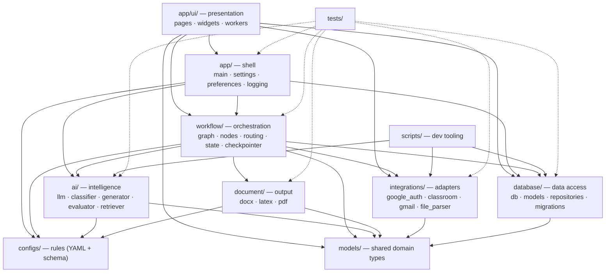
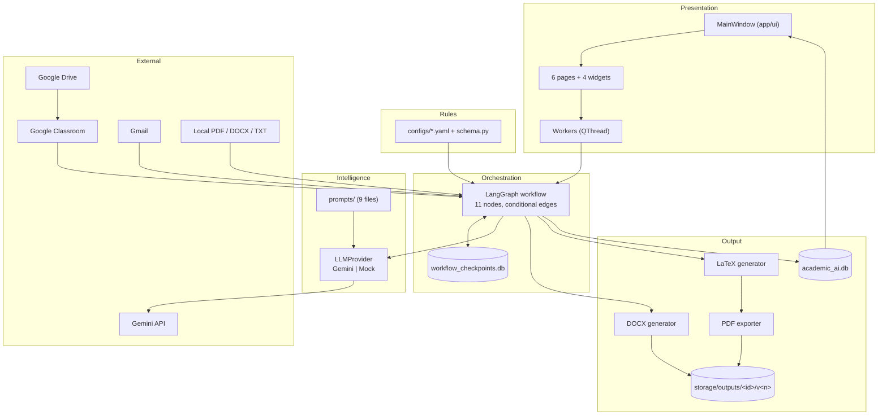
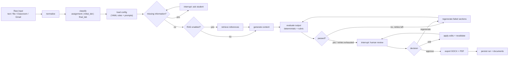
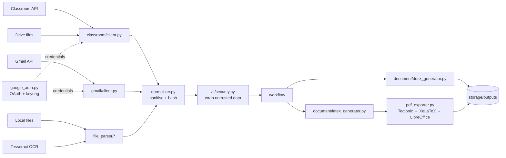

# CODE_UNDERSTANDING.md

> **What this document is.** A structural map of the `Academic_Assistent` repository: what every
> important directory contains, **why** it exists, what each file is responsible for, and how the
> parts connect. It deliberately does **not** explain how the code inside those files works — no
> functions, algorithms or line-by-line walkthroughs. Read it to learn *WHAT + WHY + WHERE*.
>
> **How it was produced.** By running the **Graphify** knowledge graph over the whole repository
> (`graphify update .`, outputs in `graphify-out/`) and then cross-checking every finding against the
> real filesystem tree and file contents. Graph-derived facts are labelled
> **[EXTRACTED]** (directly supported by the repository) or **[INFERRED]** (architectural
> interpretation). See *Appendix A* for the verification report and known gaps.
>
> **Graph snapshot used:** commit `f5dd993e` · 839 nodes · 2,054 edges · 52 communities ·
> 88 % EXTRACTED / 12 % INFERRED · no import cycles detected.

---

## 1. Project Overview

### Purpose

`Academic_Assistent` (package name **`academic-ai`**) is a **local-first, single-user desktop
application** that turns a school assignment into a finished, correctly formatted academic
document. It is built for **students**, not institutions: the student signs in with their own
Google account, pulls assignments from courses they are enrolled in, and ends up with a `.docx`
and a typeset `.pdf` on their own machine.

### The problem it solves

Producing a lab report or assignment write-up is repetitive work that has a fixed structure
(objective, apparatus, procedure, observations, calculations, discussion, references), fixed
formatting rules (font, margins, IEEE citations, word limits) and a hard rule that nothing may be
invented. Doing that by hand is slow, and doing it with a general chatbot produces unformatted text
with fabricated data. This project closes that gap by combining:

- **Deterministic Python** for everything that can be computed or validated exactly
  (word counts, required sections, arithmetic, LaTeX escaping, file parsing, formatting).
- **An LLM (Google Gemini)** only where language understanding is genuinely needed
  (classifying the assignment type, drafting prose, judging quality against a rubric).
- **A mandatory human approval gate** before anything is exported.
- **Data-driven rules** in YAML so a new assignment category is a configuration change, not a
  code change.

### Main technologies

| Concern | Technology | Why it is there |
|---|---|---|
| Language / runtime | Python 3.12 | Single-language stack for a local tool |
| Desktop UI | PySide6 (Qt 6), QSS stylesheet, QThread workers | Native window, no browser or web server |
| Workflow engine | LangGraph (graph, conditional routing, `interrupt`) | Explicit, resumable state machine instead of free-form agents |
| Durable workflow state | `langgraph-checkpoint-sqlite` | Crash recovery and human-in-the-loop resume |
| Domain models | Pydantic v2 | One typed schema for data crossing every boundary |
| Settings | `pydantic-settings` | Typed, `.env`-backed configuration |
| Category rules | YAML + PyYAML | Prompts, rubric, word limits, formatting per category |
| LLM | `google-genai` (Gemini) behind an `LLMProvider` interface | Structured JSON output; `MockProvider` for offline/dev/test |
| Database | SQLite + SQLModel/SQLAlchemy | Zero-install embedded storage, WAL mode |
| Vector store (optional) | ChromaDB | Local retrieval-augmented grounding, disabled by default |
| Google access | `google-api-python-client`, `google-auth-oauthlib`, `keyring` | Read-only Classroom/Gmail/Drive with tokens in the OS keyring |
| Documents | `python-docx`, Jinja2 LaTeX templates, PyMuPDF, Tesseract | Authored DOCX, typeset PDF, input parsing, OCR fallback |
| Tooling | uv, pytest (+qt), ruff, mypy, PyInstaller | Reproducible env, tests, lint, native packaging |

### High-level architecture

Six cooperating layers, all inside one Python process (there is **no HTTP server** in this
project — "backend" means the in-process service and orchestration layer):

1. **Presentation** — `app/ui/**`: six pages, four reusable widgets, background workers.
2. **Application shell** — `app/main.py`, `app/settings.py`, `app/preferences.py`,
   `app/logging_config.py`: process entry, configuration, per-user preferences, logging.
3. **Orchestration** — `workflow/**`: the LangGraph state machine, its state, routing, nodes
   and checkpoint store.
4. **Intelligence** — `ai/**`: provider abstraction, classification, generation, evaluation,
   retrieval, safe arithmetic, prompt-injection defences, prompt assets.
5. **Integration** — `integrations/**`: Google OAuth, Classroom, Gmail, input normalisation,
   file parsers.
6. **Persistence & output** — `database/**`, `document/**`, `storage/**`: domain tables,
   repositories, DOCX/LaTeX/PDF generation, versioned artifacts on disk.

`configs/**` and `models/**` cut across all layers: `models` defines the shared vocabulary,
`configs` defines the per-category rules every layer reads.

---

## 2. Complete Directory Tree

Meaningful project structure (dependency, cache, virtual-environment and build-output directories
are summarised in §13 instead of expanded):

```text
Academic_Assistent/
│
├── app/                              # application shell + entire desktop UI
│   ├── __init__.py
│   ├── main.py                       # process entry point (GUI and headless CLI)
│   ├── settings.py                   # typed, .env-backed application settings
│   ├── preferences.py                # student profile & document defaults (JSON)
│   ├── logging_config.py             # console + rotating-file logging setup
│   └── ui/
│       ├── main_window.py            # shell window, page stack, navigation
│       ├── styles.qss                # global Qt stylesheet
│       ├── workers.py                # background QThread workers
│       ├── pages/
│       │   ├── home_page.py          # courses / start screen
│       │   ├── input_page.py         # assignment input & parsing
│       │   ├── processing_page.py    # live workflow progress
│       │   ├── review_page.py        # human-in-the-loop review & edit
│       │   ├── history_page.py       # previous runs / documents
│       │   └── settings_page.py      # in-app configuration screen
│       └── widgets/
│           ├── course_card.py        # one Classroom course tile
│           ├── preview.py            # rendered document preview
│           ├── progress_log.py       # scrolling progress log
│           └── section_editor.py     # per-section editing control
│
├── ai/                               # intelligence layer
│   ├── __init__.py
│   ├── classifier.py                 # assignment-category classification
│   ├── generator.py                  # section-by-section content generation
│   ├── evaluator.py                  # deterministic checks + rubric evaluation
│   ├── retriever.py                  # chunking + optional ChromaDB retrieval
│   ├── calculations.py               # safe arithmetic / formula evaluation
│   ├── security.py                   # untrusted-input sanitising & wrapping
│   ├── llm/
│   │   ├── __init__.py
│   │   ├── base.py                   # LLMProvider interface
│   │   ├── gemini.py                 # Gemini implementation
│   │   └── mock.py                   # deterministic offline implementation
│   └── prompts/
│       ├── .gitkeep
│       ├── assignment_{system,generation,evaluation}.txt
│       ├── initial_lab_{system,generation,evaluation}.txt
│       └── final_lab_{system,generation,evaluation}.txt
│
├── configs/                          # per-category rules (data, not code)
│   ├── __init__.py
│   ├── schema.py                     # validated shape of a category config
│   ├── assignment.yaml
│   ├── initial_lab.yaml
│   └── final_lab.yaml
│
├── database/                         # persistence layer
│   ├── __init__.py
│   ├── db.py                         # engine, session, initialisation
│   ├── models.py                     # SQLModel table definitions
│   ├── repositories.py               # data-access objects
│   └── migrations.py                 # schema versioning
│
├── document/                         # document generation & export
│   ├── __init__.py
│   ├── docx_generator.py             # canonical DOCX artifact
│   ├── markdown_to_docx.py           # constrained Markdown → DOCX
│   ├── latex_generator.py            # constrained Markdown → LaTeX
│   ├── latex_escape.py               # LaTeX escaping / math sanitising
│   ├── pdf_exporter.py               # PDF via engine fallback chain
│   ├── assets/
│   │   └── tu_logo.png               # institution logo used on title pages
│   └── templates/
│       ├── academic_base.docx        # bundled DOCX template asset
│       └── latex/
│           ├── report.tex.j2         # LaTeX report template
│           └── references.bib.j2     # bibliography template
│
├── integrations/                     # everything outside the process
│   ├── __init__.py
│   ├── google_auth.py                # OAuth flow, token storage
│   ├── normalizer.py                 # clean, hash and normalise inputs
│   ├── classroom/
│   │   ├── __init__.py
│   │   └── client.py                 # courses, coursework, attachments
│   ├── gmail/
│   │   └── client.py                 # message search & attachment download
│   └── file_parser/
│       ├── __init__.py               # parser registry + dispatch
│       ├── base.py                   # parser contract & parsed-document type
│       ├── pdf.py                    # PDF text extraction
│       ├── docx.py                   # DOCX text/tables extraction
│       ├── text.py                   # plain text / Markdown
│       └── ocr.py                    # scanned-PDF OCR fallback
│
├── models/                           # shared domain vocabulary (Pydantic)
│   ├── __init__.py
│   ├── assignment.py                 # category, source type, raw/normalised input
│   ├── report.py                     # citations, sections, report content
│   ├── evaluation.py                 # findings, scores, human decision
│   └── workflow.py                   # workflow run record
│
├── workflow/                         # LangGraph orchestration
│   ├── __init__.py
│   ├── graph.py                      # graph assembly (wiring the nodes)
│   ├── state.py                      # shared workflow state
│   ├── nodes.py                      # the eleven workflow steps
│   ├── routing.py                    # conditional edge decisions
│   └── checkpointer.py               # SQLite checkpoint saver
│
├── scripts/                          # developer / operations utilities
│   ├── __init__.py
│   ├── build.py                      # PyInstaller build wrapper
│   ├── index_reference.py            # index reference docs into the vector store
│   ├── test_classroom.py             # manual Classroom connectivity check
│   ├── run.sh                        # launcher (POSIX)
│   └── run.bat                       # launcher (Windows)
│
├── tests/                            # automated tests
│   ├── __init__.py
│   ├── test_imports.py               # entry-point import smoke test
│   ├── test_settings.py              # settings/paths behaviour
│   ├── test_classroom_client.py      # Classroom client with fake service
│   ├── unit/                         # pure unit tests (10 modules)
│   ├── integration/                  # end-to-end workflow & export (2 modules)
│   ├── ui/                           # Qt smoke test (1 module)
│   └── fixtures/                     # shared test data
│
├── docs/
│   └── STUDENT_GUIDE.md              # the real student workflow & privacy notes
│
├── storage/                          # local runtime data (git-ignored)
│   ├── academic_ai.db                # main SQLite database
│   ├── workflow_checkpoints.db       # LangGraph checkpoints
│   ├── preferences.json              # written on first save of preferences
│   ├── credentials/                  # OAuth token file fallback
│   ├── inputs/                       # downloaded / uploaded source files
│   ├── outputs/<assignment>/v<n>/    # versioned report.docx / report.tex / metadata
│   ├── references/                   # reference documents for RAG
│   ├── rag/                          # ChromaDB persistent store
│   └── logs/                         # rotating application log
│
├── graphify-out/                     # generated knowledge graph (see §13)
├── .freebuff/                        # tooling metadata (project id)
├── .venv/                            # local virtual environment (see §13)
│
├── .env                              # local secrets & overrides (never committed)
├── .env.example                      # documented configuration template
├── .gitignore                        # exclusion rules for secrets & artifacts
├── .python-version                   # pinned Python version
├── credentials.json                  # Google OAuth desktop client (never committed)
├── plan.md                           # full architecture & implementation plan
├── pyinstaller.spec                  # native packaging definition
├── pyproject.toml                    # project metadata, dependencies, tool config
├── README.md                         # human entry point & quick start
├── TECH_STACK.md                     # audited technology inventory
└── uv.lock                           # locked dependency graph
```

---

## 3. Root Directory Explanation

| Entry | What it is | Why it exists / responsibility |
|---|---|---|
| `app/` | Python package | The application shell and the whole desktop UI. The only place that knows about windows, pages and Qt. |
| `ai/` | Python package | All LLM-facing logic plus prompt assets. Isolates "thinking" work from workflow control and from document rendering. |
| `configs/` | Data + schema package | Per-category academic rules. Keeping them as YAML means a new category or a rubric tweak never touches Python. |
| `database/` | Python package | Persistence: engine, tables, repositories, migrations. Owns SQLite; nothing else opens the database directly. |
| `document/` | Python package + assets | Turns structured report data into DOCX and PDF. Owns the LaTeX templates and the logo asset. |
| `integrations/` | Python package | Boundary to the outside world: Google APIs, OAuth, file formats, OCR, input normalisation. |
| `models/` | Python package | Shared domain types used by every other package. The dependency-stable "vocabulary" of the system. |
| `workflow/` | Python package | The LangGraph state machine that sequences the whole process and holds human-in-the-loop gates. |
| `scripts/` | Python package + shells | Developer/operations helpers: build, classroom check, RAG indexing, launch wrappers. Not imported by the app. |
| `tests/` | Test package | Automated verification, organised by test kind (unit / integration / UI). |
| `docs/` | Documentation | The student-facing guide. Separate from the developer-facing `plan.md` and `TECH_STACK.md`. |
| `storage/` | Runtime data | Created/used at runtime: databases, tokens, inputs, outputs, logs, RAG index. Git-ignored. |
| `graphify-out/` | Generated | Knowledge-graph outputs (`graph.json`, `GRAPH_REPORT.md`, `graph.html`) plus extraction caches. |
| `plan.md` | Document | The authoritative architecture and phasing document — the "why" behind most decisions here. |
| `README.md` | Document | Human entry point: purpose, quick start, documentation links. |
| `TECH_STACK.md` | Document | Audited, status-tagged inventory of every technology (implemented / optional / planned / unused). |
| `pyproject.toml` | Config | Project metadata, core/optional dependency groups, and tool configuration (pytest, ruff, mypy). |
| `uv.lock` | Lockfile | Exact resolved dependency set for reproducible installs with `uv`. |
| `.python-version` | Config | Pins the interpreter version expected by the project. |
| `pyinstaller.spec` | Build config | Defines the native one-folder build: entry script, bundled data files, hidden imports. |
| `.env.example` | Config template | Documents every environment variable without exposing values. |
| `.env` | Local secrets | The developer's real configuration (API key, model names). Never committed. |
| `credentials.json` | Local secret | Google OAuth desktop-client file used by the installed-app flow. Never committed. |
| `.gitignore` | Config | Keeps secrets, virtualenv, caches, databases and runtime storage out of version control. |
| `.venv/` | Generated | Local Python environment (currently essentially empty; dependencies are declared and locked). |
| `.freebuff/` | Tooling metadata | Holds a project identifier for the assistant tooling; not part of the application. |

---

## 4. Directory-by-Directory Explanation

### `app/` — application shell

- **Purpose:** own the process: read configuration, configure logging, start either the Qt GUI or a
  headless CLI run.
- **Why it exists:** keeps "how the program starts and is configured" separate from "what the
  program does", so the domain packages stay importable and testable without a GUI.
- **Contains:** `main.py` (entry), `settings.py` (typed settings), `preferences.py` (per-student
  profile and document defaults, persisted as JSON under `storage/`), `logging_config.py`
  (console + rotating file handler).
- **Why grouped:** all four are process-level concerns that every other package depends on.
- **Relationships:** imports `workflow`, `ai`, `database`, `models`, `document` at startup;
  is imported by nothing inside the app except `app/ui/**` and the tests.

### `app/ui/` — presentation layer

- **Purpose:** everything the student sees and clicks.
- **Why it exists:** the project targets a desktop product, so UI code is a first-class layer with a
  clear boundary — no LLM calls, no SQL and no file export happen directly here.
- **Contains:** `main_window.py` (window, page stack, navigation, stylesheet loading),
  `styles.qss` (the global theme), `workers.py` (background threads), plus `pages/` and `widgets/`.
- **Why grouped:** keeps Qt-specific code in one subtree; `main_window.py` composes the pages, the
  pages reuse the widgets.
- **Relationships:** `MainWindow` is one of the graph's god nodes and is the hub that reaches the
  home, input, processing, review, history and settings pages, the workers, and (through them) the
  workflow and integrations. **[EXTRACTED]**

### `app/ui/pages/` — one file per screen

- **Purpose:** one module per screen of the wizard-like flow.
- **Why it exists:** the app is a linear journey (pick course → provide assignment → process →
  review → history/settings). A file per screen keeps each screen's UI logic local.
- **Contains:** `home_page.py` (courses and entry point), `input_page.py` (assignment text/file/
  Classroom item), `processing_page.py` (progress), `review_page.py` (human approval and editing),
  `history_page.py` (past runs), `settings_page.py` (in-app settings).
- **Why grouped:** they are peers swapped into the same `QStackedWidget`.
- **Relationships:** every page is reached through `main_window.py`; pages delegate long work to
  `app/ui/workers.py` and read/write state through `workflow` and `database`.

### `app/ui/widgets/` — reusable UI pieces

- **Purpose:** small, composable visual components used by more than one page.
- **Why it exists:** avoids duplicating preview/editor/log/card markup across pages.
- **Contains:** `course_card.py` (a course tile), `preview.py` (rendered Markdown preview),
  `progress_log.py` (scrolling log), `section_editor.py` (per-section edit control).
- **Why grouped:** all are leaf UI components with no knowledge of the workflow.
- **Relationships:** consumed by `pages/**` only; they receive data, they do not fetch it.
  *(Note: `course_card.py` exists in the code but is not listed in `plan.md`'s original tree — the
  plan predates it.)*

### `ai/` — intelligence layer

- **Purpose:** all reasoning work: classify the assignment, draft sections, judge quality, retrieve
  references, evaluate arithmetic safely, defend against prompt injection.
- **Why it exists:** the LLM is the least predictable part of the system; isolating it lets the rest
  of the app depend on a stable interface and lets tests swap in a deterministic provider.
- **Contains:** `llm/` (provider abstraction and two implementations), `prompts/` (prompt assets),
  plus `classifier.py`, `generator.py`, `evaluator.py`, `retriever.py`, `calculations.py`,
  `security.py`.
- **Why grouped:** all of these consume or guard model input and output.
- **Relationships:** the strongest edge in the whole graph is `ai → models` (69 links) — AI code
  speaks entirely in the shared Pydantic vocabulary. `ai → configs` (9) supplies rules to prompts.
  `workflow → ai` (31) is how the graph drives the model. **[EXTRACTED]**

### `ai/llm/` — provider abstraction

- **Purpose:** define one interface (`LLMProvider`) and provide two implementations.
- **Why it exists:** Gemini is the production provider, but development, CI and the `--mock` flag
  must work with no API key and no network.
- **Contains:** `base.py` (the contract), `gemini.py` (real provider with a model fallback chain),
  `mock.py` (deterministic responses and embeddings).
- **Why grouped:** all three only make sense together as "the model boundary".
- **Relationships:** `LLMProvider` and `MockProvider` are both god nodes (34 and 29 edges).
  `app/main.py`, `workflow/graph.py` and the tests choose which implementation to inject.

### `ai/prompts/` — prompt assets

- **Purpose:** hold the prompt text as data.
- **Why it exists:** prompts change far more often than code, and there is one set per category, so
  mixing them into Python would make tuning painful.
- **Contains:** three prompt files (`system`, `generation`, `evaluation`) for each of the three
  categories — nine files — plus `.gitkeep` so the folder is versioned.
- **Why grouped:** they form a complete matrix (category × prompt role), referenced from the YAML
  configs, not hard-coded.
- **Relationships:** `configs/*.yaml` points at these paths; `ai/generator.py` and
  `ai/evaluator.py` load them. **[EXTRACTED]**

### `configs/` — category configuration

- **Purpose:** describe each assignment category — required sections, word limits, formatting,
  rubric weights, prompt paths, RAG settings, reference rules.
- **Why it exists:** this is the primary extension point. Adding a category is a YAML file plus a
  prompt set, and three YAML files hold ~190 of the graph's nodes because the graph indexes every
  configuration key.
- **Contains:** `schema.py` (the validated shape), `assignment.yaml`, `initial_lab.yaml`,
  `final_lab.yaml`.
- **Why grouped:** all three categories must satisfy exactly the same schema, and they are validated
  together at startup so a broken config fails loudly.
- **Relationships:** read by `workflow/nodes.py` (load-config step), `ai/generator.py`,
  `ai/evaluator.py`, `document/**`; validated by `configs/schema.py`. **[EXTRACTED]**

### `database/` — persistence

- **Purpose:** own the SQLite database: connection/engine, table definitions, data-access
  repositories and schema migrations.
- **Why it exists:** assignments, runs, generated documents, references and audit events must
  survive restarts, and the UI and workflow threads both need safe access.
- **Contains:** `db.py` (engine, session factory, initialisation), `models.py` (seven SQLModel
  tables), `repositories.py` (four repository classes), `migrations.py` (schema versioning).
- **Why grouped:** everything that knows SQL lives here so no other layer writes queries.
- **Relationships:** `app → database` is one of the busiest edges (36) — the UI creates and lists
  assignments and runs; `workflow → database` (15) persists run status. The `AssignmentRepository`
  is a god node (27 edges). **[EXTRACTED]**

### `document/` — document generation and export

- **Purpose:** produce the two deliverables — the canonical DOCX and the typeset PDF.
- **Why it exists:** both outputs render from the *same* structured report, so they live together;
  keeping exporters separate from the workflow means export can be retried or re-run independently.
- **Contains:** `docx_generator.py`, `markdown_to_docx.py`, `latex_generator.py`,
  `latex_escape.py`, `pdf_exporter.py`, plus `assets/` and `templates/`.
- **Why grouped:** every module here transforms report content into a document format.
- **Relationships:** `document → models` (19) and `document → configs` (10) — formatting rules come
  from category config. `workflow → document` (8) is the export step. **[EXTRACTED]**

### `document/assets/` and `document/templates/`

- **Purpose:** non-code assets the exporters need.
- **Why it exists:** they must be bundled with the app rather than recreated at runtime.
- **Contains:** `tu_logo.png` (institution logo used on title pages by the DOCX generator and
  referenced by report/preferences defaults), `academic_base.docx` (bundled Word template),
  `latex/report.tex.j2` and `latex/references.bib.j2` (Jinja2 LaTeX templates).
- **Why grouped:** assets sit beside the code that consumes them, and `pyinstaller.spec` ships them
  as data files.
- **Relationships:** `latex_generator.py` renders the two `.j2` templates; the logo path is resolved
  by `document/docx_generator.py`, `ai/generator.py` and `app/preferences.py`.
  *Observation:* `academic_base.docx` is bundled by `pyinstaller.spec` but no module loads it — the
  DOCX is built programmatically. Treat it as reserved for a future template-override feature.

### `integrations/` — external boundary

- **Purpose:** everything that talks to something outside the process: Google sign-in, Classroom,
  Gmail, and local files in PDF/DOCX/TXT form; plus normalisation of what comes back.
- **Why it exists:** external services and file formats are volatile and must be mockable; the
  workflow should only see clean, typed input.
- **Contains:** `google_auth.py`, `normalizer.py`, `classroom/`, `gmail/`, `file_parser/`.
- **Why grouped:** all are adapters — they convert "outside" into `models` types.
- **Relationships:** `app → integrations` (33) — the home and input pages trigger fetching and
  parsing; `scripts → integrations` (12) for the manual checks; `integrations → models` (5) for the
  types they return. **[EXTRACTED]**

### `integrations/classroom/` and `integrations/gmail/`

- **Purpose:** thin clients around two Google APIs.
- **Why it exists:** separate packages per service keep each API's quirks (pagination, attachment
  download, MIME walking) local and independently testable.
- **Contains:** `classroom/client.py` (service build, course/coursework/materials listing, Drive
  attachment download) and `gmail/client.py` (service build, message search, content + attachments).
- **Why grouped:** one folder per external API; both depend on `integrations/google_auth.py` for
  credentials.
- **Relationships:** both are reached from the UI's Classroom worker and from `scripts/`; they never
  touch the database directly.

### `integrations/file_parser/` — pluggable parsers

- **Purpose:** turn a local file into a `ParsedDocument`.
- **Why it exists:** one registry with one contract keeps "how do we read a PDF" from leaking into
  the UI, and makes adding a format a matter of adding a parser class.
- **Contains:** `base.py` (contract + parsed-document type), `pdf.py`, `docx.py`, `text.py`,
  `ocr.py` (scanned-PDF fallback), `__init__.py` (registry, size limit, dispatch).
- **Why grouped:** every file is format-specific and shares the same interface.
- **Relationships:** called by `app/ui/pages/input_page.py` and `integrations/normalizer.py`.
  *Observation:* `ocr.py` has a runtime defect documented in `TECH_STACK.md` (it references a name
  it does not import), so the OCR branch does not currently produce text. Flagged here as a known
  issue, not as architecture.

### `models/` — shared domain vocabulary

- **Purpose:** define every type that crosses a boundary: inputs, categories, report sections,
  citations, evaluations, human decisions, workflow records.
- **Why it exists:** it is the dependency-stable core. Because all other packages depend on it and it
  depends on almost nothing, there is a single definition of "a report" or "an assignment".
- **Contains:** `assignment.py`, `report.py`, `evaluation.py`, `workflow.py`.
- **Why grouped:** one file per domain concept cluster, all Pydantic models with no I/O.
- **Relationships:** the graph's top hub `ReportContent` (36 edges) lives here; `ai`, `document`,
  `workflow`, `database` and `tests` all point at this package.

### `workflow/` — orchestration

- **Purpose:** sequence the entire process as an explicit state machine and enforce the gates.
- **Why it exists:** the process has loops (evaluate → regenerate), two pause points (missing
  information, human review) and must survive a crash. LangGraph gives that without a bespoke
  scheduler, and SQLite checkpoints make every step resumable.
- **Contains:** `graph.py` (assembly), `state.py` (shared state), `nodes.py` (eleven steps),
  `routing.py` (conditional decisions), `checkpointer.py` (durable saver).
- **Why grouped:** these five files are meaningless apart — the graph is defined by its nodes,
  edges, state and store, and the graph is one architectural unit.
- **Relationships:** the busiest orchestration edges are `workflow → ai` (31), `workflow → models`
  (25), `workflow → database` (15), `workflow → configs` (9), `workflow → document` (8).
  `build_academic_workflow()` is a god node (26 edges) and the single entry into the machine.

### `scripts/` — developer and operations utilities

- **Purpose:** helpers a developer runs by hand, plus launch wrappers.
- **Why it exists:** keeps one-off operational tasks (build, connectivity check, reference indexing)
  out of the application and out of the packages the app imports.
- **Contains:** `build.py` (PyInstaller wrapper), `test_classroom.py` (manual Classroom read check),
  `index_reference.py` (index documents into the vector store), `run.sh` / `run.bat` (launchers).
- **Why grouped:** none of these are imported by the app; they are all "run me from a shell".
- **Relationships:** `scripts → integrations` (12), `scripts → database` (8), `scripts → ai` (7).

### `tests/` — automated tests

- **Purpose:** verify the system at three granularities.
- **Why it exists:** the deterministic parts (configs, LaTeX, parsers, database, security, settings)
  are cheap to test and easy to regress; the workflow test proves the whole pipeline runs offline
  with the mock provider.
- **Contains:** three root-level smoke/contract tests, `unit/` (10 modules), `integration/`
  (2 modules), `ui/` (1 smoke test), `fixtures/` (shared data). Details in §11.
- **Why grouped:** mirrors the layers under test and the pytest convention.
- **Relationships:** tests are deliberately the widest consumers in the graph — `tests → models` 45,
  `tests → database` 34, `tests → app` 31, `tests → ai` 26 — because they import real components
  rather than mocking their own project.

### `docs/` — documentation

- **Purpose:** the student-facing guide.
- **Why it exists:** the developer documents (`plan.md`, `TECH_STACK.md`, this file) answer "how is
  it built"; a student needs "what do I click, what scopes are requested, what happens to my data".
- **Contains:** `STUDENT_GUIDE.md` — setup, the nine-step workflow, Classroom submission policy,
  privacy/security, troubleshooting.
- **Relationships:** the graph linked it semantically to `README.md` and `plan.md`
  **[INFERRED, semantically similar]** — three documents describing the same workflow at three
  audiences.

### `storage/` — local runtime data

- **Purpose:** hold everything the app writes while it runs.
- **Why it exists:** a local-first tool needs an auditable on-disk home for databases, credentials,
  inputs, generated documents and logs. It is entirely git-ignored.
- **Contains:** `academic_ai.db` (domain tables), `workflow_checkpoints.db` (LangGraph state),
  `preferences.json` (created on first save), `credentials/` (token file fallback),
  `inputs/` (downloaded/uploaded sources), `outputs/<assignment>/v<n>/` (versioned `report.docx`,
  `report.tex`, `metadata.json`), `references/` (RAG source documents), `rag/` (vector store),
  `logs/` (rotating log).
- **Why grouped:** every path is derived from one setting (`storage_dir`), so the whole runtime
  footprint can be relocated or wiped as a unit.
- **Relationships:** written by `database/`, `document/`, `workflow/checkpointer.py`,
  `integrations/google_auth.py`, `integrations/gmail/`, `ai/retriever.py`, `app/logging_config.py`.

### `graphify-out/` — generated knowledge graph

- **Purpose:** the analysis artefacts this document was built from.
- **Contains:** `graph.json` (raw graph), `GRAPH_REPORT.md` (audit report), `graph.html`
  (interactive viewer), `manifest.json` (file manifest for incremental rebuilds), `cost.json`,
  `cache/` (AST and semantic extraction caches), `analyze_dirs.py` (helper script used for this
  document).
- **Why it exists:** makes structural questions ("what depends on what") answerable without reading
  every file. It is generated, not source.

---

## 5. File-by-File Explanation

Paths are relative to the repository root. "Related" lists the directories/files the file actually
interacts with, verified from the graph's extracted edges and from the source imports.

### Root files

| File Path | Why It Exists | Main Responsibility | Related Directories/Files |
|---|---|---|---|
| `README.md` | First thing a human opens | States purpose, who it is for, the eight-step value chain, quick start, doc links | `docs/STUDENT_GUIDE.md`, `plan.md`, `pyproject.toml` |
| `plan.md` | Codifies decisions before code existed | Authoritative architecture, locked decisions, repository layout, workflow design, risks | Every package; referenced conceptually across the graph |
| `TECH_STACK.md` | Prevent tech-stack guesswork | Audited inventory of every technology with implementation status and evidence | `pyproject.toml`, `pyinstaller.spec`, `.env.example`, all packages |
| `pyproject.toml` | Single source of project truth | Metadata, Python constraint, core + `google`/`rag`/`dev` dependency groups, pytest/ruff/mypy config | `uv.lock`, `tests/`, all imports |
| `uv.lock` | Reproducible installs | Pins the exact resolved dependency graph | `pyproject.toml`, `scripts/run.sh` |
| `pyinstaller.spec` | Native build is a deliverable | Entry script, bundled data files (`configs`, prompts, LaTeX templates, stylesheet), hidden imports | `app/main.py`, `configs/`, `ai/prompts/`, `document/templates/`, `app/ui/styles.qss`, `scripts/build.py` |
| `.env.example` | Documents configuration safely | Lists every environment variable with placeholder values, no secrets | `app/settings.py`, `README.md` |
| `.env` | Local developer configuration | Holds the real Gemini key and overrides (git-ignored) | `app/settings.py` |
| `credentials.json` | Required by Google OAuth | Desktop OAuth client secret file (git-ignored) | `integrations/google_auth.py`, `app/settings.py` |
| `.gitignore` | Protect secrets and reduce noise | Excludes `.env*`, credentials, virtualenv, caches, databases, `storage/` runtime dirs | Whole repository |
| `.python-version` | Reproducible interpreter | Pins the Python version used by `uv` | `pyproject.toml`, `uv.lock` |
| `.freebuff/project-id` | Tooling bookkeeping | Identifies the workspace to the assistant tooling | — (not application code) |

### `app/`

| File Path | Why It Exists | Main Responsibility | Related Directories/Files |
|---|---|---|---|
| `app/__init__.py` | Package marker | Declares the "Academic AI desktop application" package | `app/*` |
| `app/main.py` | The only process entry point | Parses CLI flags, configures logging, chooses headless CLI mode vs Qt GUI, launches the window | `app/settings.py`, `app/logging_config.py`, `app/ui/main_window.py`, `workflow/graph.py`, `database/*`, `ai/llm/*` |
| `app/settings.py` | One typed config object | Defines model names, output-token budget, storage paths, OAuth client path, PDF engine preferences; exposes derived paths (logs dir, credentials path) | `.env`, `pyproject.toml`, `database/db.py`, `document/*`, `integrations/*`, `ai/*` |
| `app/preferences.py` | Per-student, non-secret preferences | Student profile, document defaults, document-type→category mapping, profile-completeness check, JSON round-trip | `storage/preferences.json`, `configs/*.yaml`, `app/ui/pages/*` |
| `app/logging_config.py` | Observability without extra deps | Console handler plus rotating file handler | `app/main.py`, `storage/logs/` |

### `app/ui/`

| File Path | Why It Exists | Main Responsibility | Related Directories/Files |
|---|---|---|---|
| `app/ui/main_window.py` | There must be one shell window | Hosts the page stack, navigation between the six pages, loads the stylesheet, owns shared UI state | `pages/*`, `widgets/*`, `workers.py`, `styles.qss`, `app/preferences.py` |
| `app/ui/styles.qss` | Consistent look without a web stack | Global Qt style sheet | `main_window.py`, `pyinstaller.spec` |
| `app/ui/workers.py` | Keeping the UI responsive | Two background workers: fetching Classroom courses, running the workflow; emit progress/result signals | `workflow/graph.py`, `integrations/classroom/client.py`, `pages/*` |
| `app/ui/pages/home_page.py` | Landing screen | Shows courses/assignment entry, syncs Classroom, routes the student into the flow | `widgets/course_card.py`, `workers.py`, `app/preferences.py`, `database/*` |
| `app/ui/pages/input_page.py` | Assignments arrive in many forms | Collects manual text, a local file, or a Classroom item; triggers parsing | `integrations/file_parser/`, `integrations/classroom/client.py`, `integrations/normalizer.py` |
| `app/ui/pages/processing_page.py` | Long-running work needs feedback | Displays live progress of the workflow run | `workers.py`, `widgets/progress_log.py` |
| `app/ui/pages/review_page.py` | Human approval is mandatory | Presents generated content, allows editing/regenerating, records approve/edit/regenerate decisions | `widgets/preview.py`, `widgets/section_editor.py`, `models/evaluation.py`, `workflow/*` |
| `app/ui/pages/history_page.py` | Work must be recoverable | Lists previous runs and documents, reopens past results | `database/repositories.py`, `storage/outputs/` |
| `app/ui/pages/settings_page.py` | Configuration without editing files | In-app view/edit of settings and preferences | `app/settings.py`, `app/preferences.py`, `integrations/google_auth.py` |
| `app/ui/widgets/course_card.py` | Reusable course tile | Renders one course and emits selection | `pages/home_page.py`, `integrations/classroom/client.py` |
| `app/ui/widgets/preview.py` | Students must see the result before approving | Renders Markdown content as a formatted document preview | `pages/review_page.py`, `models/report.py` |
| `app/ui/widgets/progress_log.py` | Transparency during processing | Scrolling, append-only log view | `pages/processing_page.py`, `workers.py` |
| `app/ui/widgets/section_editor.py` | Sections are edited individually | Edit control bound to one report section | `pages/review_page.py`, `models/report.py` |

### `ai/`

| File Path | Why It Exists | Main Responsibility | Related Directories/Files |
|---|---|---|---|
| `ai/__init__.py` | Package marker | Marks the intelligence layer | `ai/*` |
| `ai/llm/base.py` | The model must be swappable | Defines the provider contract: structured generation, free text, embeddings | `ai/llm/gemini.py`, `ai/llm/mock.py`, `ai/classifier.py`, `ai/generator.py`, `ai/evaluator.py`, `workflow/nodes.py` |
| `ai/llm/gemini.py` | Production model access | Real Gemini provider with model resolution/fallback and schema-constrained output | `app/settings.py`, `models/*`, `ai/prompts/` |
| `ai/llm/mock.py` | Development and CI need no key | Deterministic, offline generation and embeddings | `tests/*`, `app/main.py` (`--mock`), `workflow/nodes.py` |
| `ai/classifier.py` | The rules differ per category | Decides `assignment` / `initial_lab` / `final_lab` and reports confidence | `models/assignment.py`, `ai/llm/base.py`, `configs/` |
| `ai/generator.py` | The core value of the product | Produces structured report sections from assignment text, config rules and retrieved context | `ai/llm/base.py`, `ai/prompts/`, `models/report.py`, `configs/*.yaml`, `document/assets/tu_logo.png` |
| `ai/evaluator.py` | Quality must be judged, not assumed | Runs deterministic checks and rubric-based evaluation, returns actionable findings | `models/evaluation.py`, `configs/*.yaml`, `ai/prompts/*_evaluation.txt`, `ai/llm/base.py` |
| `ai/retriever.py` | Grounding in course material (optional) | Chunks text, indexes and retrieves reference passages | `storage/rag/`, `app/settings.py`, `configs/*.yaml` (`rag`) |
| `ai/calculations.py` | The model must never do arithmetic | Safe expression evaluation and formula extraction; results are fed into prompts | `workflow/nodes.py`, `ai/generator.py` |
| `ai/security.py` | External text is hostile input | Length capping, sanitising and wrapping of untrusted content before it reaches a prompt | `workflow/nodes.py`, `integrations/normalizer.py`, all prompt builders |
| `ai/prompts/assignment_system.txt` | Rules for the assistant role | System prompt for the assignment category | `configs/assignment.yaml`, `ai/generator.py`, `ai/evaluator.py` |
| `ai/prompts/assignment_generation.txt` | Drafting instructions | Generation prompt for the assignment category | `configs/assignment.yaml`, `ai/generator.py` |
| `ai/prompts/assignment_evaluation.txt` | Grading instructions | Evaluation prompt for the assignment category | `configs/assignment.yaml`, `ai/evaluator.py` |
| `ai/prompts/initial_lab_system.txt` | Lab-specific rules | System prompt for initial labs | `configs/initial_lab.yaml` |
| `ai/prompts/initial_lab_generation.txt` | Lab drafting instructions | Generation prompt for initial labs | `configs/initial_lab.yaml` |
| `ai/prompts/initial_lab_evaluation.txt` | Lab grading instructions | Evaluation prompt for initial labs | `configs/initial_lab.yaml` |
| `ai/prompts/final_lab_system.txt` | Stricter final-lab rules | System prompt for final labs (structured schema, IEEE style) | `configs/final_lab.yaml` |
| `ai/prompts/final_lab_generation.txt` | Final-lab drafting | Generation prompt for final labs | `configs/final_lab.yaml` |
| `ai/prompts/final_lab_evaluation.txt` | Final-lab grading | Evaluation prompt for final labs | `configs/final_lab.yaml` |
| `ai/prompts/.gitkeep` | Empty-dir placeholder | Keeps the prompt folder tracked even if emptied | `ai/prompts/` |

### `configs/`

| File Path | Why It Exists | Main Responsibility | Related Directories/Files |
|---|---|---|---|
| `configs/__init__.py` | Package marker | Marks the configuration package | `configs/*` |
| `configs/schema.py` | Bad config must fail at startup | Validated config model (limits, word limits, margins, formatting, prompts, rubric, RAG, references) and loading helpers | `configs/*.yaml`, `workflow/nodes.py`, `ai/*`, `document/*` |
| `configs/assignment.yaml` | Rules for plain assignments | Sections, word limits, formatting, rubric, prompt paths for the `assignment` category | `ai/prompts/assignment_*`, `models/assignment.py` |
| `configs/initial_lab.yaml` | Rules for initial labs | Lab structure (apparatus, procedure, observations, calculations), limits, rubric | `ai/prompts/initial_lab_*` |
| `configs/final_lab.yaml` | Rules for final labs | Larger structure, stricter formatting/citation requirements, rubric, RAG switches | `ai/prompts/final_lab_*` |

### `database/`

| File Path | Why It Exists | Main Responsibility | Related Directories/Files |
|---|---|---|---|
| `database/__init__.py` | Package marker | Marks the persistence package | `database/*` |
| `database/db.py` | One engine, one place | Resolves the DB path, creates the engine and pragmas, initialises schema, hands out sessions | `app/settings.py`, `storage/academic_ai.db`, `models/*` |
| `database/models.py` | Durable records need tables | Seven SQLModel tables: assignments, source records, workflow runs, generated documents, reference documents, audit log, schema version | `database/db.py`, `models/*` |
| `database/repositories.py` | Keep SQL out of the app | Four repositories (assignment, workflow run, document, audit log) exposing intent-level operations | `database/db.py`, `app/ui/pages/*`, `workflow/nodes.py` |
| `database/migrations.py` | Schema will change over time | Version-tracked, idempotent migrations | `database/db.py`, `SchemaVersionTable` |

### `document/`

| File Path | Why It Exists | Main Responsibility | Related Directories/Files |
|---|---|---|---|
| `document/__init__.py` | Package marker | Marks the document package | `document/*` |
| `document/docx_generator.py` | The canonical editable artifact | Builds the DOCX from report content + formatting config and writes it to versioned storage | `models/report.py`, `configs/*.yaml`, `markdown_to_docx.py`, `storage/outputs/` |
| `document/markdown_to_docx.py` | LLM output is Markdown | Converts the supported Markdown subset into DOCX paragraphs/runs | `docx_generator.py`, `models/report.py` |
| `document/latex_generator.py` | PDFs come from LaTeX | Converts the supported Markdown subset to LaTeX and renders the report template | `templates/latex/report.tex.j2`, `latex_escape.py`, `models/report.py` |
| `document/latex_escape.py` | One bad character breaks a build | Escapes TeX special characters and sanitises math | `latex_generator.py`, `models/report.py` |
| `document/pdf_exporter.py` | Best-quality rendering with fallbacks | Chooses the best available engine (Tectonic → XeLaTeX → LibreOffice), compiles, and stores the PDF next to the DOCX | `latex_generator.py`, `app/settings.py`, `storage/outputs/` |
| `document/assets/tu_logo.png` | Title pages need institutional branding | Logo asset referenced by document/preferences defaults | `docx_generator.py`, `ai/generator.py`, `app/preferences.py`, `models/report.py` |
| `document/templates/academic_base.docx` | Reserved template override | Bundled Word template asset carried by the build (no code path loads it today) | `pyinstaller.spec`, `plan.md` |
| `document/templates/latex/report.tex.j2` | LaTeX must come from a trusted template | Full report skeleton, packages, layout, references | `latex_generator.py`, `models/report.py` |
| `document/templates/latex/references.bib.j2` | Bibliography must be generated, not invented | Renders the reference entries | `latex_generator.py`, `models/report.py` |

### `integrations/`

| File Path | Why It Exists | Main Responsibility | Related Directories/Files |
|---|---|---|---|
| `integrations/__init__.py` | Package marker | Declares the external-integration package | `integrations/*` |
| `integrations/google_auth.py` | Google access needs a single sign-in | Runs the installed-app OAuth flow, manages keyring/file token storage, checks granted scopes | `credentials.json`, `storage/credentials/`, `keyring`, all Google clients |
| `integrations/normalizer.py` | Downstream code needs clean input | Sanitises text, computes a content hash for de-duplication, extracts a title, produces a normalised input | `models/assignment.py`, `integrations/file_parser/`, `ai/security.py` |
| `integrations/classroom/__init__.py` | Package marker | Declares the Classroom client package | `classroom/client.py` |
| `integrations/classroom/client.py` | Assignment source #1 | Builds the Classroom service; lists courses, coursework and materials; downloads Drive attachments | `google_auth.py`, `app/ui/pages/*`, `scripts/test_classroom.py` |
| `integrations/gmail/client.py` | Assignment source #2 | Builds the Gmail service; searches messages; extracts content and attachments | `google_auth.py`, `storage/inputs/`, `app/ui/pages/*` |
| `integrations/file_parser/__init__.py` | One way to read any supported file | Parser registry, size limit, error types, format dispatch | `base.py`, `pdf.py`, `docx.py`, `text.py`, `app/ui/pages/input_page.py` |
| `integrations/file_parser/base.py` | Parsers need a shared contract | Defines the parsed-document type and the parser interface | all parser modules, `normalizer.py` |
| `integrations/file_parser/pdf.py` | Many assignments arrive as PDFs | Extracts text from PDFs and decides when OCR is needed | `ocr.py`, `base.py` |
| `integrations/file_parser/docx.py` | Word documents are common | Extracts paragraphs and tables in document order | `base.py`, `python-docx` |
| `integrations/file_parser/text.py` | Plain text / Markdown | Reads text files with encoding tolerance | `base.py` |
| `integrations/file_parser/ocr.py` | Scanned PDFs have no text layer | Rasterises pages and runs Tesseract | `pdf.py`, `pytesseract`, `pillow` |

### `models/`

| File Path | Why It Exists | Main Responsibility | Related Directories/Files |
|---|---|---|---|
| `models/__init__.py` | Package marker | Marks the shared-vocabulary package | all packages |
| `models/assignment.py` | Inputs need one shape | Category and source-type enums, raw input, normalised input, classification result, missing-information request | `app/ui/*`, `workflow/*`, `ai/classifier.py`, `database/*` |
| `models/report.py` | The report is the central object | Citations, tables, figures, front page, section drafts, report content | `ai/generator.py`, `document/*`, `app/ui/widgets/*` |
| `models/evaluation.py` | Quality decisions need structure | Decision types, deterministic findings, section scores, evaluation result, human decision | `ai/evaluator.py`, `workflow/*`, `app/ui/pages/review_page.py` |
| `models/workflow.py` | Runs must be addressable | Workflow run record linking a thread to an assignment | `workflow/*`, `database/*` |

### `workflow/`

| File Path | Why It Exists | Main Responsibility | Related Directories/Files |
|---|---|---|---|
| `workflow/__init__.py` | Package marker | Marks the orchestration package | `workflow/*` |
| `workflow/graph.py` | The process must be assembled in one place | Registers nodes and edges and produces the compiled workflow with checkpointer | `nodes.py`, `routing.py`, `state.py`, `checkpointer.py` |
| `workflow/state.py` | Every step must share context | Declares the state carried through the run (inputs, category, config, report, evaluation, retries, decisions, status) | every node, `models/*` |
| `workflow/nodes.py` | Each step needs an owner | The eleven steps: normalise, classify, load config, check missing info, retrieve references, generate, evaluate, regenerate failed, human review, export, persist | `ai/*`, `configs/schema.py`, `database/*`, `document/*`, `integrations/normalizer.py` |
| `workflow/routing.py` | Loops and gates need decisions | Conditional routing after evaluation and after human review | `graph.py`, `models/evaluation.py` |
| `workflow/checkpointer.py` | Runs must survive crashes | Provides the SQLite checkpoint saver used by the graph | `storage/workflow_checkpoints.db`, `graph.py` |

### `scripts/`

| File Path | Why It Exists | Main Responsibility | Related Directories/Files |
|---|---|---|---|
| `scripts/__init__.py` | Package marker | Declares the developer-scripts package | `scripts/*` |
| `scripts/build.py` | Packaging should be one command | Wraps PyInstaller with the project spec | `pyinstaller.spec` |
| `scripts/index_reference.py` | RAG needs an indexing step | Indexes reference documents into the vector store | `ai/retriever.py`, `storage/references/`, `storage/rag/` |
| `scripts/test_classroom.py` | Verify Google access manually | Lists courses and coursework for the signed-in student | `integrations/google_auth.py`, `integrations/classroom/client.py` |
| `scripts/run.sh` | One-command launch (POSIX) | Verifies `uv` exists, then launches the app with forwarded arguments | `app/main.py`, `pyproject.toml` |
| `scripts/run.bat` | One-command launch (Windows) | Same purpose for Windows shells | `app/main.py` |

### `tests/`

| File Path | Why It Exists | Main Responsibility | Related Directories/Files |
|---|---|---|---|
| `tests/__init__.py` | Package marker | Marks the test package | `tests/*` |
| `tests/test_imports.py` | Catch broken wiring early | Asserts the entry point imports cleanly | `app/main.py` |
| `tests/test_settings.py` | Paths and defaults are easy to break | Verifies defaults need no env vars, OAuth path resolution, storage paths | `app/settings.py` |
| `tests/test_classroom_client.py` | Live Classroom cannot be used in CI | Exercises the Classroom client against a fake service, including pagination | `integrations/classroom/client.py` |
| `tests/unit/test_calculations.py` | Arithmetic safety is critical | Safe evaluation, blocked unsafe expressions, formula extraction | `ai/calculations.py` |
| `tests/unit/test_configs.py` | Configs are the extension point | Loads all three category configs and checks assignment specifics | `configs/*.yaml`, `configs/schema.py` |
| `tests/unit/test_database.py` | Persistence must be reliable | Repository CRUD behaviour | `database/*` |
| `tests/unit/test_gmail.py` | Gmail parsing is easy to regress | Message search against a mock | `integrations/gmail/client.py` |
| `tests/unit/test_latex.py` | LaTeX breakage is silent | Escaping, math sanitising, template rendering | `document/latex_escape.py`, `document/latex_generator.py` |
| `tests/unit/test_models.py` | The shared vocabulary underpins everything | Model construction/defaults | `models/*` |
| `tests/unit/test_parsers.py` | Input formats vary widely | Text/DOCX parsing, normalisation and de-duplication | `integrations/file_parser/*`, `integrations/normalizer.py` |
| `tests/unit/test_preferences.py` | Preferences are file-backed | Round-trip, missing file, corrupt file, type mapping | `app/preferences.py` |
| `tests/unit/test_rag.py` | Optional feature must still work | Chunking and index/retrieve behaviour | `ai/retriever.py` |
| `tests/unit/test_security.py` | Injection defence is a safety property | Sanitising and untrusted-data wrapping | `ai/security.py` |
| `tests/integration/test_workflow.py` | Proves the whole pipeline runs | End-to-end workflow with the mock provider | `workflow/*`, `ai/llm/mock.py`, `database/*` |
| `tests/integration/test_docx_pdf_export.py` | Export is the product's output | DOCX and PDF generation pipeline | `document/*`, `models/report.py` |
| `tests/ui/test_ui_smoke.py` | The GUI must at least construct | Smoke test that the main window builds | `app/ui/main_window.py`, `pytest-qt` |
| `tests/fixtures/.gitkeep` | Shared test data lives here | Placeholder for fixture files | `tests/*` |
| `tests/unit/.gitkeep` | Directory marker | Keeps the unit-test directory tracked | `tests/unit/*` |
| `tests/integration/.gitkeep` | Directory marker | Keeps the integration-test directory tracked | `tests/integration/*` |
| `tests/ui/.gitkeep` | Directory marker | Keeps the UI-test directory tracked | `tests/ui/*` |

### `docs/`

| File Path | Why It Exists | Main Responsibility | Related Directories/Files |
|---|---|---|---|
| `docs/STUDENT_GUIDE.md` | Students need operational instructions | Prerequisites, first-time setup, requested scopes, the nine-step workflow, submission policy, privacy, troubleshooting | `README.md`, `integrations/google_auth.py`, `app/ui/pages/*` |

---

## 6. Architectural Layers

The layers below are the ones the graph actually shows, not an aspirational diagram. Each is a set
of directories with a single responsibility and a defined direction of dependency.

| # | Layer | Location | Why it exists | Boundary (what must not cross it) |
|---|---|---|---|---|
| 1 | **Presentation** | `app/ui/**` | Give the student a native desktop flow | No SQL, no LLM calls, no LaTeX. The UI only collects input, shows state, and emits signals. |
| 2 | **Application shell / bootstrap** | `app/main.py`, `app/settings.py`, `app/preferences.py`, `app/logging_config.py` | Decide *how the process runs* before anything else | Does not implement domain behaviour; it wires and configures. |
| 3 | **Orchestration** | `workflow/**` | Enforce order, loops, retries and human gates | Owns control flow only — it delegates all real work to `ai`, `document`, `database`, `integrations`. |
| 4 | **Intelligence (services)** | `ai/**` | Encapsulate all model interaction behind one interface | Nothing above it imports `google-genai` directly; the provider interface is the only door. |
| 5 | **Integration (adapters)** | `integrations/**` | Convert external systems and file formats into domain types | Nothing above it knows about HTTP, OAuth objects or PDF libraries. |
| 6 | **Data access** | `database/**` | Keep persistence behind repositories | No module outside `database/` builds queries; the app talks in repository methods. |
| 7 | **Document output** | `document/**` | Turn a report into DOCX/PDF | Consumes `models` + `configs`; returns file paths, never throws formatting into the workflow. |
| 8 | **Configuration (cross-cutting)** | `configs/**` | Make academic rules data, not code | Read by `workflow`, `ai`, `document`; it depends on nothing else. |
| 9 | **Domain vocabulary (cross-cutting)** | `models/**` | One shared definition of every entity | Depends on almost nothing; every layer may depend on it. |
| 10 | **Utilities (cross-cutting)** | `app/logging_config.py`, `ai/calculations.py`, `ai/security.py`, `integrations/normalizer.py` | Small, reusable, side-effect-light helpers | Never call upward into UI or workflow. |
| 11 | **Developer tooling** | `scripts/**`, `pyinstaller.spec`, `pyproject.toml`, `tests/**` | Build, package and verify | Not imported by the application. |

**Layer rules that the graph confirms [EXTRACTED]:**

- Dependencies flow *inward/downward*: `app → workflow → ai/integrations/document → database → models`.
- `models` is the only package with no outgoing package dependency of substance.
- There are **no import cycles** in the repository (`Import Cycles — None detected`).
- Two edges look "upward" but are small and intentional: `ai → app` (2) and `document → app` (2) —
  both are configuration lookups (paths/settings), not control flow.
- `workflow → document` (8) exists only because export is a workflow step; `document` never calls
  back into `workflow`.

---

## 7. Module Relationships

### 7.1 EXTRACTED relationships (directly supported by imports/calls in the repository)

Counts are graph edges aggregated per directory pair from `graphify-out/graph.json`.

| Producer → Consumer | Edges | What it means |
|---|---|---|
| `ai → models` | 69 | AI code is written entirely in domain types (ReportContent, Citation, EvaluationResult…). |
| `tests → models` | 45 | Tests construct real domain objects instead of mocks. |
| `app → database` | 36 | The UI creates assignments, lists runs and opens history through repositories. |
| `app → models` | 34 | Pages and workers pass typed inputs/results around. |
| `tests → database` | 34 | Repository behaviour is tested against a real SQLite database. |
| `app → integrations` | 33 | The home/input pages drive Classroom, Gmail and file parsing. |
| `tests → app` | 31 | Settings, preferences and the main window are tested directly. |
| `workflow → ai` | 31 | Every reasoning step is a workflow node calling into the AI layer. |
| `tests → ai` | 26 | Calculations, security and the mock provider are unit-tested. |
| `workflow → models` | 25 | The state machine reads/writes the shared vocabulary. |
| `document → models` | 19 | Exporters render from the structured report, not from raw strings. |
| `tests → document` | 17 | LaTeX escaping and DOCX/PDF export are covered. |
| `app → ai` | 15 | The UI chooses a provider and passes results to classifiers/workers. |
| `workflow → database` | 15 | Run status and results are persisted as the graph progresses. |
| `tests → integrations` | 14 | Classroom/Gmail clients are tested with fake services. |
| `scripts → integrations` | 12 | Manual checks and indexing call into the adapters. |
| `app → workflow` | 10 | Starting/resuming a run is initiated from the UI. |
| `document → configs` | 10 | Formatting, fonts and margins come from the category config. |
| `ai → configs` | 9 | Prompts, rubric and limits are read from YAML, not hard-coded. |
| `workflow → configs` | 9 | The load-config step feeds rules into later nodes. |
| `workflow → document` | 8 | The export step renders DOCX and PDF. |
| `scripts → database` | 8 | Utility scripts open sessions for inspection/indexing. |
| `scripts → ai` | 7 | Reference indexing uses the AI layer for embeddings. |
| `integrations → models` | 5 | Adapters return typed parsed/normalised objects. |

### 7.2 INFERRED relationships (architectural interpretation — not proven by an import)

238 of 2,054 edges are INFERRED (12 %, average confidence 0.90). The ones worth knowing about:

| Inferred relationship | Why the graph inferred it | How much to trust it |
|---|---|---|
| `Evaluator` —uses→ `ReportContent` | The evaluator's schema shape mirrors the report model | **High.** Real but indirect; `ai/evaluator.py` does not import that symbol directly. |
| `SectionGenerator` —uses→ `Citation` | Citation objects flow through generated sections | **High.** Indirect via `models/report.py`. |
| `ReportContent` has 10 INFERRED edges | It is the central data structure everything mentions | **High** for structure; the specific verb ("uses") is a model guess. |
| `LLMProvider` has 11 INFERRED edges | An interface implemented twice and consumed widely | **High.** |
| `plan.md` concepts —semantically_similar_to→ `docs/STUDENT_GUIDE.md` | Both describe the same nine-step workflow | **Certain.** Documentation duplication, not code coupling. |
| `docs/STUDENT_GUIDE.md` —similar→ `plan.md` (approval gate, OAuth scopes) | Same concepts restated for two audiences | **Certain** as document similarity; says nothing about runtime. |
| `TECH_STACK.md` —references→ `ReportContent` / `LLMProvider` / `MainWindow` / `HomePage` | The document names those symbols | **Certain.** Documentation mention only. |
| Hyperedges "Generate-Evaluate-Retry-Review Loop", "Academic Integrity Guardrails" | Derived from `plan.md` narrative | **Interpretation.** They describe design intent; the code implements the loop in `workflow/graph.py` + `routing.py`, but the hyperedge came from prose. |

**Explicitly uncertain:** the graph resolves no relationship *between* `app/ui/widgets/*` and the
workflow — widgets appear only as leaves consumed by pages. Whether a widget should know about
workflow state is a design opinion, not a graph fact.

### 7.3 Module dependency diagram



---

## 8. Application Startup Structure

### Entry point

**`app/main.py`** is the single execution entry (`python -m app.main`, `scripts/run.sh`,
`scripts/run.bat`, or the PyInstaller bundle). **[EXTRACTED]** — `pyinstaller.spec` also names
`app/main.py` as the analysed script.

### Startup sequence (structure, not code)

1. **Argument parsing** — `--cli`, `--mock`, `--title`, `--prompt`, `--category` decide the mode.
2. **Logging** — `app/logging_config.py` installs console + rotating-file handlers
   (`storage/logs/`).
3. **Configuration** — `app/settings.py` is a module-level settings object populated from
   `.env`/environment, with defaults that work with **no** variables set.
4. **Branch on mode:**
   - **GUI (default):** create the Qt application, construct `MainWindow`, show it, enter the Qt
     event loop. On Linux without a display, the entry point falls back to CLI mode automatically.
   - **CLI (`--cli`, or headless Linux):** initialise the database, choose a provider
     (`MockProvider` when `--mock` or when no Gemini key is configured, otherwise `GeminiProvider`),
     build the workflow, create an assignment row, stream the graph to completion, and auto-approve
     the review interrupt so export still runs.
5. **UI-owned startup work:** `MainWindow` loads `app/ui/styles.qss`, builds the six pages and wires
   navigation; `HomePage` reads preferences and (on demand) starts the Classroom sync worker.

### Configuration sources, in precedence order

1. Real environment variables.
2. `.env` at the project root (pydantic-settings).
3. Field defaults declared in `app/settings.py`.
4. Separately: `configs/*.yaml` (academic rules), `storage/preferences.json` (student
   preferences), and `credentials.json` (Google OAuth client).

### Architectural components involved at startup [EXTRACTED]

`app/main.py` → `app/settings.py` → `app/logging_config.py` → (`app/ui/main_window.py` →
`app/ui/pages/*`) or (`workflow/graph.py` → `workflow/checkpointer.py` → `database/db.py`).
The graph's community "Application Entrypoint & LLM" groups `main()`, `configure_logging()`,
`build()` and `GeminiProvider` — the entry point is structurally tied to mode selection and
provider choice.

---

## 9. High-Level Data Flow

### 9.1 Overall architecture



### 9.2 Runtime data flow (the eleven-step pipeline)



**Gate semantics [EXTRACTED from graph structure]:** there are exactly two pause points
(`check_missing_info`, `human_review`), one bounded loop (evaluation → regeneration, capped by the
state's retry counters), and export is reachable only through the human decision.

### 9.3 Integration boundaries



---

## 10. Configuration and Environment

### Configuration layers

| Layer | File(s) | Scope | Notes |
|---|---|---|---|
| Process settings | `app/settings.py` + `.env` | Model names, token budget, storage roots, OAuth client path, PDF engine preferences, log level | Typed via `pydantic-settings`; exposes derived paths. Defaults work with **no** environment variables. |
| Environment template | `.env.example` | Documents every variable | Placeholder values only; safe to read and commit. |
| Local secrets | `.env`, `credentials.json` | Real API key, real OAuth client | Git-ignored. **Never** reproduced in documentation. |
| Academic rules | `configs/*.yaml` + `configs/schema.py` | Required sections, word limits, formatting, rubric weights, prompt paths, RAG switches, reference rules | Three categories share one validated schema, all validated at startup. |
| Prompt text | `ai/prompts/*.txt` | Nine prompt files (3 roles × 3 categories) | Referenced by path from the YAML configs. |
| User preferences | `storage/preferences.json` | Student profile and document defaults | Written on first save; missing/corrupt file falls back to defaults (covered by tests). |
| Build configuration | `pyproject.toml`, `uv.lock`, `pyinstaller.spec` | Dependencies, tool config, bundled data files, hidden imports | Packaging must list every data folder (configs, prompts, LaTeX templates, stylesheet). |

### Environment variable *names* (values intentionally omitted)

`GEMINI_API_KEY`, `GEMINI_MODEL`, `GEMINI_FALLBACK_MODEL`, `GEMINI_PRO_MODEL`,
`GEMINI_EMBEDDING_MODEL`, `GEMINI_MAX_OUTPUT_TOKENS`, `GOOGLE_OAUTH_CLIENT_FILE`,
`GOOGLE_TOKEN_STORE`, `PDF_ENGINE`, `PDF_FALLBACK_ENGINE`, `TECTONIC_PATH`, `LOG_LEVEL`.

> **Secret handling.** `.env` and `credentials.json` exist in this working copy but are git-ignored
> and are not quoted anywhere in this document. OAuth tokens live in the OS keyring with a
> file-based fallback under `storage/credentials/`, also git-ignored. Only *how* settings are read
> is documented; no value is exposed.

---

## 11. Testing Structure

`pytest` is configured in `pyproject.toml` with `testpaths = ["tests"]` and `pythonpath = ["."]`.
`pytest-qt` is available for widget tests; the UI test is a smoke test, not interaction coverage.

| Directory | Kind | What it covers | Representative modules |
|---|---|---|---|
| `tests/` (root) | Smoke / contract | Entry-point imports, settings and path resolution, Classroom client against a fake service | `test_imports.py`, `test_settings.py`, `test_classroom_client.py` |
| `tests/unit/` | Pure unit | Calculations, configs, database, Gmail, LaTeX, models, parsers, preferences, RAG, security | 10 modules |
| `tests/integration/` | End-to-end | Full workflow with the mock provider; DOCX + PDF export pipeline | `test_workflow.py`, `test_docx_pdf_export.py` |
| `tests/ui/` | UI smoke | The main window can be constructed | `test_ui_smoke.py` |
| `tests/fixtures/` | Support | Shared test data | `.gitkeep` placeholder today |

**Coverage map back to the application:**

- **Well covered:** `models`, `configs`, `database`, `document/latex_escape`, `ai/calculations`,
  `ai/security`, `integrations/file_parser`, `app/settings`, `app/preferences`.
- **Covered through integration only:** the workflow graph and routing, the export chain, the mock
  provider.
- **Thin:** `app/ui/pages/*` (smoke only), `ai/llm/gemini.py` (no live-API test),
  `ai/retriever.py` (chunking/index only, ChromaDB-dependent), the OCR path.

---

## 12. External Dependencies

Grouped by the architectural role each dependency plays. Status reflects what the graph and the
source imports actually show.

| Dependency | Layer | Architectural purpose | Status |
|---|---|---|---|
| **PySide6** | Presentation | Native desktop widgets, signals/slots, threading | Core, imported |
| **markdown** | Presentation | Render section previews for review | Core, imported |
| **LangGraph** | Orchestration | Stateful graph, conditional edges, `interrupt` for human gates | Core, imported |
| **langgraph-checkpoint-sqlite** | Orchestration / persistence | Durable checkpoints so runs resume after failure | Core, imported |
| **Pydantic v2** | Domain / all layers | Typed models and schema-constrained LLM output | Core, imported |
| **pydantic-settings** | Configuration | Typed `.env` settings with secret-safe types | Core, imported |
| **PyYAML** | Configuration | Load the three category rule files | Core, imported |
| **Jinja2** | Intelligence + documents | Prompt templating and LaTeX template rendering | Core, imported |
| **google-genai** | Intelligence | Gemini client for classification, generation, evaluation, embeddings | Core, imported |
| **SQLModel / SQLAlchemy** | Data access | Table definitions and typed queries over SQLite | Core, imported |
| **SQLite** (stdlib) | Persistence | Embedded database file, WAL mode | Core, imported |
| **google-api-python-client** | Integrations | Classroom, Gmail and Drive REST calls | Optional `[google]` extra |
| **google-auth-oauthlib** | Integrations | Installed-app OAuth 2.0 flow | Optional `[google]` extra |
| **keyring** | Integrations | OS credential store for OAuth tokens | Core, imported |
| **python-docx** | Documents + parsing | DOCX creation and DOCX input parsing | Core, imported |
| **PyMuPDF** | Parsing / export support | PDF text extraction and page rasterisation | Core, imported |
| **pytesseract + Pillow** | Parsing | OCR for scanned PDFs | Core, imported (OCR path currently defective — see §4) |
| **ChromaDB** | Intelligence (RAG) | Local persistent vector store | Optional `[rag]` extra, **disabled** in all three configs |
| **pytest / pytest-qt / pytest-cov** | Tooling | Unit, widget, coverage | Dev extra |
| **ruff / mypy** | Tooling | Lint/format and static typing | Dev extra |
| **PyInstaller** | Packaging | Native one-folder application build | Dev extra |
| **uv** | Tooling | Environment and dependency resolution | External tool |
| **Tectonic / XeLaTeX / LibreOffice / Tesseract** | External binaries | Typesetting and OCR engines | Optional, detected at runtime |
| **tenacity** | — | Declared for retries | **Not imported anywhere** — retries are hand-written. |
| **pytest-mock** | — | Convenience mocking | Declared, not used (tests use `unittest.mock`). |

Databases and services **not** used: no PostgreSQL/MySQL/Redis, no web framework, no Docker, no CI
configuration, no hosted deployment of any component.

---

## 13. Generated and Non-Source Files

| Path | Kind | Explanation | Should it be committed? |
|---|---|---|---|
| `.venv/` | Virtual environment | Local interpreter environment; effectively empty in this checkout (dependencies are declared in `pyproject.toml` and `uv.lock`) | No |
| `graphify-out/graph.json` | Generated | Raw knowledge graph (nodes/edges/communities) | Optional — team choice |
| `graphify-out/GRAPH_REPORT.md` | Generated | Human-readable audit report for the current graph | Optional |
| `graphify-out/graph.html` | Generated | Interactive browser visualisation | Optional |
| `graphify-out/manifest.json` | Generated | File manifest enabling incremental `graphify update` | Optional |
| `graphify-out/cost.json` | Generated | Token-cost ledger for graph runs | Optional |
| `graphify-out/cache/` | Cache | AST extraction cache (`cache/ast/…`) and semantic cache (`cache/semantic/…`) | No |
| `graphify-out/.graphify_python`, `.graphify_root`, `.graphify_labels.json` | Tool state | Interpreter path, scan root and community labels used by the tool | No |
| `graphify-out/analyze_dirs.py` | Helper script | Small analysis script written for this document (aggregates nodes/edges per directory) | No — safe to delete |
| `storage/academic_ai.db` (+ `-wal`, `-shm`) | Runtime data | Main SQLite database and its WAL sidecars | No |
| `storage/workflow_checkpoints.db` (+ `-wal`, `-shm`) | Runtime data | LangGraph checkpoint store | No |
| `storage/preferences.json` | Runtime data | Saved student preferences (created on first save) | No |
| `storage/credentials/google_token.json` | **Secret** | OAuth token fallback when keyring is unavailable | **Never** |
| `storage/inputs/`, `storage/references/`, `storage/rag/` | Runtime data | Downloaded inputs, reference corpus, vector index | No (`.gitkeep` keeps dirs) |
| `storage/outputs/<id>/v<n>/` | Generated artifacts | `report.docx`, `report.tex`, `metadata.json` per version | No |
| `storage/logs/app.log` | Log | Rotating application log | No |
| `__pycache__/`, `.pytest_cache/`, `.ruff_cache/`, `.mypy_cache/` | Cache | Tool caches | No |
| `dist/`, `build/` | Build output | PyInstaller products | No |
| `.env`, `credentials.json` | **Secrets** | Local configuration and OAuth client | **Never** |
| `.freebuff/project-id` | Tool metadata | Workspace identifier for the assistant tooling | Not needed |

---

## 14. Developer Navigation Guide

### Adding a feature

1. Decide **which layer owns it** using §6. UI-only → `app/ui/pages/`; a new reasoning step →
   `workflow/nodes.py` + `workflow/graph.py`; a new external service → `integrations/<service>/`.
2. If it introduces a new entity, define it first in `models/` so both sides can share it.
3. If it produces durable data, add a table in `database/models.py` and a method in
   `database/repositories.py` — do not query from the UI.
4. Wire the UI through `MainWindow`/pages; do long work in `app/ui/workers.py`.

### Adding an API endpoint

**There is no HTTP API in this project.** The equivalent surfaces are:

- **A new workflow step** → add a node in `workflow/nodes.py`, register it and its edges in
  `workflow/graph.py`, and add any conditional decision to `workflow/routing.py`.
- **A new external call** → add a client function under `integrations/`, obtain credentials from
  `integrations/google_auth.py`, and return a `models/` type.
- **A new UI action** → add a signal/slot on the relevant page and delegate to a worker.

### Modifying database functionality

- Table shape: `database/models.py`.
- Schema evolution: add a step in `database/migrations.py` (version-tracked, applied by
  `database/db.py` on initialisation).
- Queries: `database/repositories.py` — extend the existing repository classes.
- File location and pragmas: `database/db.py` (path comes from `app/settings.py`).
- Tests: `tests/unit/test_database.py`.

### Changing application configuration

- Environment/runtime settings → `app/settings.py` (and document new variables in `.env.example`).
- Academic rules for a category → the relevant `configs/*.yaml`; change the *shape* only in
  `configs/schema.py`.
- Prompt wording → `ai/prompts/*.txt` (no code change needed).
- Student-facing defaults → `app/preferences.py`.
- Anything new that must ship in the native build also needs adding to `pyinstaller.spec`'s data
  list.

### Adding external integrations

1. Create `integrations/<name>/client.py` with an `__init__.py`.
2. Obtain credentials through `integrations/google_auth.py` (or a sibling auth module) — never read
   secrets directly from files in feature code.
3. Convert responses into `models/` types; run external text through
   `integrations/normalizer.py` and `ai/security.py` before it reaches a prompt.
4. Call it from a workflow node (preferred) or from a UI worker.
5. Add a test with a fake service, mirroring `tests/test_classroom_client.py`.

### Writing tests

- Pure logic → `tests/unit/test_<area>.py`.
- Pipeline behaviour → `tests/integration/`; use `MockProvider` so no API key or network is needed.
- UI construction → `tests/ui/` with `qtbot`.
- Shared data → `tests/fixtures/`.
- A useful rule visible in the existing suite: tests import **real** project components rather than
  mocking them, and only fake external services.

---

## 15. Complete Project Mental Model

Think of the repository as **one desktop app with a six-stage assembly line running inside it**.

**Stage 0 — The shell (`app/`).** `app/main.py` is the only front door. Before anything else runs,
`app/settings.py` has already read `.env` into a typed settings object, and `app/logging_config.py`
has pointed logs at `storage/logs/`. `app/preferences.py` holds what belongs to the *student*
(profile, document defaults) rather than to the *machine*. From here the app either opens a window
or runs headless.

**Stage 1 — The window (`app/ui/`).** `main_window.py` is the hub: it loads `styles.qss`, holds a
stack of six pages, and has the highest betweenness centrality in the whole graph — everything the
student does passes through it. Pages never implement logic; they collect input and hand work to
`workers.py`, which keeps network and model calls off the UI thread. Widgets are leaves: a course
tile, a preview, a log, a section editor.

**Stage 2 — Intake (`integrations/`).** An assignment can come from Classroom, Gmail, a local
PDF/DOCX/TXT, or plain text. `google_auth.py` provides the single sign-in; `classroom/` and
`gmail/` are thin clients per API; `file_parser/` is a registry of format-specific readers with an
OCR fallback. Everything is funnelled through `normalizer.py`, which cleans the text and computes a
content hash so the same assignment is never processed twice.

**Stage 3 — The assembly line (`workflow/`).** This is the spine. `graph.py` wires eleven nodes:
normalise → classify → load config → check missing info → retrieve references → generate →
evaluate → regenerate failed → human review → export → persist. `state.py` is the tray that travels
with the work, `routing.py` decides loops and gates, `checkpointer.py` writes the tray to
`workflow_checkpoints.db` after each step so a crash resumes rather than restarts. Two gates are
deliberate: missing information and human approval.

**Stage 4 — Thinking (`ai/`).** The workflow never talks to a model directly; it talks to
`LLMProvider`. `ai/llm/gemini.py` is production, `ai/llm/mock.py` is the deterministic twin that
makes tests and `--mock` runs possible. On that interface sit four jobs: `classifier.py` (which of
three categories), `generator.py` (draft sections from rules + context), `evaluator.py`
(deterministic checks plus rubric scoring), and `retriever.py` (optional grounding from course
material). Two guards are deliberately not LLM work at all: `calculations.py` does arithmetic safely,
and `security.py` treats every external string as hostile data. Their instructions live as data in
`ai/prompts/`, not in code.

**Stage 5 — Rules and vocabulary (`configs/`, `models/`).** `configs/` is where academic rules live:
required sections, word limits, fonts and margins, rubric weights, which prompts to use, whether
RAG is on. That is why three small YAML files account for roughly 190 graph nodes — the graph
indexes every key. `models/` is the opposite: the smallest, most stable package, containing the
types everyone shares. `ReportContent` is the most connected symbol in the repository, which is
exactly what you want from a central data structure.

**Stage 6 — Memory and output (`database/`, `document/`, `storage/`).** `database/` keeps the
relational record (assignments, runs, documents, audit events) and hides SQL behind four
repositories. `document/` renders two artefacts from the *same* report: a DOCX built with
`python-docx` (canonical, editable) and a PDF typeset through Jinja2 LaTeX templates with an engine
fallback chain (Tectonic → XeLaTeX → LibreOffice). Both land in `storage/outputs/<assignment>/v<n>/`
so every export is versioned. `storage/` is the single on-disk home for everything the app writes —
databases, tokens, inputs, outputs, vector index, logs — and is git-ignored in full.

**The two invariants that explain most design decisions:**

1. **Deterministic Python does everything it can; the LLM does only language.** Formatting, counts,
   arithmetic, escaping and persistence are never delegated to the model.
2. **Nothing leaves the machine without a human.** Export is unreachable until the review node
   records an approval, and that gate is a structural property of the graph, not a UI convention.

---

## Appendix A — Graphify verification report

### Did Graphify successfully map the repository?

**Yes.** A full build followed by an incremental refresh (`graphify update .`) produced:

- **839 nodes · 2,054 edges · 52 communities** (39 non-trivial communities described).
- **1,816 EXTRACTED edges (88 %)** and **238 INFERRED edges (12 %)**, 0 AMBIGUOUS.
- **0 import cycles.**
- Graph built from commit `f5dd993e`, matching `HEAD`.
- Outputs present and readable: `graphify-out/GRAPH_REPORT.md`, `graphify-out/graph.json`,
  `graphify-out/graph.html`.

### Major architectural components identified

Community detection grouped the repository into these recognisable components (matching §6):

1. Workflow Orchestration Core
2. Google API Integrations
3. Document Parsing & Normalization
4. Database & Repositories
5. Report Generation & Export
6. Architecture Docs & Concepts
7. Home Page & Preferences
8. App Shell & Workflow Worker
9. Review / Processing / History / Settings pages
10. Category configuration communities (assignment, initial lab, final lab, formatting, sections,
    rubric, word limits, per-section limits, RAG)

**God nodes (most connected):** `ReportContent` (36), `LLMProvider` (34), `MockProvider` (29),
`MainWindow` (29), `CategoryConfig` (29), `WorkflowState` (28), `HomePage` (28),
`AssignmentRepository` (27), `build_academic_workflow()` (26), `DocxGenerator` (25).

### Files absent from the graph

Graphify indexes text; 16 files in the working tree have no representation, and the report itself
flags them ("16 file(s) not represented in the graph"):

| File | Why it is absent | Documented manually? |
|---|---|---|
| `.env.example` | unsupported extension, sensitive-content filtering | Yes — §10 (names only, no values) |
| `.env` | deliberately excluded secret | Yes — §10 |
| `credentials.json` | deliberately excluded secret | Yes — §3, §10 |
| `.gitignore` | no supported extension | Yes — §3 |
| `.python-version` | no supported extension | Yes — §3 |
| `uv.lock` | lockfile, excluded from extraction | Yes — §3, §10 |
| `pyinstaller.spec` | not a recognised code extension | Yes — §3, §13 |
| `scripts/run.bat` | shell script without recognised extension | Yes — §5 |
| `app/ui/styles.qss` | stylesheet, unsupported type | Yes — §5 |
| `document/assets/tu_logo.png` | binary image | Yes — §4, §5 |
| `document/templates/academic_base.docx` | binary document | Yes — §4, §5 |
| `ai/prompts/.gitkeep` | empty marker | Yes — §5 |
| `tests/fixtures/.gitkeep` | empty marker | Yes — §5 |
| `tests/unit/.gitkeep` | empty marker | Yes — §5 |
| `tests/integration/.gitkeep` | empty marker | Yes — §5 |
| `tests/ui/.gitkeep` | empty marker | Yes — §5 |

Directories the graph covers poorly and that were verified by filesystem inspection instead:
`storage/` (runtime data), `graphify-out/` (generated), `.venv/`, `.freebuff/`. **No source
directory is missing:** every `.py` module, every YAML config, every prompt, both LaTeX templates
and all Markdown documents appear in the graph, and the graph was re-checked against the full
repository file list after the refresh.

### Relationships that remain uncertain

- **All 238 INFERRED edges** are model-reasoned, not import-verified. The largest cluster surrounds
  `ReportContent` (10 edges), `LLMProvider` (11) and `MainWindow`. Each was checked where it mattered
  and labelled in §7.2.
- **Documentation-to-code edges** (`TECH_STACK.md → ReportContent`, `plan.md → …`) are concept
  mentions, not runtime coupling. They are reported as such.
- **Widget-to-workflow coupling** is not resolved by the graph; widgets appear only as leaves.
- **`document/templates/academic_base.docx`** has no consuming code path today; whether it is
  intended for a future template override is an inference from `plan.md`, not a code fact.
- **`configs/` community fragmentation** (many 3-node communities for individual keys) is an
  artefact of YAML indexing, not evidence of module boundaries — do not read architecture into it.
- **Low cohesion in the two largest communities** (Workflow Orchestration Core ≈ 0.07, Google API
  Integrations ≈ 0.06) reflects broad, shallow coupling across the app rather than two cohesive
  modules. It is a signal about code organisation, not a defect list.

### Confirmation

**No application source code was modified.** The only files created or changed by this task are:

- `CODE_UNDERSTANDING.md` (this document),
- `graphify-out/**` (regenerated graph outputs, caches and tool state),
- `graphify-out/analyze_dirs.py` (small helper script used for the per-directory edge aggregation).

No file under `app/`, `ai/`, `configs/`, `database/`, `document/`, `integrations/`, `models/`,
`workflow/`, `scripts/` or `tests/` was touched.
