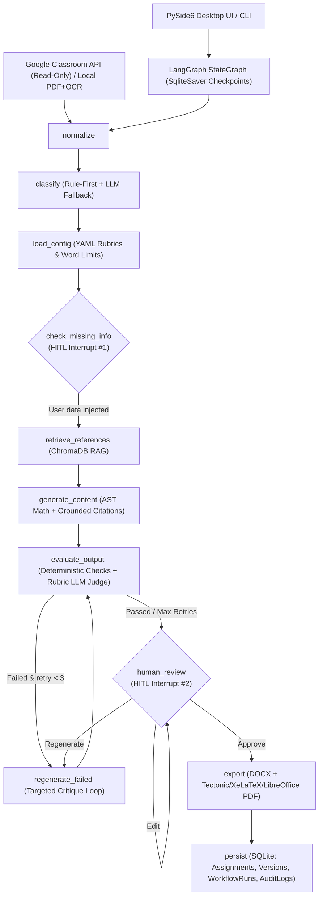

# Academic AI — Agentic Academic Document Preparation System

A local-first desktop and CLI **Agentic AI engineering system** built with **LangGraph**, **PySide6**, **NVIDIA NIM / Google Gemini**, **ChromaDB**, **SQLModel**, and **XeLaTeX / python-docx**. It ingests assignments from **Google Classroom** (read-only student OAuth) or local **PDF / DOCX / TXT** files (with Tesseract OCR fallback), orchestrates multi-step generation and rubric evaluation with self-correction loops, enforces human-in-the-loop (HITL) approval gates, and exports publication-ready **DOCX** and **PDF** reports.

---

## System Architecture



---

## AI Engineering & Agentic Design

| Component | Design Pattern & Engineering Rationale | Implementation |
|---|---|---|
| **Stateful Agentic Graph** | LangGraph `StateGraph` backed by SQLite checkpoints for pause/resume across two HITL gates and crash recovery | [`workflow/graph.py`](workflow/graph.py), [`workflow/nodes.py`](workflow/nodes.py), [`workflow/routing.py`](workflow/routing.py) |
| **Resilient Multi-LLM Router** | Ordered failover (`NVIDIA NIM` -> `Google Gemini`) with `tenacity` exponential backoff on transient 429/5xx errors and per-call latency/token telemetry | [`ai/llm/router.py`](ai/llm/router.py), [`ai/llm/nvidia.py`](ai/llm/nvidia.py), [`ai/llm/gemini.py`](ai/llm/gemini.py), [`ai/llm/telemetry.py`](ai/llm/telemetry.py) |
| **Evaluator-Optimizer Loop** | Hybrid verification combining deterministic checks (required sections, word bounds, banned AI disclaimers, citation validity, `[[MISSING]]` tracking) with weighted rubric scoring (`SectionEvaluation`) and targeted section regeneration | [`ai/evaluator.py`](ai/evaluator.py), [`configs/`](configs/) |
| **Neuro-Symbolic Math Sandbox** | AST-based arithmetic and chained formula evaluator (`eval()`/`__import__`/large exponent blocked) computes deterministic lab results before LLM prose generation | [`ai/calculations.py`](ai/calculations.py) |
| **Prompt Injection Defense** | Randomized delimiter tokens wrapping untrusted external assignment text plus regex redaction of override attempts | [`ai/security.py`](ai/security.py) |
| **Grounded Course RAG** | ChromaDB persistent vector store with strict collection-name sanitization, idempotent `upsert`, and source-attributed chunks for verifiable citations | [`ai/retriever.py`](ai/retriever.py) |
| **Document Export Pipeline** | Synchronized `python-docx` and `XeLaTeX` / `Tectonic` / `LibreOffice` compilation supporting IOE Pulchowk front pages, fenced code blocks, math preservation, and multi-version history | [`document/docx_generator.py`](document/docx_generator.py), [`document/latex_generator.py`](document/latex_generator.py), [`document/pdf_exporter.py`](document/pdf_exporter.py) |

---

## Desktop & CLI Features

- **Dashboard**: Classroom connection status, enrolled course cards, recent documents, and profile completeness.
- **Classroom & Local Preparation**: Select Google Classroom coursework (with attachment summaries) or work offline with local PDF/DOCX/TXT uploads and optional RAG reference indexing.
- **Active Processing & HITL Data Request**: Live node execution log plus an interrupt prompt when experimental lab measurements are missing—student inputs are injected directly into generation and evaluation context.
- **Review & Approve**: Rendered preview, section-by-section Markdown editor, weighted rubric score + LLM telemetry summary, targeted single-section or whole-document feedback regeneration, and mandatory approval gate.
- **Document History & Versioning**: Multi-version output tracking (`v1`, `v2`, ...) stored locally in SQLite with DOCX/PDF/LaTeX artifacts and clean deletion.

---

## Quick Start

### 1. Install Dependencies
```bash
uv sync --extra dev --extra google --extra rag
cp .env.example .env
```

### 2. Configure API Keys (Optional for `--mock` mode)
Edit `.env`:
```env
LLM_PROVIDER=nvidia
NVIDIA_API_KEY=your-nvidia-nim-key
NVIDIA_MODEL=nvidia/nemotron-3-ultra-550b-a55b

# Optional Gemini fallback
GEMINI_API_KEY=your-gemini-key
GEMINI_MODEL=gemini-2.5-flash-lite
GEMINI_FALLBACK_MODEL=gemini-2.5-flash
```
For Google Classroom read access, save your OAuth desktop client JSON as `credentials.json` in the project root. Requested scopes are strictly read-only (`classroom.courses.readonly`, `classroom.coursework.me.readonly`, `classroom.courseworkmaterials.readonly`, `classroom.student-submissions.me.readonly`).

### 3. Run Desktop App or Headless CLI
```bash
# Desktop UI
uv run python -m app.main

# Headless CLI (offline deterministic mock mode)
uv run python -m app.main --cli --mock --title "Ohm's Law Lab" --category initial_lab \
  --prompt "Verify V = I*R with V = 12 V and R = 4 ohms. Measure I = V / R."

# Index course reference material into ChromaDB RAG
uv run python -m scripts.index_reference --course "Computer Networks" --file path/to/manual.pdf
```

---

## Verification, Quality Gates & Benchmarks

```bash
# Static lint & type checks
uv run ruff check app ai models workflow document integrations database scripts tests configs
uv run mypy app ai models workflow document integrations database configs scripts/eval_benchmark.py

# Offline AI engineering benchmark (classifier, guardrails, AST sandbox, security, RAG)
uv run python -m scripts.eval_benchmark

# Full unit, UI smoke, and integration test suite
QT_QPA_PLATFORM=offscreen uv run pytest -v
```

See [Student Guide](docs/STUDENT_GUIDE.md) and [Implementation Plan](plan.md) for additional workflow details.
