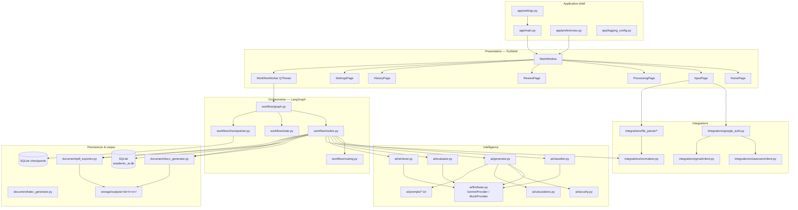

# 01 — Project Overview

> Audit basis: direct inspection of the repository at commit `f5dd993` (working tree also contains
> uncommitted Graphify outputs and documentation files). This document describes the code that
> exists, not the code the README or `plan.md` says should exist.

## 1. What this project is

`academic-ai` is a **local-first, single-user desktop application** for students. It turns an
assignment description into a structured academic report, lets the student review/edit it, and
exports a **DOCX** plus a **PDF**. It also has a headless CLI mode used for smoke testing.

It is **not** a web application. There is no FastAPI/Flask/Django server, no HTTP routes, no
frontend build system, and no multi-user auth layer. The "frontend" is a PySide6/Qt desktop UI and
the "backend" is an in-process orchestration/domain layer.

### Primary user

A student who is enrolled in Google Classroom and wants a correctly structured, correctly formatted
assignment or lab report, with mandatory human review before export.

### Problem it solves

Academic reports have repetitive structure (objective, apparatus, procedure, observations,
calculations, discussion, references) and strict formatting rules (margins, fonts, numbering,
citations, word limits). General-purpose chatbots produce unformatted text and often fabricate data.
This project combines:

- deterministic Python for arithmetic, parsing, validation, escaping, and document layout;
- Gemini only where language understanding is needed (classification, drafting, rubric evaluation);
- YAML-driven category rules and prompts;
- a mandatory human approval gate;
- local SQLite persistence and versioned output folders.

## 2. Feature inventory and status

Legend: **Implemented** = on the normal execution path; **Partial** = exists but incomplete or not
wired end-to-end; **Configured only** = declared/loaded but not used; **Missing** = expected by the
design but absent.

| Feature | Status | Evidence |
|---|---|---|
| Google Classroom OAuth (read-only student scopes) | Implemented | `integrations/google_auth.py:24-30`, `integrations/classroom/client.py:14-53` |
| List courses and coursework | Implemented | `integrations/classroom/client.py:19-53`; UI `app/ui/pages/input_page.py:219-263` |
| Gmail search and attachment download | Implemented | `integrations/gmail/client.py:22-96`; UI `app/ui/pages/input_page.py:289-369` |
| Manual text input | Implemented | `app/ui/pages/input_page.py:76-97,324-337` |
| Local file input (PDF/DOCX/TXT) | Implemented | `integrations/file_parser/*`, `app/ui/pages/input_page.py:99-121,339-350` |
| Scanned-PDF OCR fallback | Partial / broken | `integrations/file_parser/ocr.py:24` references `fitz` without importing it |
| Normalization, hashing, title extraction | Implemented | `integrations/normalizer.py:12-78` |
| Rule + LLM assignment classification | Implemented | `ai/classifier.py:41-112` |
| YAML category configs (assignment / initial_lab / final_lab) | Implemented | `configs/*.yaml`, `configs/schema.py:71-130` |
| Section-by-section Gemini generation | Implemented | `ai/generator.py:24-201` |
| Deterministic validation | Partial | `ai/evaluator.py:33-122`; does not enforce total word limits, reference minimums, figures, or missing placeholders |
| LLM rubric evaluation | Implemented, fail-open | `ai/evaluator.py:124-187`; exceptions default to a passing score |
| Section retry loop (max 3) | Implemented | `workflow/routing.py:9-22`, `workflow/nodes.py:167-198` |
| Missing-lab-data interrupt | Implemented | `workflow/nodes.py:81-116` |
| Mandatory human review interrupt | Implemented | `workflow/nodes.py:201-232`, `app/ui/main_window.py:252-265` |
| Direct section editing | Implemented | `app/ui/widgets/section_editor.py:63-105`, `workflow/nodes.py:216-227` |
| DOCX generation | Implemented | `document/docx_generator.py:33-447` |
| LaTeX generation | Implemented | `document/latex_generator.py:192-284`, `document/templates/latex/report.tex.j2` |
| PDF compilation (Tectonic → XeLaTeX → LibreOffice) | Implemented, settings partly ignored | `document/pdf_exporter.py:29-137`; `settings.pdf_engine` / `pdf_fallback_engine` are not consulted |
| Versioned output folders | Implemented | `document/docx_generator.py:40-42`, `document/pdf_exporter.py:36-38` |
| SQLite persistence + LangGraph checkpoints | Implemented | `database/*`, `workflow/checkpointer.py` |
| RAG / ChromaDB retrieval | Implemented but disabled by default | `ai/retriever.py`, `configs/*.yaml` (`rag.enabled: false`) |
| Profile and document defaults from preferences | Partial / not wired | `app/preferences.py` exists, but the workflow never injects it; the Settings page does not edit it |
| Figure support | Missing | `FigureData` exists in `models/report.py:29-32` but is never rendered by DOCX or LaTeX |
| Appendix support | Missing | `ReportContent.appendix` exists (`models/report.py:79`) but is never rendered |
| Bibliography from `.bib` | Missing | `document/templates/latex/references.bib.j2` is empty and unused |
| Automatic Classroom submission | Missing (intentional) | README and `plan.md` state it is out of scope |
| HTTP API | Not applicable | Desktop app; no web server |
| Docker / CI | Missing | No Dockerfile, no `.github/workflows`, no CI config |
| Monitoring / evaluation dashboard | Missing | Only file logs and LangGraph checkpoints |

## 3. Technology stack (actual imports)

| Concern | Technology | Where |
|---|---|---|
| Language/runtime | Python 3.12 (`>=3.12,<3.13`) | `pyproject.toml:6`, `.python-version` |
| Desktop UI | PySide6 / Qt 6, QSS | `app/ui/**`, `app/ui/styles.qss` |
| Workflow | LangGraph (`StateGraph`, conditional edges, `interrupt`) | `workflow/**` |
| Durable workflow state | `langgraph-checkpoint-sqlite` (`SqliteSaver`) | `workflow/checkpointer.py` |
| Domain models | Pydantic v2 | `models/**`, `configs/schema.py` |
| Settings | `pydantic-settings`, `SecretStr` | `app/settings.py` |
| Category rules | PyYAML | `configs/*.yaml` |
| LLM | `google-genai` (Gemini), behind `LLMProvider` | `ai/llm/**` |
| Database | SQLite + SQLModel/SQLAlchemy | `database/**` |
| Vector store | ChromaDB (optional extra) | `ai/retriever.py`, `scripts/index_reference.py` |
| Google APIs | `google-api-python-client`, `google-auth-oauthlib`, `keyring` | `integrations/**` |
| DOCX | `python-docx` | `document/docx_generator.py`, `document/markdown_to_docx.py` |
| LaTeX/PDF | Jinja2 template + Tectonic/XeLaTeX/LibreOffice | `document/latex_generator.py`, `document/pdf_exporter.py` |
| PDF parsing/OCR | PyMuPDF, pytesseract, Pillow | `integrations/file_parser/**` |
| Markdown preview | `markdown` | `app/ui/widgets/preview.py` |
| Testing/tooling | pytest, pytest-qt, ruff, mypy, PyInstaller | `pyproject.toml:35-64`, `pyinstaller.spec` |

`tenacity` is declared but not imported by application code; retries are hand-written in
`ai/llm/gemini.py` and the LangGraph routing.

## 4. Repository at a glance

```text
app/            desktop shell, settings, preferences, logging, PySide6 UI
ai/             LLM abstraction, classifier, generator, evaluator, retriever, security, prompts
configs/        category YAML + Pydantic schema
database/       SQLModel tables, engine, migrations, repositories
document/       DOCX generator, LaTeX generator/escape, PDF exporter, templates, assets
integrations/   Google OAuth, Classroom, Gmail, normalizer, file parsers
models/         shared Pydantic domain models
scripts/        Classroom smoke test, RAG indexing, PyInstaller build, run scripts
storage/        local DB, checkpoints, outputs, logs, credentials (gitignored contents)
tests/          unit, integration, UI smoke tests
workflow/       LangGraph graph, nodes, state, routing, checkpointer
docs/           this audit + the existing STUDENT_GUIDE.md
```

Generated/ignored directories not part of the architecture report: `.git/`, `.venv/`,
`__pycache__/`, `graphify-out/`, `.freebuff/`, and the contents of `storage/`.

## 5. High-level architecture



## 6. What is actually production-shaped, and what is not

**Production-shaped**

- Explicit LangGraph state machine with resumable interrupts and SQLite checkpoints.
- Typed Pydantic contracts at most boundaries (`RawInput`, `NormalizedInput`, `ReportContent`,
  `EvaluationResult`, `HumanDecision`, `CategoryConfig`).
- Provider abstraction with a deterministic mock provider, so tests and offline runs work.
- Versioned output directories and an audit log table.
- Read-only Google scopes and OS-keyring token storage with a file fallback.
- Prompt-injection wrappers and a safe arithmetic evaluator.

**Not production-ready yet**

- Two concrete runtime defects: `workflow/nodes.py:42` uses `SourceType` without importing it;
  `integrations/file_parser/ocr.py:24` uses `fitz.Matrix` without importing `fitz`.
- User profile/document preferences are persisted but never injected into generation, so the front
  page falls back to "Student" and hardcoded institution defaults.
- The LaTeX template hardcodes formatting that the YAML/DOCX path treats as configurable, so DOCX
  and PDF can diverge.
- The PDF exporter ignores `PDF_ENGINE` and `PDF_FALLBACK_ENGINE`.
- Default references are fabricated placeholders (`ai/generator.py:124-139`).
- Evaluator failures default to a passing score (`ai/evaluator.py:163-168`).
- No figure/appendix rendering, no `.bib` bibliography, no CI, no coverage gate.
- GUI tests are minimal and no test exercises the real Gemini provider or PDF compilation failure.

## 7. Assumptions and scope notes

- The repository is treated as a **single-user local desktop app**. Any "API" discussion in these
  documents refers to internal Python contracts and Qt signals, not HTTP endpoints.
- `storage/`, `.env`, and `credentials.json` contain user-specific or secret material. Their
  contents were not read into this documentation and must never be committed.
- `graphify-out/` is generated tooling output; it is not part of the application runtime.
- `CODE_UNDERSTANDING.md`, `TECH_STACK.md`, and `plan.md` are pre-existing documents. They were
  inspected for context but not overwritten. This audit is based on source code where the two
  disagree.
