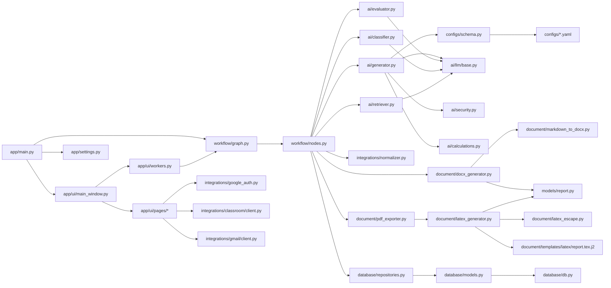

# 02 — Project Structure

This is the complete application tree, excluding generated or environment directories. The tree is
deliberately annotated with **why** each area exists, not just what it contains.

## 1. Top-level tree

```text
Academic_Assistent/
├── .env                         # local secrets (gitignored; never documented)
├── .env.example                 # documented env contract
├── .gitignore
├── .python-version              # 3.12
├── README.md                    # product summary + quick start (partly outdated)
├── pyproject.toml               # dependencies, extras, pytest/ruff/mypy config
├── uv.lock                      # locked dependency graph
├── pyinstaller.spec             # native packaging definition
├── credentials.json             # Google OAuth desktop client (gitignored secret)
├── plan.md                      # design/implementation plan (pre-existing)
├── CODE_UNDERSTANDING.md        # pre-existing structural map (not overwritten)
├── TECH_STACK.md                # pre-existing stack audit (not overwritten)
│
├── app/                         # application shell + desktop presentation
│   ├── __init__.py
│   ├── main.py                  # process entry: CLI vs Qt GUI
│   ├── settings.py              # pydantic-settings, SecretStr, paths
│   ├── preferences.py           # per-student profile + document defaults
│   ├── logging_config.py        # stdout + rotating file logging
│   └── ui/
│       ├── main_window.py       # QMainWindow, sidebar, QStackedWidget routing
│       ├── styles.qss           # global Qt stylesheet
│       ├── workers.py           # QThread wrappers for workflow + Classroom
│       ├── pages/
│       │   ├── home_page.py     # dashboard, Classroom cards, recent documents
│       │   ├── input_page.py    # Classroom / manual / file / Gmail input tabs
│       │   ├── processing_page.py
│       │   ├── review_page.py   # preview + section editor + approve/regenerate
│       │   ├── history_page.py  # generated document history
│       │   └── settings_page.py # API key, model, PDF engine, OAuth test
│       └── widgets/
│           ├── course_card.py   # Classroom course card
│           ├── preview.py       # Markdown → HTML preview
│           ├── progress_log.py  # node progress + log
│           └── section_editor.py# per-section Markdown editor
│
├── ai/                          # AI/LLM services and prompt assets
│   ├── __init__.py
│   ├── classifier.py            # rules + LLM fallback classification
│   ├── generator.py             # section/full-report generation, front page assembly
│   ├── evaluator.py             # deterministic checks + LLM rubric evaluation
│   ├── retriever.py             # ChromaDB RAG index/retrieve + chunking
│   ├── calculations.py          # safe AST arithmetic + formula extraction
│   ├── security.py              # input cap, injection redaction, delimiter wrapping
│   ├── llm/
│   │   ├── base.py              # LLMProvider Protocol
│   │   ├── gemini.py            # google-genai provider + model fallback
│   │   └── mock.py              # deterministic offline/test provider
│   └── prompts/
│       ├── assignment_system.txt
│       ├── assignment_generation.txt
│       ├── assignment_evaluation.txt
│       ├── initial_lab_system.txt
│       ├── initial_lab_generation.txt
│       ├── initial_lab_evaluation.txt
│       ├── final_lab_system.txt
│       ├── final_lab_generation.txt
│       └── final_lab_evaluation.txt
│
├── configs/                     # data-driven category rules
│   ├── __init__.py
│   ├── schema.py                # Pydantic validation + YAML loader/cache
│   ├── assignment.yaml
│   ├── initial_lab.yaml
│   └── final_lab.yaml
│
├── database/                    # local persistence
│   ├── __init__.py
│   ├── db.py                    # SQLite engine, WAL pragmas, sessions
│   ├── models.py                # SQLModel tables
│   ├── migrations.py            # schema version bookkeeping
│   └── repositories.py          # assignment/document/audit/workflow repositories
│
├── document/                    # document generation and export
│   ├── __init__.py
│   ├── docx_generator.py        # authored DOCX with front page, TOC, tables
│   ├── markdown_to_docx.py      # limited Markdown → DOCX runs
│   ├── latex_generator.py       # ReportContent → LaTeX source
│   ├── latex_escape.py          # TeX escaping + math sanitizer
│   ├── pdf_exporter.py          # Tectonic/XeLaTeX/LibreOffice fallback chain
│   ├── assets/
│   │   └── tu_logo.png          # front-page logo
│   └── templates/
│       ├── academic_base.docx   # present but not used by the generator
│       └── latex/
│           ├── report.tex.j2    # the real presentation template
│           └── references.bib.j2# empty and unused
│
├── integrations/                # external systems + input normalization
│   ├── __init__.py
│   ├── google_auth.py           # OAuth installed-app flow, keyring token store
│   ├── normalizer.py            # sanitize, hash, extract title
│   ├── classroom/
│   │   ├── __init__.py
│   │   └── client.py            # courses, coursework, materials, Drive download
│   ├── gmail/
│   │   ├── __init__.py
│   │   └── client.py            # search, body extraction, attachment download
│   └── file_parser/
│       ├── __init__.py          # parser registry + size limit
│       ├── base.py              # parser ABC + ParsedDocument
│       ├── pdf.py               # PyMuPDF extraction + OCR fallback
│       ├── docx.py              # python-docx paragraphs/tables
│       ├── text.py              # txt/md/csv/tsv
│       └── ocr.py               # Tesseract rendering (currently broken)
│
├── models/                      # shared Pydantic domain contracts
│   ├── __init__.py
│   ├── assignment.py            # RawInput, NormalizedInput, Category, SourceType
│   ├── report.py                # Citation, TableData, FigureData, FrontPage, SectionDraft, ReportContent
│   ├── evaluation.py            # DecisionType, findings, scores, EvaluationResult, HumanDecision
│   └── workflow.py              # WorkflowRunRecord (unused by runtime)
│
├── workflow/                    # LangGraph orchestration
│   ├── __init__.py
│   ├── state.py                 # WorkflowState TypedDict
│   ├── graph.py                 # node registration + edges
│   ├── nodes.py                 # node implementations
│   ├── routing.py               # conditional routing after evaluation/review
│   └── checkpointer.py          # SqliteSaver factory
│
├── scripts/                     # operator/developer utilities
│   ├── __init__.py
│   ├── test_classroom.py        # manual Classroom access smoke test
│   ├── index_reference.py       # index a reference file into ChromaDB
│   ├── build.py                 # PyInstaller build wrapper
│   ├── run.bat                  # Windows launcher
│   └── run.sh                   # POSIX launcher
│
├── tests/
│   ├── __init__.py
│   ├── test_imports.py
│   ├── test_settings.py
│   ├── test_classroom_client.py
│   ├── fixtures/
│   ├── integration/
│   │   ├── test_workflow.py
│   │   └── test_docx_pdf_export.py
│   ├── ui/
│   │   └── test_ui_smoke.py
│   └── unit/
│       ├── test_calculations.py
│       ├── test_configs.py
│       ├── test_database.py
│       ├── test_gmail.py
│       ├── test_latex.py
│       ├── test_models.py
│       ├── test_parsers.py
│       ├── test_preferences.py
│       ├── test_rag.py
│       └── test_security.py
│
├── docs/
│   ├── STUDENT_GUIDE.md         # pre-existing user guide
│   └── 01..09_*.md              # this audit
│
├── storage/                     # runtime data (contents gitignored)
│   ├── academic_ai.db
│   ├── workflow_checkpoints.db
│   ├── outputs/<assignment_id>/v<version>/
│   ├── inputs/gmail/
│   ├── rag/
│   ├── credentials/google_token.json
│   ├── logs/app.log
│   └── references/
│
├── graphify-out/                # generated knowledge graph; not runtime code
├── .freebuff/                   # tool metadata; not runtime code
├── .venv/                       # local environment
└── __pycache__/                 # bytecode
```

## 2. Directory responsibilities and design rationale

### `app/` — application shell and presentation

| Path | Responsibility | Why it exists |
|---|---|---|
| `app/main.py` | Parses `--cli`, `--mock`, `--title`, `--prompt`, `--category`; either runs the headless workflow or launches `QApplication` + `MainWindow`. | One entry point for both automated smoke tests and the desktop app. |
| `app/settings.py` | `Settings(BaseSettings)` reads `.env`; exposes `SecretStr` key, model names, PDF engines, storage root, OAuth path. | Keeps environment/config out of business logic and prevents accidental key printing. |
| `app/preferences.py` | `StudentProfile`, `DocumentDefaults`, `AppPreferences`; atomic JSON save/load. | The student's identity and formatting choices belong to the user, not the repo. |
| `app/logging_config.py` | Root logger with stdout and rotating `storage/logs/app.log`. | A desktop app needs a local audit trail without a log server. |
| `app/ui/main_window.py` | Sidebar navigation, six-page `QStackedWidget`, worker signal wiring, interrupt dialogs. | Manual routing is simpler than a router library for six screens. |
| `app/ui/workers.py` | `WorkflowWorker` runs LangGraph off the UI thread; `ClassroomCoursesWorker` fetches courses off-thread. | LLM/network work must not block Qt's event loop. |
| `app/ui/pages/*` | One screen per workflow stage. | Keeps each screen's state and controls local. |
| `app/ui/widgets/*` | Reusable preview, editor, progress, course-card components. | Avoids duplicating UI logic across pages. |

### `ai/` — intelligence layer

| Path | Responsibility | Why it exists |
|---|---|---|
| `ai/llm/base.py` | `LLMProvider` Protocol with structured/text/embed methods. | Allows Gemini, mock, or future providers to be swapped without touching workflow code. |
| `ai/llm/gemini.py` | google-genai client, JSON schema enforcement, model fallback chain, embeddings. | One place for provider-specific retry/model policy. |
| `ai/llm/mock.py` | Deterministic responses for tests/offline. | Makes the whole workflow testable without an API key. |
| `ai/classifier.py` | Keyword rules first, LLM fallback, manual override. | Cheap deterministic classification when possible; LLM only for ambiguity. |
| `ai/generator.py` | Renders per-category prompts, generates each section, assembles `ReportContent` and `FrontPage`. | Core content-production service. |
| `ai/evaluator.py` | Structural/word-count/banned-phrase/citation checks + per-section LLM rubric. | Separates deterministic validation from semantic judgment. |
| `ai/retriever.py` | Chunking, ChromaDB indexing/retrieval, optional embeddings. | Optional grounding for course reference material. |
| `ai/calculations.py` | Safe AST evaluator and simple formula extraction. | Prevents the LLM from being the source of arithmetic truth. |
| `ai/security.py` | Length cap, injection-pattern redaction, random-boundary wrapping. | Treats assignment/email text as untrusted data. |
| `ai/prompts/*.txt` | Prompt assets per category and role. | Prompt changes should not require Python edits. |

### `configs/` — category rules

| Path | Responsibility | Why it exists |
|---|---|---|
| `configs/schema.py` | Pydantic validation for word limits, formatting, prompts, rubric, RAG, references; YAML loader with cache. | Makes category behavior data-driven and validates it at load time. |
| `configs/assignment.yaml` | Sections, word limits, formatting, prompts, rubric, RAG flag, reference minimum. | Academic assignment profile. |
| `configs/initial_lab.yaml` | Same for a first lab report. | Lab-specific structure. |
| `configs/final_lab.yaml` | Same for a comprehensive final lab. | Longer, theory/error-analysis profile. |

### `database/` — persistence

| Path | Responsibility | Why it exists |
|---|---|---|
| `database/db.py` | Engine creation, SQLite WAL/synchronous/foreign-key pragmas, session factory. | One configured connection policy for UI and worker threads. |
| `database/models.py` | Eight SQLModel tables: assignments, source records, workflow runs, generated documents, reference documents, audit logs, schema versions. | Local relational history and auditability. |
| `database/repositories.py` | Assignment, workflow-run, document, audit-log repositories. | Keeps SQL out of workflow nodes. |
| `database/migrations.py` | Schema-version table and a placeholder migration step. | A place for future schema evolution without Alembic. |

### `document/` — document generation

| Path | Responsibility | Why it exists |
|---|---|---|
| `document/docx_generator.py` | Builds the editable DOCX: styles, front page, TOC field, headings, Markdown body, tables, references, header/footer. | DOCX is the canonical editable artifact. |
| `document/markdown_to_docx.py` | Converts a limited Markdown subset into DOCX runs/headings/lists/code. | Avoids a heavyweight DOCX Markdown renderer. |
| `document/latex_generator.py` | Converts Markdown to LaTeX and renders `report.tex.j2` with LaTeX-safe Jinja delimiters. | Produces high-quality typeset PDF source. |
| `document/latex_escape.py` | Escapes TeX specials and strips dangerous primitives from math. | Prevents broken or unsafe LaTeX. |
| `document/pdf_exporter.py` | Writes `.tex`, tries Tectonic → XeLaTeX → LibreOffice, writes metadata. | Best-quality-first fallback chain. |
| `document/templates/latex/report.tex.j2` | The actual visual identity of the PDF. | Presentation is separated from content. |
| `document/templates/latex/references.bib.j2` | Empty placeholder. | Intended for a future BibTeX path; not used. |
| `document/templates/academic_base.docx` | Present but never opened by `DocxGenerator`. | Intended template hook that is not wired. |

### `integrations/` — external systems

| Path | Responsibility | Why it exists |
|---|---|---|
| `integrations/google_auth.py` | Installed-app OAuth, scope check, refresh, keyring + file token mirror. | One auth path for Classroom and Gmail. |
| `integrations/classroom/client.py` | List courses/coursework/materials, download Drive files. | Read-only Classroom access. |
| `integrations/gmail/client.py` | Search messages, extract text/plain bodies, download attachments. | Alternative assignment source. |
| `integrations/normalizer.py` | Unicode/control-character cleanup, whitespace normalization, content hash, title extraction. | One canonical form for classification/generation/dedup. |
| `integrations/file_parser/*` | PDF/DOCX/TXT parsing, size limit, OCR fallback. | Turns local files into the same normalized text. |

### `models/` — shared contracts

| Path | Responsibility | Why it exists |
|---|---|---|
| `models/assignment.py` | `Category`, `SourceType`, `RawInput`, `NormalizedInput`, `ClassificationResult`, `MissingInfoRequest`. | Input-side vocabulary shared by UI, workflow, and integrations. |
| `models/report.py` | `Citation`, `TableData`, `FigureData`, `FrontPage`, `SectionDraft`, `ReportContent`. | Output-side vocabulary shared by AI and both document generators. |
| `models/evaluation.py` | `DecisionType`, deterministic findings, section scores, `EvaluationResult`, `HumanDecision`. | Evaluation and human-review contract. |
| `models/workflow.py` | `WorkflowRunRecord`. | Intended DB/run record; runtime uses the SQLModel table instead. |

### `workflow/` — orchestration

| Path | Responsibility | Why it exists |
|---|---|---|
| `workflow/state.py` | `WorkflowState` TypedDict. | LangGraph needs an explicit state schema. |
| `workflow/graph.py` | Registers 11 nodes, linear edges, conditional retry/review edges, compiles with a checkpointer. | The workflow is the application's spine. |
| `workflow/nodes.py` | Each node's business logic and DB/export calls. | Nodes are the only place that composes services. |
| `workflow/routing.py` | Pass/fail retry and human-decision routing. | Keeps branching policy out of node bodies. |
| `workflow/checkpointer.py` | `SqliteSaver` factory. | Crash recovery and interrupt resume. |

### `scripts/`, `tests/`, `docs/`

- `scripts/test_classroom.py`: manual, read-only Classroom verification.
- `scripts/index_reference.py`: indexes a file into ChromaDB and records it in SQLite.
- `scripts/build.py` + `pyinstaller.spec`: native packaging.
- `tests/`: unit/integration/UI smoke coverage; see `docs/08` for gaps.
- `docs/STUDENT_GUIDE.md`: the pre-existing student workflow guide; not modified.

## 3. Generated or irrelevant directories

| Directory | Role | Should it be in the architecture report? |
|---|---|---|
| `.git/` | Version control | No |
| `.venv/` | Local Python environment | No |
| `__pycache__/` | Bytecode | No |
| `graphify-out/` | Generated knowledge graph / Graphify tooling | No; mention only as tooling |
| `.freebuff/` | Tool metadata | No |
| `storage/` | Runtime data and secrets | Mention paths; never document contents |
| `dist/`, `build/` | PyInstaller outputs (gitignored) | No |

## 4. File-level dependency map (important paths)


