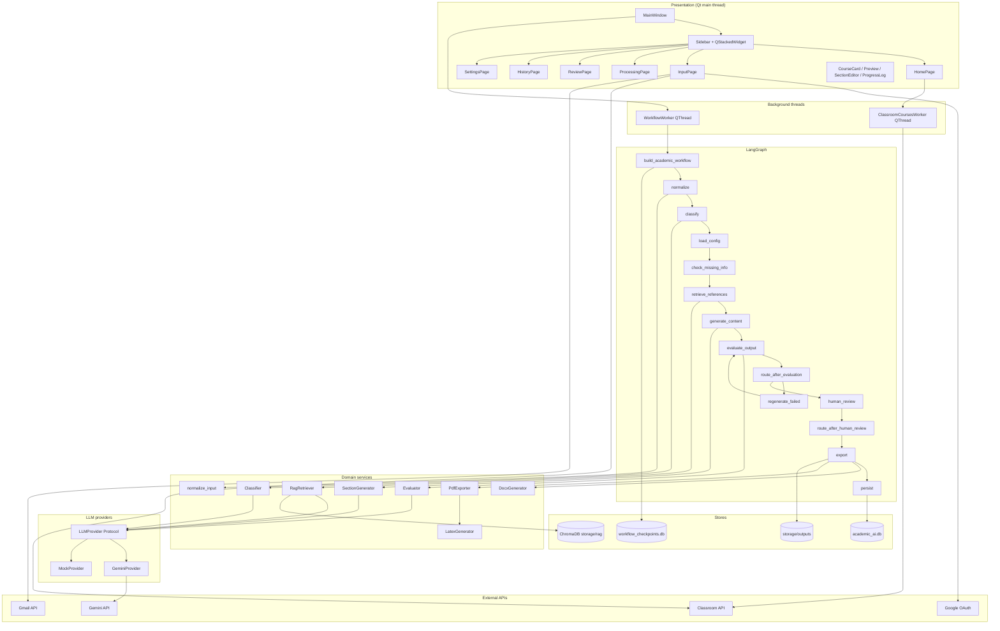
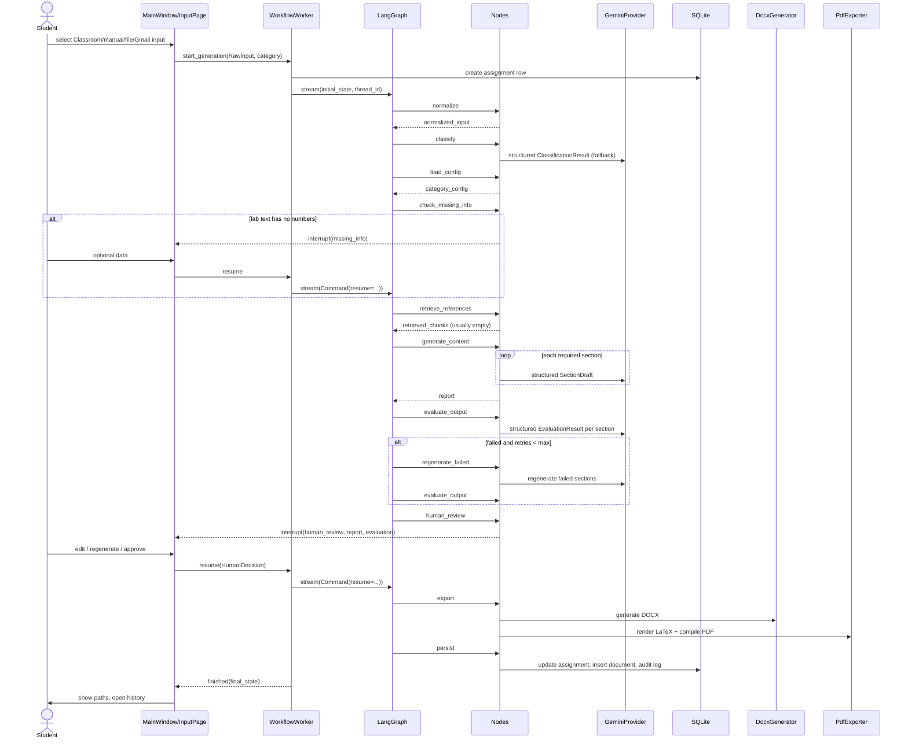

# 03 — System Architecture

## 1. Architectural style

This is a **local-first, single-process desktop application** with an explicit **state-machine
orchestrator**. It is not a client/server system.

- **Presentation:** PySide6 widgets and a `QStackedWidget`.
- **Application shell:** `app/main.py`, `app/settings.py`, `app/preferences.py`,
  `app/logging_config.py`.
- **Orchestration:** a LangGraph `StateGraph` compiled with a SQLite checkpointer.
- **Services:** classifier, generator, evaluator, retriever, document generators, repositories.
- **Integrations:** Google OAuth, Classroom, Gmail, file parsers.
- **Persistence/output:** SQLite, checkpoints, `storage/outputs/<id>/v<n>/`.

The key architectural decision is that **the LLM never controls the flow**. The graph has fixed
nodes and deterministic conditional edges; the LLM only produces typed payloads inside nodes. This is
why the app can resume after a crash, pause for missing data, pause for human review, and retry only
failed sections.

## 2. Component diagram

## 3. Application initialization

### GUI path

1. `app/main.py:77-107` parses arguments.
2. `configure_logging()` runs before the UI (`app/main.py:91`).
3. If not `--cli` and a display exists, `QApplication` is created and `MainWindow` is constructed
   (`app/main.py:100-106`).
4. `MainWindow.__init__` (`app/ui/main_window.py:37-170`):
   - calls `init_db()` (`:44`), which creates SQLite tables and runs migrations;
   - loads `app/ui/styles.qss` (`:47-49`);
   - creates `WorkflowWorker` and connects progress/interrupt/finished/error signals (`:52-56`);
   - builds the sidebar and six pages (`:58-158`);
   - connects navigation and page signals (`:161-167`);
   - refreshes profile and recent documents (`:169-170`).

### CLI path

`run_cli_generation` (`app/main.py:14-74`):

1. imports workflow/provider/DB modules lazily;
2. `init_db()`;
3. chooses `MockProvider` if `--mock` or no Gemini key, otherwise `GeminiProvider`;
4. creates an assignment row;
5. builds the graph and streams updates;
6. auto-approves the human-review interrupt;
7. prints `docx_path` / `pdf_path`.

This CLI path is the main automated end-to-end smoke path, but it is not a public API.

## 4. Routing and controllers

There is no URL router. "Routing" has two meanings in this project:

### UI routing

`MainWindow` uses a `QStackedWidget` with fixed indexes (`app/ui/main_window.py:143-158`):

| Index | Page | Navigation |
|---|---|---|
| 0 | `HomePage` | Dashboard button / home signals |
| 1 | `InputPage` | Classroom & Input button / `open_input` |
| 2 | `ProcessingPage` | Active Processing button |
| 3 | `ReviewPage` | Review & Approve button / `human_review` interrupt |
| 4 | `HistoryPage` | Document History button |
| 5 | `SettingsPage` | Settings button |

Pages communicate upward with Qt signals, not direct calls:

- `InputPage.start_generation(RawInput, str)` → `MainWindow._on_start_generation`
  (`app/ui/pages/input_page.py:33`, `app/ui/main_window.py:215-221`).
- `ReviewPage.review_decided(HumanDecision)` → `MainWindow._on_review_decision`
  (`app/ui/pages/review_page.py:20`, `app/ui/main_window.py:257-265`).
- `HomePage.open_input/open_course/open_settings/open_history` → `MainWindow`
  (`app/ui/pages/home_page.py:29-32`, `app/ui/main_window.py:162-165`).

### Workflow routing

`workflow/routing.py`:

- `route_after_evaluation` returns `regenerate_failed` when the report failed and retries remain,
  otherwise `human_review` (`:9-22`).
- `route_after_human_review` returns `export` for APPROVE/EDIT, `regenerate_failed` for REGENERATE
  (`:25-37`). The type hint also lists `human_review`, but the graph mapping does not provide that
  edge (`workflow/graph.py:65-72`), so it is currently unreachable.

## 5. Dependency injection

There is no DI container. Dependencies are passed explicitly:

- `build_academic_workflow(llm=provider, checkpointer=...)` receives the provider
  (`workflow/graph.py:27`).
- Nodes that need the LLM are bound with `functools.partial`
  (`workflow/graph.py:33-39`).
- Services receive the provider in their constructors (`Classifier(llm)`,
  `SectionGenerator(llm)`, `Evaluator(llm)`, `RagRetriever(llm=...)`).
- `PdfExporter` accepts an optional `LatexGenerator` (`document/pdf_exporter.py:26-27`).
- `DocxGenerator` accepts an optional `template_path` (`document/docx_generator.py:26-27`), but the
  parameter is never used in `generate()`.

This is simple and testable, but it means the composition root is split between `app/main.py`,
`app/ui/workers.py`, and `workflow/graph.py` rather than centralized.

## 6. Middleware and cross-cutting concerns

There is no HTTP middleware stack. Cross-cutting behavior is implemented as functions/wrappers:

| Concern | Mechanism | Files |
|---|---|---|
| Configuration | `pydantic-settings` + `.env` | `app/settings.py` |
| Secrets | `SecretStr` for Gemini key; keyring for Google token | `app/settings.py:20`, `integrations/google_auth.py:37-76` |
| Logging | root logger + rotating file | `app/logging_config.py` |
| Input sanitization | length cap, control-char cleanup, Unicode normalization | `ai/security.py:9-19`, `integrations/normalizer.py:12-21` |
| Prompt-injection defense | redaction + random-boundary wrapping | `ai/security.py:22-33` |
| LaTeX safety | escaping + dangerous-command stripping | `document/latex_escape.py` |
| Persistence | repositories + SQLModel sessions | `database/**` |
| Workflow durability | LangGraph SQLite checkpointer | `workflow/checkpointer.py` |
| Human approval | LangGraph `interrupt` | `workflow/nodes.py:201-232` |

## 7. Concurrency model

- Qt main thread owns all widgets.
- `WorkflowWorker` is a `QThread` that builds and streams the graph
  (`app/ui/workers.py:37-131`). It emits:
  - `progress_signal(str, str)`
  - `interrupt_signal(str, dict)`
  - `finished_signal(dict)`
  - `error_signal(str)`
- `ClassroomCoursesWorker` is a separate `QThread` for course listing
  (`app/ui/workers.py:24-34`).
- SQLite is opened with `check_same_thread=False` and WAL mode
  (`database/db.py:29-41`), which is necessary because the UI and worker can touch the DB.
- A new `thread_id` (`run_<uuid>`) is generated per run (`app/ui/workers.py:52-57`), and LangGraph
  persists state under that thread.

Known concurrency gaps:

- `InputPage._load_classroom_courses` and `_on_course_selected` call Google APIs synchronously on
  the UI thread (`app/ui/pages/input_page.py:219-263`), so the window can freeze.
- `ProcessingPage.cancel_requested` exists (`app/ui/pages/processing_page.py:10`) but is never
  connected; a run cannot be cancelled.
- `WorkflowWorker` restarts the same `QThread` object for resume; this works only after the previous
  `run()` has returned, and there is no guard against double-start.

## 8. Execution flow (happy path)

## 9. Error handling and observability

- **UI:** `MainWindow._on_worker_error` shows a `QMessageBox` and returns to the dashboard
  (`app/ui/main_window.py:282-289`).
- **Worker:** catches all exceptions, logs with `logger.exception`, and emits the message
  (`app/ui/workers.py:128-131`).
- **Evaluator:** catches per-section LLM exceptions and substitutes a passing evaluation
  (`ai/evaluator.py:163-168`). This is fail-open and can hide real failures.
- **RAG:** catches indexing/retrieval errors and returns empty results
  (`ai/retriever.py:55-57,80-82`).
- **PDF:** catches subprocess exceptions and falls back; a non-zero return code without an exception
  is not logged (`document/pdf_exporter.py:68-137`).
- **Logging:** only `app/main.py` calls `configure_logging()`. If `MainWindow` is constructed in a
  test or embedded context without `main()`, logging may not be configured.
- **No metrics/tracing:** there is no token accounting, latency histogram, or LLM call log beyond
  warning messages in `GeminiProvider`.

## 10. Deployment shape

- **Packaging:** PyInstaller spec (`pyinstaller.spec`) with `app/main.py` as entry, data files for
  YAML/prompts/LaTeX/QSS, and hidden imports.
- **No container/CI:** no Dockerfile, no GitHub Actions, no release pipeline.
- **Runtime prerequisites:** a Gemini API key, a Google OAuth desktop client JSON, and one of
  Tectonic/XeLaTeX/LibreOffice for PDF (DOCX still works without a PDF engine).
- **Local data:** SQLite databases and generated documents live under `storage/`.

## 11. Architectural strengths and weaknesses

**Strengths**

- Clear separation between orchestration, services, providers, and presentation.
- Deterministic flow with explicit interrupts and retries.
- Typed contracts and data-driven category configs.
- Provider abstraction with a real offline mock.

**Weaknesses**

- The composition root is spread across three files.
- Preferences are persisted but not injected into generation.
- Formatting rules are duplicated between YAML/DOCX and the LaTeX template.
- The evaluator is fail-open and does not compute a real rubric score.
- No CI, coverage gate, or LLM call observability.
