# 04 — Data Flow

## 1. End-to-end flow

The application has four entry points, one shared normalization path, one LangGraph workflow, and
two output formats.

```mermaid
flowchart LR
    subgraph Sources
        A[Google Classroom<br/>courseWork description]
        B[Manual text]
        C[Local file<br/>PDF/DOCX/TXT]
        D[Gmail message]
    end

    A --> RAW[RawInput]
    B --> RAW
    C --> RAW
    D --> RAW

    RAW --> NORM[normalize_input<br/>sanitize + hash + title]
    NORM --> NI[NormalizedInput]
    NI --> CLS[Classifier]
    CLS --> CAT[category: assignment / initial_lab / final_lab]
    CAT --> CFG[load_category_config]
    CFG --> CC[CategoryConfig]
    CC --> MISS{missing lab data?}
    MISS -- yes --> INT1[interrupt: missing_info]
    INT1 --> UD[user_provided_data]
    MISS -- no --> RAG
    UD --> RAG[retrieve_references]
    RAG --> CHUNKS[retrieved_chunks]
    CHUNKS --> GEN[SectionGenerator]
    GEN --> REPORT[ReportContent]
    REPORT --> EVAL[Evaluator]
    EVAL --> ER[EvaluationResult]
    ER --> ROUTE{passed or retries left?}
    ROUTE -- retry --> REGEN[regenerate_failed]
    REGEN --> EVAL
    ROUTE -- pass/exhausted --> HR[interrupt: human_review]
    HR --> DEC{HumanDecision}
    DEC -- regenerate --> REGEN
    DEC -- edit --> EDIT[apply edited sections]
    DEC -- approve --> EXPORT
    EDIT --> EXPORT[export]
    EXPORT --> DOCX[report.docx]
    EXPORT --> TEX[report.tex]
    TEX --> PDF[report.pdf]
    DOCX --> PERSIST[persist]
    PDF --> PERSIST
    PERSIST --> DB[(SQLite)]
    PERSIST --> META[metadata.json]
```



## 2. Where input enters

| Entry point | UI control | Model | File |
|---|---|---|---|
| Google Classroom | "Google Classroom" tab, course + coursework list | `RawInput(source_type=CLASSROOM, title, raw_text=description or title, external_id)` | `app/ui/pages/input_page.py:300-322` |
| Manual text | "Manual Input" tab | `RawInput(source_type=MANUAL, title, raw_text, course_name)` | `app/ui/pages/input_page.py:324-337` |
| Local file | "Local File" tab | `RawInput(source_type=FILE, title=stem, file_path, raw_text=notes)` | `app/ui/pages/input_page.py:339-350` |
| Gmail | "Gmail" tab | `RawInput(source_type=GMAIL, title=subject, raw_text=body, external_id)` | `app/ui/pages/input_page.py:352-369` |
| CLI | `--title`, `--prompt`, `--category` | `RawInput(source_type=MANUAL, ...)` | `app/main.py:44-53` |

The UI emits `start_generation(RawInput, category)`; `MainWindow` switches to the processing page and
starts `WorkflowWorker` (`app/ui/main_window.py:215-221`).

## 3. Validation layers

There is no HTTP validation middleware. Validation happens in layers:

| Layer | What it validates | Where |
|---|---|---|
| UI | Required fields per tab (text present, file selected, assignment/email selected) | `app/ui/pages/input_page.py:300-369` |
| Pydantic input models | `RawInput`, `NormalizedInput`, enum values, types | `models/assignment.py:27-47` |
| File parser | existence, 25 MB limit, supported extension | `integrations/file_parser/__init__.py:28-40` |
| Normalizer | Unicode NFC, control characters, line endings, whitespace | `integrations/normalizer.py:12-31` |
| Category config | YAML schema, rubric weights sum to 1.0, section limits | `configs/schema.py:71-102` |
| LLM structured output | response schema enforcement + Pydantic validation | `ai/llm/gemini.py:51-79` |
| Evaluator | required sections, word limits, banned phrases, citation keys | `ai/evaluator.py:33-122` |
| Human review | mandatory approval before export | `workflow/nodes.py:201-232` |

## 4. Normalization and deduplication

`normalize_input` (`integrations/normalizer.py:52-78`):

1. starts with `raw.raw_text`;
2. if `raw.file_path` is set, parses the file and appends its text under an `[Attachment: ...]`
   marker;
3. sanitizes the combined text;
4. uses `raw.title` if provided, otherwise extracts a title from the first lines;
5. computes a SHA-256 content hash over lowercased, whitespace-collapsed text plus the course name;
6. returns a `NormalizedInput` carrying the original metadata.

The hash is designed for deduplication, but the workflow does **not** currently check
`AssignmentRepository.get_by_hash` before creating a new assignment. The repository method exists
(`database/repositories.py:52-54`) but is unused on the normal path.

## 5. Classification flow

`Classifier.classify` (`ai/classifier.py:73-112`):

1. If the user selected a category, return it with confidence 1.0 and `method="manual"`.
2. Otherwise run keyword rules:
   - `FINAL_LAB_KEYWORDS` → final lab;
   - `LAB_KEYWORDS` → initial lab;
   - `ASSIGNMENT_KEYWORDS` → assignment.
3. If a rule scores at least 0.85 confidence, return it.
4. Otherwise call the LLM with a wrapped, truncated (3000 chars) input and a
   `ClassificationResult` schema.
5. On LLM failure, default to assignment with confidence 0.70.

The category string is then used to load `configs/<category>.yaml`.

## 6. Category configuration flow

`load_category_config(category)` (`configs/schema.py:108-122`):

- returns a cached `CategoryConfig` if present;
- otherwise reads `configs/<category>.yaml`, validates it, caches it, and returns it.

`CategoryConfig` contains:

- `required_sections`
- `word_limits.total` and per-section limits
- `formatting` (font, size, line spacing, margins, citation style, heading numbering)
- `prompts` (system/generation/evaluation paths)
- `rubric` (weighted criteria that must sum to 1.0)
- `rag.enabled` and `rag.collections`
- `references.required` and `references.min_count`

The workflow stores the validated config as a dict in `WorkflowState.category_config`.

## 7. Missing-information interrupt

`check_missing_info_node` (`workflow/nodes.py:81-116`):

- only runs for `initial_lab` / `final_lab`;
- if the normalized text has no digits and no `user_provided_data` exists, it calls LangGraph
  `interrupt({"type": "missing_info", "questions": [...]})`;
- the UI opens a multi-line dialog (`app/ui/main_window.py:227-250`);
- the response is stored as `user_provided_data.details` and the graph resumes.

Important: the provided data is stored in state but **is not injected into the generation prompt**.
`SectionGenerator.generate_section` renders `assignment_text`, `calculated_data`, references, prior
sections, feedback, document type, format notes, assignment notes, and revision feedback
(`ai/generator.py:63-78`), but not `user_provided_data`. This is a functional gap.

## 8. Retrieval flow

`retrieve_references_node` (`workflow/nodes.py:119-133`):

- loads the category config;
- if `cfg.rag.enabled` is true, uses `RagRetriever.retrieve(course, title)`;
- stores `retrieved_chunks` in state.

`RagRetriever` (`ai/retriever.py`):

- chunks text into 1000-character windows with 150-character overlap (`:12-20`);
- stores chunks in a ChromaDB persistent collection named from the course (`:36-57`);
- uses `LLMProvider.embed` if a provider is supplied, otherwise Chroma's default embedding
  (`:47-51,72-76`);
- returns top-k documents or an empty list on any error (`:59-82`).

All three shipped category configs set `rag.enabled: false`, so on the default path retrieval is a
no-op. `scripts/index_reference.py` indexes with `MockProvider`, whose embeddings are deterministic
pseudo-embeddings, not semantic embeddings (`ai/llm/mock.py:110-119`).

## 9. Generation flow

`generate_content_node` (`workflow/nodes.py:136-149`) calls
`SectionGenerator.generate_full_report` (`ai/generator.py:91-201`).

Inside `generate_full_report`:

1. `extract_and_evaluate_formulas(normalized.cleaned_text)` produces a calculation summary
   (`ai/calculations.py:87-102`).
2. It joins retrieved chunks into `references_context`.
3. It iterates over `config.required_sections`, skipping `references`/`bibliography`.
4. For each section, `generate_section`:
   - reads the system/generation prompt files from the repo root;
   - looks up per-section word limits (defaults 100/500);
   - wraps the assignment text as untrusted data;
   - renders the Jinja2 prompt with title, course, assignment text, section heading, limits,
     calculations, references, prior-section summary, feedback, document type, format notes,
     assignment notes, revision feedback;
   - calls `llm.generate_structured(SectionDraft, system_prompt, user_prompt)`;
   - recomputes `word_count`, normalizes the heading, and extracts `[[MISSING: ...]]` placeholders.
5. It builds a `FrontPage` if `document_preferences.include_front_page` is true.
6. It returns `ReportContent` with title, course, author, date, institution, abstract, sections,
   references, front page, document type, TOC flag, and metadata.

### Default reference behavior

If no references are supplied, `generate_full_report` inserts two fabricated placeholder citations
(`ai/generator.py:124-139`). They are rendered in DOCX/PDF as if they were real references. This is
an academic-integrity risk, even if intended as scaffolding.

### Preference injection gap

`generate_full_report` reads:

```python
metadata.get("document_preferences", {})
metadata.get("student_profile", {})
```

(`ai/generator.py:146-148`) but nothing in the UI or worker populates those keys. `RawInput.metadata`
is passed through normalization into `NormalizedInput.metadata`, but no caller sets it from
`app/preferences.py`. As a result, the front page falls back to `"Student"`, empty roll/group, and
hardcoded institution defaults.

## 10. Evaluation flow

`evaluate_output_node` (`workflow/nodes.py:152-164`) calls `Evaluator.evaluate_semantic`
(`ai/evaluator.py:124-187`).

Deterministic checks (`ai/evaluator.py:33-122`):

- every required section (except references/bibliography) exists;
- each section's word count is within its configured min/max;
- no banned LLM-disclaimer phrases;
- every section citation key exists in the references list.

Semantic checks (`ai/evaluator.py:137-168`):

- for each section, render the category evaluation prompt with heading, body, rubric, and limits;
- call `llm.generate_structured(EvaluationResult, ...)`;
- take the first section evaluation, overwrite its heading, and mark it failed if `passed` is false;
- on exception, substitute a passing evaluation with score 0.9.

The final result merges deterministic failures and semantic failures. `overall_score` is hardcoded
to `0.92` when passed and `0.55` when failed (`ai/evaluator.py:182`); it is not computed from the
rubric weights.

## 11. Retry flow

`route_after_evaluation` (`workflow/routing.py:9-22`):

- pass → `human_review`;
- fail and `retry_count < max_retries` (default 3) → `regenerate_failed`;
- fail and retries exhausted → `human_review` (with warning).

`regenerate_failed_node` (`workflow/nodes.py:167-198`):

- increments `retry_count`;
- for each section whose heading is in `failed_sections`, regenerates it with a generic feedback
  string;
- keeps the other sections unchanged;
- returns the updated report and loops back to evaluation.

The feedback is generic; it does not pass the evaluator's specific issues or rubric scores back into
the prompt.

## 12. Human review flow

`human_review_node` (`workflow/nodes.py:201-232`) calls
`interrupt({"type": "human_review", "report": ..., "evaluation": ...})`.

The UI (`app/ui/pages/review_page.py`) shows:

- a status badge and failed-section summary;
- a Markdown preview (`app/ui/widgets/preview.py`);
- a section editor (`app/ui/widgets/section_editor.py`);
- buttons: Regenerate Failed Sections, Apply My Edits, Approve & Export.

Decision mapping:

| UI action | `HumanDecision` | Route |
|---|---|---|
| Approve & Export | `APPROVE` + current editor contents | `export` |
| Apply My Edits | `EDIT` + edited sections | `export` (no re-evaluation) |
| Regenerate Failed Sections | `REGENERATE` + failed section names | `regenerate_failed` |
| Regenerate Section (single) | `REGENERATE` + one section | `regenerate_failed` |

For `EDIT`, `human_review_node` applies the edited bodies and recomputes word counts
(`workflow/nodes.py:217-227`), then the router sends the report straight to export. There is no
second evaluation pass after editing.

## 13. Export flow

`export_node` (`workflow/nodes.py:235-252`):

1. validates `ReportContent` and `CategoryConfig` from state;
2. `DocxGenerator.generate(report, cfg, assignment_id)` writes
   `storage/outputs/<assignment_id>/v1/report.docx`;
3. `PdfExporter.export(report, docx_path, assignment_id)` writes:
   - `storage/outputs/<assignment_id>/v1/report.tex`;
   - `storage/outputs/<assignment_id>/v1/report.pdf` if a LaTeX engine succeeds;
   - falls back to LibreOffice DOCX→PDF if LaTeX fails;
   - writes `metadata.json`.

The output folder is fixed at `version=1` because `export_node` never passes a version
(`workflow/nodes.py:240-244`). Re-running the same assignment overwrites the same `v1` folder.

## 14. Persistence flow

`persist_node` (`workflow/nodes.py:255-291`):

- gets or creates the assignment row;
- updates its status to the workflow status (`approved`);
- inserts a `GeneratedDocumentTable` row with DOCX/PDF paths and `run_id=thread_id`;
- writes an `AuditLogTable` event `workflow_completed`.

The LangGraph checkpoint is stored separately in `storage/workflow_checkpoints.db`.

## 15. Data shapes crossing boundaries

| Boundary | Shape | Produced by | Consumed by |
|---|---|---|---|
| UI → workflow | `RawInput` + category string | `InputPage` | `WorkflowWorker` |
| raw → normalized | `NormalizedInput` | `normalize_input` | classifier, generator |
| normalized → category | `ClassificationResult` | `Classifier` | `load_config_node` |
| YAML → workflow | `CategoryConfig` | `load_category_config` | generator, evaluator, DOCX |
| workflow → generator | `CategoryConfig`, `NormalizedInput`, `retrieved_chunks` | nodes | `SectionGenerator` |
| generator → workflow | `ReportContent` | `SectionGenerator` | evaluator, review, export |
| workflow → evaluator | `CategoryConfig`, `ReportContent` | nodes | `Evaluator` |
| evaluator → workflow | `EvaluationResult` | `Evaluator` | routing, review UI |
| human → workflow | `HumanDecision` | `ReviewPage` | `human_review_node` |
| workflow → documents | `ReportContent`, `CategoryConfig` | `export_node` | `DocxGenerator`, `PdfExporter` |
| workflow → DB | SQLModel rows | `persist_node` | repositories |

## 16. Failure and fallback paths

| Failure | Current behavior |
|---|---|
| No Gemini key | `MockProvider` is used in GUI/CLI; output is deterministic sample text |
| Gemini model failure | Tries primary, fallback, `gemini-2.5-flash`, `gemini-2.5-flash-lite` |
| Classification ambiguity | Defaults to assignment |
| RAG error | Returns empty chunks |
| Evaluation LLM error | Substitutes a passing evaluation |
| LaTeX engine missing/fails | Tries Tectonic → XeLaTeX → LibreOffice |
| LibreOffice missing/fails | `pdf_path` is empty; DOCX remains |
| Missing lab numbers | Interrupts and asks the student |
| Workflow exception | Worker logs and emits error; UI shows a dialog |
| Human rejects/approves | Export is gated on the review interrupt |
