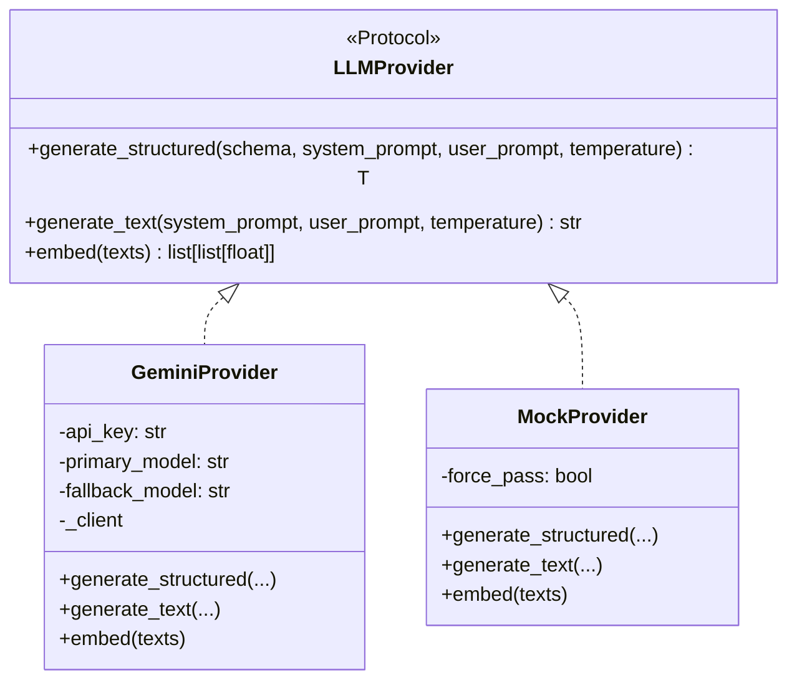
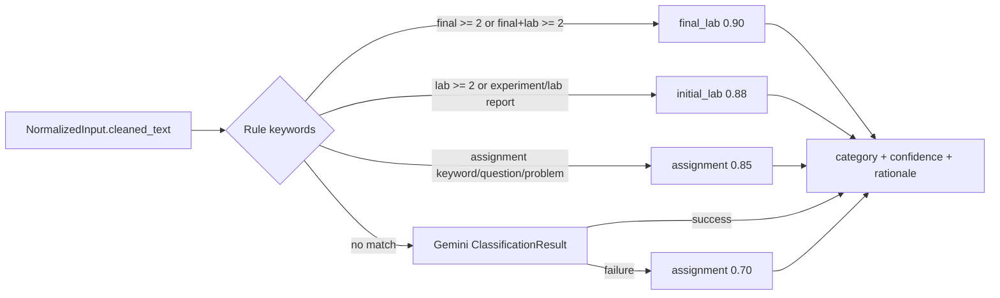
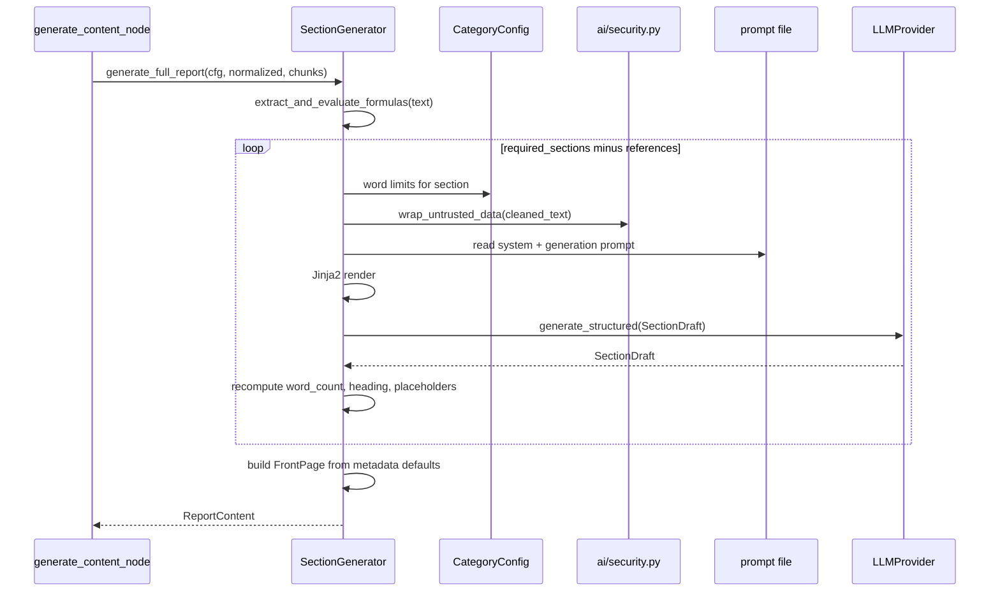
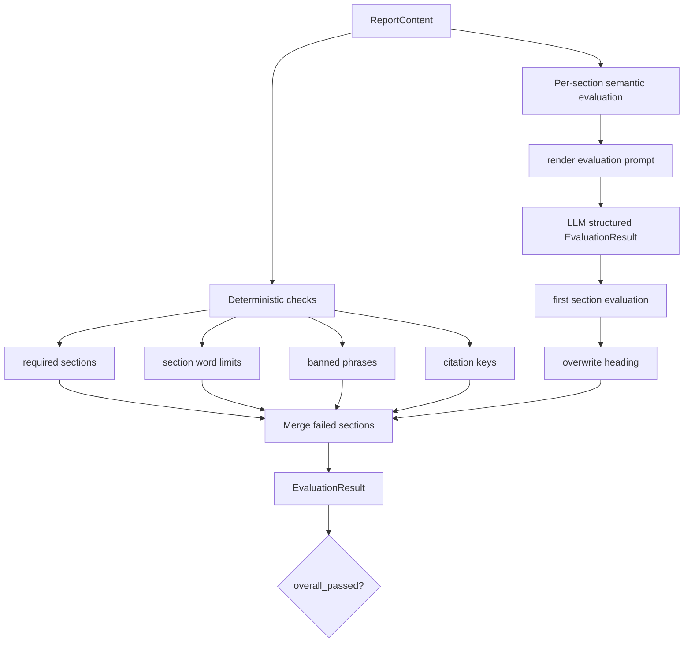
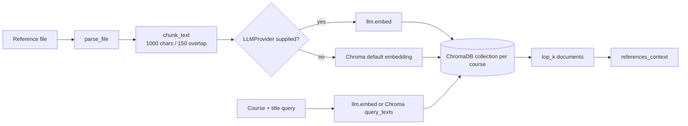

# 05 — AI Engineering Architecture

## 1. Design principle

The project uses the LLM only where language understanding is required:

- **classification** of an ambiguous assignment;
- **drafting** section prose;
- **rubric evaluation** of drafted prose.

Everything that can be computed or validated deterministically is done in Python: normalization,
hashing, word counts, required-section checks, arithmetic, LaTeX escaping, file parsing, document
layout. This is the right bias for a document-generation product because it reduces cost, variance,
and hallucination surface.

## 2. Provider abstraction

- `ai/llm/base.py:10-33` defines the Protocol.
- `ai/llm/gemini.py:16-122` is the real provider.
- `ai/llm/mock.py:21-119` is the deterministic provider used when `--mock` is set or no key exists.

### Gemini provider behavior

- Client creation: `google.genai.Client` with `api_version="v1beta"` and a 60-second HTTP timeout
  (`ai/llm/gemini.py:28-39`).
- Structured generation:
  - `response_mime_type="application/json"`;
  - `response_schema=schema` (the Pydantic class);
  - `max_output_tokens=settings.gemini_max_output_tokens` (default 8192);
  - temperature default 0.2.
- Model fallback list is hardcoded:
  `[primary_model, fallback_model, "gemini-2.5-flash", "gemini-2.5-flash-lite"]`
  (`ai/llm/gemini.py:59,96`).
- On a response, it returns `response.parsed` if present; otherwise validates `response.text` as
  JSON against the schema (`:69-74`).
- If all models fail, raises `RuntimeError` (`:79`).
- `generate_text` uses the same fallback list and returns `response.text` (`:81-111`).
- `embed` calls `client.models.embed_content` once per text, sequentially
  (`:113-121`).

### Mock provider behavior

- `ClassificationResult`: keyword-based lab/assignment choice.
- `SectionDraft`: deterministic sample body with a citation.
- `EvaluationResult`: pass/fail controlled by `force_pass`.
- `embed`: SHA-256-derived 768-dimension pseudo-vectors, **not semantic embeddings**
  (`ai/llm/mock.py:110-119`).

This is excellent for unit tests and offline demos, but it means any RAG evaluation done with the
mock provider measures plumbing, not retrieval quality.

## 3. Model and settings configuration

`app/settings.py:17-34`:

| Setting | Default |
|---|---|
| `GEMINI_MODEL` | `gemini-2.5-flash-lite` |
| `GEMINI_FALLBACK_MODEL` | `gemini-2.5-flash` |
| `GEMINI_PRO_MODEL` | `gemini-2.5-pro` |
| `GEMINI_EMBEDDING_MODEL` | `gemini-embedding-001` |
| `GEMINI_MAX_OUTPUT_TOKENS` | `8192` |

`.env.example` documents a different generation of model names (`gemini-3.6-flash`,
`gemini-3.5-flash`, `gemini-3.1-pro-preview`). The Settings page also lists `gemini-3.6-flash` etc.
This is a configuration-drift issue: the defaults, example file, UI choices, and fallback list are
not derived from one source of truth.

`GEMINI_PRO_MODEL` is declared but not used anywhere in the current code.

## 4. Prompt architecture

### Prompt assets

| Role | Assignment | Initial lab | Final lab |
|---|---|---|---|
| System | `ai/prompts/assignment_system.txt` | `initial_lab_system.txt` | `final_lab_system.txt` |
| Generation | `assignment_generation.txt` | `initial_lab_generation.txt` | `final_lab_generation.txt` |
| Evaluation | `assignment_evaluation.txt` | `initial_lab_evaluation.txt` | `final_lab_evaluation.txt` |

The YAML config points to these paths (`configs/*.yaml:prompts`). `SectionGenerator` resolves them
relative to the repository root (`ai/generator.py:35-48`).

### Prompt rendering

`SectionGenerator.generate_section` (`ai/generator.py:62-78`) renders:

| Variable | Source |
|---|---|
| `title` | `NormalizedInput.title` |
| `course` | `NormalizedInput.course_name` or `"Academic Coursework"` |
| `assignment_text` | `wrap_untrusted_data(normalized.cleaned_text)` |
| `section_heading` | section name, underscores → spaces, title-cased |
| `min_words`, `max_words` | category word limits |
| `calculated_data` | safe formula extraction summary |
| `references_context` | joined retrieved chunks |
| `prior_sections_summary` | heading + word count of earlier sections |
| `feedback` | retry feedback |
| `document_type` | document preference or category display name |
| `format_notes` | document preference |
| `assignment_notes` | normalized metadata |
| `revision_feedback` | normalized metadata |

### Prompt quality observations

- System prompts contain explicit anti-hallucination rules and `[[MISSING: ...]]` instructions
  (e.g. `assignment_system.txt:3-7`).
- Generation prompts are intentionally short and rely on the system prompt plus the schema.
- The final lab prompt asks for IEEE style, but the evaluator and renderer do not enforce it.
- The evaluator prompt receives raw section body text without the untrusted-data wrapper
  (`ai/evaluator.py:145-152`), unlike the generator and classifier.
- The retry prompt uses generic feedback (`workflow/nodes.py:185`), so the model does not know the
  exact rubric failure.
- The missing-info answer (`user_provided_data`) is not included in the generation prompt, so the
  student's data does not reach the model.

## 5. Classification pipeline

Manual selection bypasses all of this with confidence 1.0 (`ai/classifier.py:73-80`).

## 6. Generation pipeline

Important behaviors:

- Sections are generated **sequentially**, each with a summary of prior sections, not their full
  text (`ai/generator.py:54,104-121`). This limits context growth but also limits cross-section
  coherence.
- The model may return tables/figures/citations as structured fields, but only tables are rendered;
  figures are ignored by both exporters.
- Word limits are enforced only after generation; the model is asked to respect them but can
  overrun. The evaluator then flags overruns.
- The front page is assembled from metadata defaults, not from the persisted student profile.

## 7. Evaluation pipeline

Current limitations:

- `overall_score` is hardcoded (`0.92`/`0.55`), not rubric-weighted.
- Deterministic checks do not enforce `references.min_count`, total word count, figure presence,
  missing placeholders, or formula correctness.
- Semantic evaluation trusts the first section evaluation returned for a one-section prompt.
- On any LLM exception, the section is marked passed with score 0.9 (`ai/evaluator.py:163-168`).
- There is no evaluator calibration set, no agreement measurement, and no human-labeled benchmark.

## 8. Retrieval-augmented generation (RAG)

Current state:

- Disabled in all three category configs (`rag.enabled: false`).
- `scripts/index_reference.py` uses `MockProvider`, so indexed vectors are pseudo-embeddings, not
  semantic embeddings. This makes retrieval quality meaningless unless the script is changed to a
  real provider.
- No reranking, no metadata filtering beyond collection-per-course, no citation provenance, no
  chunk-level source tracking in the generated report.
- `chunk_text` is character-based and can split mid-sentence/mid-table.
- ChromaDB is an optional extra (`pyproject.toml:32-34`) and is imported lazily
  (`ai/retriever.py:30-34`).

## 9. Context management

- Assignment text is capped at 100,000 characters by `sanitize_external_input`
  (`ai/security.py:6-12`).
- Classification truncates to 3,000 characters (`ai/classifier.py:93`).
- Generation passes the full cleaned assignment text to every section, wrapped as untrusted data
  (`ai/generator.py:55,66`).
- Prior sections are represented only by heading + word count, not full text
  (`ai/generator.py:54`).
- Retrieved chunks are joined with newlines and passed to every section
  (`ai/generator.py:102,116`).
- There is no token counting, truncation strategy per model, or prompt-size guard. A long assignment
  plus many retrieved chunks can exceed the model context; the failure will surface as a provider
  error and then be retried across fallback models.

## 10. Token usage, cost, and latency

- No token accounting is recorded.
- No per-run cost estimate exists.
- Every section is a separate LLM call; every section is a separate evaluation call. A final lab
  with 10 sections can make roughly 20+ calls per attempt, plus retries.
- The fallback list can multiply calls on failure.
- The default model is `gemini-2.5-flash-lite`, which is a cost-conscious choice, but the fallback
  chain includes `gemini-2.5-flash` and may silently increase cost.
- There is no caching of identical prompts or section outputs.
- There is no streaming; the UI shows node-level progress, not token-level progress.

## 11. Security and prompt-injection posture

Implemented:

- `sanitize_external_input` caps length and redacts a few known injection phrases
  (`ai/security.py:9-19`).
- `wrap_untrusted_data` wraps text in a random 16-hex-character boundary
  (`ai/security.py:22-33`).
- Generator and classifier use the wrapper.
- `escape_latex` escapes TeX specials; `sanitize_math` strips dangerous primitives
  (`document/latex_escape.py:5-58`).

Gaps:

- Evaluator sends raw section text to the LLM without wrapping.
- The redaction list is narrow and can be bypassed by paraphrasing.
- The Gemini API key is written to `.env` in plaintext by the Settings page
  (`app/ui/pages/settings_page.py:115-139`); it is not stored in the OS keyring.
- Google OAuth tokens are mirrored to a file even when keyring storage succeeds
  (`integrations/google_auth.py:60-76`), which increases exposure.
- The LaTeX template uses `\IfFileExists` on an absolute logo path; the logo path is not sanitized
  beyond backslash replacement (`document/latex_generator.py:271`).

## 12. AI engineering assessment

**What is good**

- Provider abstraction and a real offline mock.
- Structured output with Pydantic schemas at every LLM boundary.
- Deterministic checks before semantic checks.
- Explicit anti-hallucination instructions and missing-data placeholders.
- Human approval gate.

**What must improve first**

1. Wire student/document preferences into generation metadata.
2. Stop fabricating default references; require real references or emit a visible placeholder.
3. Make evaluation fail-closed or explicitly mark unverified sections.
4. Add token/call accounting and a per-run AI trace.
5. Pass evaluator feedback and user-provided data into regeneration prompts.
6. Add a real embedding provider for RAG and a retrieval evaluation set.
7. Add prompt regression tests with fixed fixtures and a golden-output review process.
