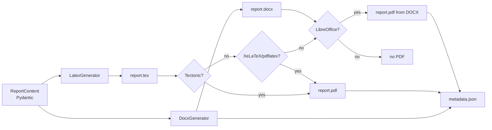

# 06 — Document Generation and LaTeX Architecture

This is the highest-risk area of the project: the generated PDF is the visible product, and the
LaTeX template currently holds presentation rules that are duplicated or contradicted elsewhere.

## 1. Pipeline overview



### Actual call order

1. `workflow/nodes.py:235-244` (`export_node`) calls `DocxGenerator.generate` then
   `PdfExporter.export`.
2. `document/docx_generator.py:33-125` builds the DOCX from `ReportContent` + `CategoryConfig`.
3. `document/pdf_exporter.py:29-66` writes `report.tex` and calls the LaTeX engines.
4. `document/latex_generator.py:203-284` renders `document/templates/latex/report.tex.j2`.
5. `document/pdf_exporter.py:68-137` tries Tectonic, then XeLaTeX/pdflatex, then LibreOffice.
6. `metadata.json` records title, version, timestamp, paths, and an engine label.

The PDF is **not** generated from the DOCX on the normal path. The DOCX and LaTeX are two independent
renderings of the same `ReportContent`. LibreOffice is only a fallback that converts the DOCX.

## 2. File responsibilities

| File | Controls | Why it matters |
|---|---|---|
| `models/report.py` | Content contract: `ReportContent`, `SectionDraft`, `FrontPage`, `Citation`, `TableData`, `FigureData`. | Defines what can be rendered. Adding a field here does not render it automatically. |
| `configs/*.yaml` | Per-category formatting values: font, size, line spacing, margins, heading numbering, citation style. | Intended source of truth for DOCX formatting. |
| `configs/schema.py` | Validates the YAML formatting block (`FormattingConfig`, `MarginConfig`). | Prevents invalid limits/weights. |
| `document/docx_generator.py` | DOCX layout: styles, margins, header/footer, front page, TOC field, headings, tables, references. | Uses `CategoryConfig.formatting`. |
| `document/markdown_to_docx.py` | Markdown subset → DOCX headings/lists/code/bold/italic. | Body content rendering for DOCX. |
| `document/latex_generator.py` | Markdown → LaTeX conversion and Jinja2 rendering. | Bridges content to the `.tex` template. |
| `document/latex_escape.py` | TeX escaping and dangerous-command stripping. | Safety and compilation correctness. |
| `document/templates/latex/report.tex.j2` | The entire PDF presentation: document class, packages, fonts, margins, spacing, colors, headers, title page, TOC, sections, tables, references. | This is the visual identity of the PDF. |
| `document/templates/latex/references.bib.j2` | Empty; unused. | No BibTeX path exists yet. |
| `document/pdf_exporter.py` | Engine selection and fallback, `.tex`/`.pdf`/`metadata.json` output. | Turns LaTeX source into a PDF. |
| `document/assets/tu_logo.png` | Front-page logo. | Used by both DOCX and LaTeX via `FrontPage.logo_path`. |
| `document/templates/academic_base.docx` | Present but never opened. | Intended template hook that is not wired. |

## 3. Content versus presentation separation

### Content side

- `ReportContent` (`models/report.py:70-94`) carries title, course, author, date, institution,
  abstract, sections, references, appendix, metadata, front page, document type, TOC flag.
- `SectionDraft` (`models/report.py:60-67`) carries heading, Markdown body, tables, figures,
  citations, word count, missing placeholders.
- `FrontPage` (`models/report.py:35-57`) carries institution/university/campus/department,
  document type, title, subtitle, course, submitted-by fields, submitted-to, date, logo path.

### Presentation side

- `DocxGenerator` reads `CategoryConfig.formatting` for font, size, line spacing, margins, and
  heading numbering. It hardcodes many sizes/colors internally.
- `LatexGenerator` does **not** accept or use `CategoryConfig` at all
  (`document/latex_generator.py:203-284`). The LaTeX template hardcodes font, size, margins, line
  spacing, colors, and section styling.

### Consequence

Changing `configs/assignment.yaml:formatting` changes the DOCX but **not** the LaTeX PDF. Changing
`report.tex.j2` changes the PDF but **not** the DOCX. The two outputs can silently diverge.

## 4. LaTeX template anatomy

`document/templates/latex/report.tex.j2` is the authoritative PDF template. It uses LaTeX-safe
Jinja2 delimiters (`\VAR{...}`, `\BLOCK{...}`, `%%` line statements), configured in
`document/latex_generator.py:206-218`.

### 4.1 Document class and paper

```latex
\documentclass[12pt,a4paper]{article}
```

- Class: `article`.
- Base font size: `12pt`.
- Paper: `a4paper`.

### 4.2 Fonts

```latex
\usepackage{fontspec}
\setmainfont{Times New Roman}[
  BoldFont = {Times New Roman Bold},
  ItalicFont = {Times New Roman Italic},
  BoldItalicFont = {Times New Roman Bold Italic}
]
\setmonofont{Liberation Mono}[Scale=0.88]
```

- Requires **XeLaTeX** or a Tectonic engine with `fontspec` support.
- Hardcodes Times New Roman and Liberation Mono.
- Does not read `config.formatting.font` or `config.formatting.font_size`.

### 4.3 Page layout and margins

```latex
\usepackage[
  top=1in, bottom=1in,
  left=1.25in, right=1in,
  headheight=15pt
]{geometry}
```

- Hardcoded margins differ from `configs/*.yaml` (`left: 1.0in` in all three YAML files) and from
  `DocumentDefaults.margin_inches = 1.0`.
- The left margin is wider than the DOCX default, so page breaks and line lengths differ.

### 4.4 Line spacing and paragraphs

```latex
\usepackage{setspace}
\setstretch{1.25}
...
\setlength{\parindent}{0pt}
\setlength{\parskip}{0.5em}
```

- Hardcoded 1.25 spacing; YAML/DOCX use 1.15.
- Paragraphs are not indented; vertical space separates them.

### 4.5 Packages

`amsmath`, `amssymb`, `booktabs`, `tabularx`, `longtable`, `graphicx`, `caption`, `float`,
`enumitem`, `xcolor`, `microtype`, `hyperref`, `titlesec`, `fancyhdr`, `setspace`.

This is a reasonable academic package set. `longtable` is loaded but the generator uses `tabularx`.
`graphicx` is available but figures are not rendered.

### 4.6 Colors

```latex
\definecolor{ioeblue}{RGB}{27,54,93}
\definecolor{ioegold}{RGB}{180,145,80}
\definecolor{textgray}{RGB}{80,80,80}
\definecolor{linkblue}{RGB}{30,80,160}
```

These match the DOCX navy (`RGB(0x1B,0x36,0x5D)`) and muted palette approximately, but are duplicated
constants.

### 4.7 Section styling

```latex
\titleformat{\section}
  {\large\bfseries\color{ioeblue}}
  {\thesection.}{0.5em}{}
  [\vspace{-0.4em}\noindent{\color{ioegold}\rule{\linewidth}{0.6pt}}]
```

- Sections are numbered (`\thesection.`), blue, bold, with a gold rule.
- Subsections and subsubsections are also styled.
- `config.formatting.heading_numbering` is not consulted; numbering is always on in LaTeX.

### 4.8 Header and footer

```latex
\usepackage{fancyhdr}
\pagestyle{fancy}
\fancyhf{}
%% if course
\fancyhead[L]{\small\itshape\color{textgray} \VAR{course}}
\fancyhead[R]{\small\color{textgray} \VAR{title}}
%% else
\fancyhead[L]{\small\itshape\color{textgray} \VAR{title}}
%% endif
\fancyfoot[C]{\small\thepage}
\renewcommand{\headrulewidth}{0.4pt}
\renewcommand{\footrulewidth}{0pt}
\fancypagestyle{plain}{
  \fancyhf{}
  \fancyfoot[C]{\small\thepage}
  \renewcommand{\headrulewidth}{0pt}
}
```

- Left header: course (or title if no course). Right header: title.
- Center footer: page number.
- `plain` style (used by `\tableofcontents` and `\section` page starts) removes the header rule and
  headers but keeps the page number.
- The title page sets `\thispagestyle{empty}`, so it has no header/footer/page number.

### 4.9 Title page

`\begin{titlepage}` block (`report.tex.j2:106-171`):

- Logo: `\IfFileExists{\VAR{front_page.logo_path}}{\includegraphics[width=2.1cm]{...}}{...}`
  (`report.tex.j2:115`).
- University: `front_page.university` (blue, bold, large).
- **Hardcoded** `Institute of Engineering` line (not `front_page.institution`).
- Campus: `front_page.campus`.
- Department: `front_page.department` if present.
- Gold rule.
- Document type: `\MakeUppercase{front_page.document_type}`.
- Title: `front_page.title` (Huge, blue, bold).
- Optional subtitle and course.
- `\vfill`.
- Two minipages:
  - Submitted By: Name, Roll No., Group (only if present).
  - Submitted To: `front_page.department or front_page.submitted_to`.
- Date.

Not rendered on the title page: `program`, `semester`, `section`, `submitted_to` when department is
present. Those fields exist in `FrontPage` and are rendered by the DOCX only partially.

### 4.10 Abstract

```latex
\begin{center}
\begin{minipage}{0.88\textwidth}
\small\itshape\setstretch{1.2}
\textbf{Abstract:} \VAR{abstract}
\end{minipage}
\end{center}
```

- The abstract is escaped but not Markdown-converted.
- It is a single italic paragraph, not a separate section.

### 4.11 Table of contents

```latex
\BLOCK{ if include_toc }
\tableofcontents
\newpage
\BLOCK{ endif }
```

- Uses LaTeX's native TOC.
- `include_toc` comes from `ReportContent.include_toc`.
- Because sections are `\section{...}`, they appear in the TOC.
- The template does not add a "Table of Contents" heading itself; `\tableofcontents` uses
  `\contentsname`, which is redefined to a blue "Table of Contents"
  (`report.tex.j2:98-99`).

### 4.12 Body sections

```latex
\BLOCK{ for section in sections }
\section{\VAR{section.heading}}

\VAR{section.body_latex}

\BLOCK{ for table in section.tables }
...
\BLOCK{ endfor }

\BLOCK{ endfor }
```

- Every section is a numbered `\section`.
- `body_latex` is produced by `markdown_to_latex`.
- Markdown headings inside the body become `\section*`/`\subsection*` (unnumbered), which can create
  a second, unnumbered heading hierarchy inside a numbered section.
- Tables are rendered twice if the model puts a Markdown table in `body_markdown` **and** fills
  `section.tables`: `markdown_to_latex` converts the Markdown table, and the template also renders
  `section.tables`.

### 4.13 Markdown conversion rules

`document/latex_generator.py:75-189` supports:

| Markdown | LaTeX |
|---|---|
| `#`–`####` headings | `\section*`, `\subsection*`, `\subsubsection*` (unnumbered) |
| `**bold**` | `\textbf{...}` |
| `*italic*` | `\textit{...}` |
| `` `code` `` | `\texttt{...}` |
| `-`/`*`/`+` bullets | `itemize` |
| `1.`/`1)` numbered | `enumerate` |
| `>` quote | `quote` |
| `---` | `\noindent\rule{\textwidth}{0.4pt}` |
| Markdown tables | `tabularx` with `booktabs` rules |

Unsupported/limited:

- No fenced code blocks with language-specific syntax highlighting. Backticks are inline only.
- No math conversion. `$...$` is escaped by `escape_latex` (dollar becomes `\$`), so math is
  rendered as literal text. `sanitize_math` exists but is unused.
- No images. `FigureData` is ignored.
- No nested lists.
- No links (`[text](url)` is escaped, not converted to `\href`).
- Tables are fixed to equal-width `X` columns; no alignment or column widths.
- `_prepare_text` converts `[[MISSING: x]]` to `[To be completed: x]` for LaTeX
  (`latex_generator.py:15-19`), but DOCX does not perform this conversion.

### 4.14 Tables

Structured tables (`SectionDraft.tables`) are rendered by the template
(`report.tex.j2:207-222`):

```latex
\begin{table}[H]
\centering
\small
\caption{...}
\begin{tabularx}{\textwidth}{XXX}
\toprule
...
\midrule
...
\bottomrule
\end{tabularx}
\end{table}
```

- Uses `[H]` (float package) to keep the table in place.
- No `\label`, no cross-reference, no table numbering control.
- Caption is escaped.
- If `headers` and `rows` have different widths, the template emits whatever cells are present; it
  does not pad rows. `markdown_to_latex` does pad Markdown tables, but the template path does not.

### 4.15 References

```latex
\begin{thebibliography}{99}
\itemsep=2pt
\bibitem{1} Authors, \textit{Title}, Venue, Year.
...
\end{thebibliography}
```

- Manual bibliography, not BibTeX.
- `Citation.key` is ignored in the `\bibitem` label; it uses `loop.index` (1-based). A citation key
  `[1]` in the body therefore matches the first item only by coincidence.
- No IEEE formatting enforcement, no sorting, no DOI/URL rendering even though `Citation.url`
  exists.
- Default references are fabricated placeholders (`ai/generator.py:124-139`).

### 4.16 Appendices

- `ReportContent.appendix` exists (`models/report.py:79`) but is never rendered by either exporter.
- No `\appendix` command is emitted.

## 5. DOCX template anatomy (for comparison)

`document/docx_generator.py`:

- Creates a blank `docx.Document()` (`:44`); it does **not** use
  `document/templates/academic_base.docx` or its `template_path` argument.
- Applies margins from `CategoryConfig.formatting.margins_inches` (`:46-49`).
- Configures Normal/Heading/List styles from config (`:127-156`).
- Adds header (title, right-aligned, bottom border) and footer (PAGE field) (`:183-224`).
- Adds a first-page footer with the front-page date (`:217-224`).
- Adds the front page (`:259-332`):
  - logo;
  - university uppercase;
  - institution (19pt, navy);
  - campus;
  - department;
  - gold/navy rule;
  - document type uppercase;
  - title (22pt, navy);
  - subtitle/course;
  - two-column table: Submitted by (Name, Roll No., Group) / Submitted to (department or
    submitted_to).
- Adds a TOC field (`:394-404`) that Word must update.
- Adds Abstract as a level-2 heading plus italic paragraph (`:82-89`).
- Adds each section as a level-1 heading with optional numbering (`:91-106`).
- Converts body Markdown with `add_markdown_paragraph` (`:102`).
- Adds structured tables with captions and shaded headers (`:406-447`).
- Adds references with hanging indents (`:108-121`).
- Does not render figures or the appendix.

## 6. Formatting rules: where each is actually controlled

| Requirement | DOCX source | LaTeX/PDF source | Consistent? |
|---|---|---|---|
| Paper size | python-docx default (Letter unless changed) | `a4paper` | **No** |
| Margins | `configs/*.yaml` `margins_inches` | hardcoded `geometry` (left 1.25in) | **No** |
| Base font family | `configs/*.yaml` `font` | hardcoded `Times New Roman` | Only if config matches |
| Base font size | `configs/*.yaml` `font_size` (11) | `12pt` class option | **No** |
| Line spacing | `configs/*.yaml` `line_spacing` (1.15) | `\setstretch{1.25}` | **No** |
| Heading numbering | `configs/*.yaml` `heading_numbering` | always numbered | **No** |
| Heading colors | hardcoded `NAVY` in generator | hardcoded `ioeblue` | Approximately |
| Section rule | none | gold rule | **No** |
| Header | title, right, bottom border | course/title, left/right | **No** |
| Footer | page field | page number | Similar |
| Front-page institution | `front_page.institution` | hardcoded "Institute of Engineering" | **No** |
| Front-page university | `front_page.university` | `front_page.university` | Yes |
| Front-page campus | `front_page.campus` | `front_page.campus` | Yes |
| Front-page department | `front_page.department` | `front_page.department` | Yes |
| Submitted by fields | Name, Roll No., Group | Name, Roll No., Group | Yes |
| Submitted to | department or submitted_to | department or submitted_to | Yes |
| TOC | Word field | `\tableofcontents` | Different mechanics |
| References | manual hanging indent | manual `thebibliography` | Different formatting |
| Citation style | not enforced | not enforced | Both ignore `citation_style` |
| Figures | not rendered | not rendered | Both missing |
| Appendix | not rendered | not rendered | Both missing |

## 7. How changing a file affects the PDF

| Change | Effect |
|---|---|
| `configs/*.yaml` `formatting` | Changes DOCX only. PDF ignores it. |
| `configs/*.yaml` `required_sections` / word limits | Changes generation and evaluation, therefore the content that reaches both renderers. |
| `ai/prompts/*.txt` | Changes generated text, therefore both DOCX and PDF content. |
| `models/report.py` `FrontPage` fields | No effect on rendering until the DOCX/LaTeX template is updated. |
| `document/templates/latex/report.tex.j2` | Changes PDF presentation. |
| `document/latex_generator.py` | Changes how Markdown becomes LaTeX and which fields are passed to the template. |
| `document/docx_generator.py` | Changes DOCX presentation. |
| `document/pdf_exporter.py` | Changes engine order/fallback and output paths. |
| `document/assets/tu_logo.png` | Changes the logo in both outputs (via `logo_path`). |
| `document/templates/academic_base.docx` | **No effect**; unused. |
| `document/templates/latex/references.bib.j2` | **No effect**; unused. |

## 8. PDF compilation and fallback

`document/pdf_exporter.py`:

1. Writes `report.tex` to the output folder.
2. `_compile_with_tectonic` (`:68-88`):
   - uses `shutil.which("tectonic")` or `settings.tectonic_path`;
   - runs `tectonic --untrusted -o <tmp> <tex>`;
   - 60s timeout;
   - copies `document.pdf` to `report.pdf` on success.
3. `_compile_with_xelatex` (`:90-112`):
   - uses `xelatex` or `pdflatex` from PATH;
   - runs twice for the TOC;
   - 40s timeout each;
   - copies the produced PDF if it exists.
4. `_compile_with_libreoffice` (`:114-137`):
   - uses `libreoffice` or `soffice`;
   - converts the DOCX to PDF;
   - 60s timeout.

Important: `settings.pdf_engine` and `settings.pdf_fallback_engine` are **not read** by the exporter.
The order is hardcoded Tectonic → XeLaTeX → LibreOffice. The Settings page lets the user choose an
engine, but the choice has no effect (`app/ui/pages/settings_page.py:61-66,118-124`).

`metadata.json` labels the engine as `"tectonic/xelatex"` whenever a PDF exists, even if it came from
LibreOffice (`document/pdf_exporter.py:56-63`).

## 9. Duplicated and hardcoded presentation logic

| Duplication | Where |
|---|---|
| Colors (navy/gold/gray) | `document/docx_generator.py:21-22` and `report.tex.j2:37-40` |
| Margins | `configs/*.yaml`, `DocumentDefaults`, `report.tex.j2:14-18`, DOCX generator |
| Font family/size | `configs/*.yaml`, `DocumentDefaults`, `report.tex.j2:6-11`, DOCX generator |
| Line spacing | `configs/*.yaml`, `DocumentDefaults`, `report.tex.j2:22`, DOCX generator |
| Front-page institution | `ai/generator.py:160-163`, `docx_generator.py:271-283`, `report.tex.j2:122-127` |
| Front-page field list | `models/report.py:35-57`, `docx_generator.py:316-332`, `latex_generator.py:254-272`, `report.tex.j2:146-168` |
| Section heading numbering | `configs/*.yaml`, `docx_generator.py:93-97`, `report.tex.j2:55-58` |
| Reference formatting | `docx_generator.py:108-121`, `report.tex.j2:226-235` |
| Markdown parsing | `document/markdown_to_docx.py` and `document/latex_generator.py:75-189` (two separate parsers) |
| Missing-placeholder handling | `latex_generator.py:15-19` (LaTeX only), `ai/generator.py:85-87` (collection) |

Hardcoded values that should be configuration:

- `report.tex.j2`: `12pt`, `a4paper`, `Times New Roman`, `Liberation Mono`, all margins,
  `\setstretch{1.25}`, all colors, `\parskip`, `\parindent`, section spacing, logo width, title
  sizes.
- `docx_generator.py`: heading sizes (16/13/11.5/11), front-page sizes (19/22/12/11/10.5), table
  header fill `E8EEF5`, rule colors `1B365D`, header font size 8.5.
- `ai/generator.py`: default institution/university/campus/department, `"Student"`, default
  references.
- `models/report.py`: `FrontPage` defaults and absolute logo path.
- `app/preferences.py`: duplicate defaults for institution/university/campus/department.

## 10. Reliability risks in document generation

1. **Silent divergence** between DOCX and PDF because only DOCX reads `CategoryConfig.formatting`.
2. **Compilation failures are under-reported**: non-zero Tectonic/XeLaTeX return codes are not
   logged with stderr, and the UI only says the PDF is pending/fallback.
3. **Font availability**: `fontspec` with Times New Roman fails on systems without that font. Tectonic
   may substitute or fail; the fallback chain then tries XeLaTeX/LibreOffice.
4. **Path handling**: the logo path is an absolute Windows path inserted into `\includegraphics`.
   Spaces/backslashes are partly handled (backslashes replaced), but a path with TeX specials could
   still break.
5. **Unescaped user-controlled content**: most content is escaped, but `section.heading` is escaped
   in `latex_generator.py:225`; table captions/headers/rows are escaped (`:228-237`); references are
   escaped (`:241-249`). Good. The `logo_path` is the main exception.
6. **No PDF validation**: the exporter checks existence, not that the PDF is non-empty or valid.
7. **Versioning**: `export_node` always uses version 1, so reruns overwrite prior output.
8. **No figure/appendix/bibliography support**, so the template cannot yet represent the full
   academic report model.
9. **TOC requires two LaTeX passes** (handled for XeLaTeX) and a field update for DOCX (not
   automatic).
10. **Table duplication** if both Markdown tables and structured `tables` are present.

## 11. Recommended direction (details in `docs/08`)

- Make `LatexGenerator.render(report, config)` accept `CategoryConfig` and pass formatting values
  into the template.
- Replace hardcoded template values with Jinja variables fed from a single formatting model.
- Use `front_page.institution` instead of the hardcoded "Institute of Engineering".
- Wire `document/templates/academic_base.docx` or remove it; do not leave a dead template hook.
- Add figure and appendix rendering to both exporters.
- Make the PDF engine selection honor `settings.pdf_engine` / `pdf_fallback_engine`.
- Record the actual engine used in `metadata.json`.
- Add a LaTeX compilation smoke test that asserts a non-empty PDF for a fixture report.
- Add a visual regression or at least a text-extraction assertion for the PDF.
