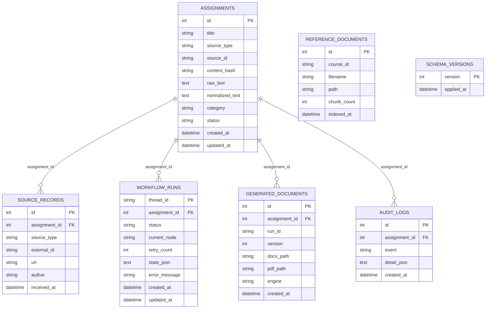

# 07 — Database and API

## 1. API reality check

There is **no HTTP API**. This is a single-process desktop application:

- the UI calls Python services directly through Qt signals and method calls;
- the workflow calls services and repositories in-process;
- the only network APIs are outbound calls to Google (OAuth/Classroom/Gmail/Drive) and Gemini.

Therefore this document describes:

1. the **internal contracts** that behave like an API between layers;
2. the **database schema** and repositories;
3. the **Qt signal contracts** between pages and the main window.

## 2. Internal "API" surfaces

### 2.1 UI → workflow

| Signal | Payload | Emitted by | Consumed by |
|---|---|---|---|
| `start_generation` | `RawInput`, `str` category | `InputPage` | `MainWindow._on_start_generation` |
| `review_decided` | `HumanDecision` | `ReviewPage` | `MainWindow._on_review_decision` |
| `open_input` | `str` tab name | `HomePage` | `MainWindow._on_home_navigate_input` |
| `open_course` | `str` course id | `HomePage`/`CourseCard` | `MainWindow._on_open_course` |
| `open_settings` | — | `HomePage` | `MainWindow._on_open_settings` |
| `open_history` | — | `HomePage` | `MainWindow._on_open_history` |

### 2.2 Workflow worker → UI

| Signal | Payload | Meaning |
|---|---|---|
| `progress_signal` | `(node_name, message)` | A node finished or a resume started |
| `interrupt_signal` | `(interrupt_type, payload)` | `missing_info` or `human_review` |
| `finished_signal` | `final_state: dict` | Workflow completed; contains `docx_path`/`pdf_path` |
| `error_signal` | `str` | Unhandled workflow exception |

### 2.3 Workflow state contract

`WorkflowState` (`workflow/state.py:6-27`) is a `TypedDict` with `total=False`:

| Key | Type | Set by |
|---|---|---|
| `assignment_id` | `int` | worker / CLI |
| `thread_id` | `str` | worker / CLI |
| `raw_input` | `dict` | worker / CLI |
| `normalized_input` | `dict` | `normalize` |
| `category` | `str` | `classify` |
| `category_config` | `dict` | `load_config` |
| `missing_info` | `dict` | `check_missing_info` |
| `user_provided_data` | `dict` | `check_missing_info` after resume |
| `references` | `list[dict]` | currently unused by nodes |
| `retrieved_chunks` | `list[str]` | `retrieve_references` |
| `report` | `dict` | `generate_content` / `regenerate_failed` |
| `evaluation` | `dict` | `evaluate_output` |
| `retry_count` | `int` | `regenerate_failed` |
| `max_retries` | `int` | initial state |
| `failed_sections` | `list[str]` | `evaluate_output` |
| `human_decision` | `dict` | `human_review` |
| `status` | `str` | nodes |
| `node_history` | `list[str]` | every node |
| `errors` | `list[str]` | declared, not populated |
| `docx_path` | `str` | `export` |
| `pdf_path` | `str` | `export` |

### 2.4 Domain contracts

#### `RawInput`

`models/assignment.py:27-35`

```text
source_type: SourceType = manual
title: str = ""
raw_text: str = ""
file_path: str | None = None
course_name: str | None = None
due_date: str | None = None
external_id: str | None = None
metadata: dict[str, Any] = {}
```

#### `NormalizedInput`

`models/assignment.py:38-47`

```text
title: str
cleaned_text: str
source_type: SourceType
content_hash: str
course_name: str | None
due_date: str | None
attachments: list[str]
metadata: dict[str, Any]
created_at: datetime
```

#### `ReportContent`

`models/report.py:70-94`

```text
title: str
course: str = ""
author: str = ""
date: str = ""
institution: str = ""
abstract: str = ""
sections: list[SectionDraft]
references: list[Citation]
appendix: str = ""
metadata: dict[str, Any]
front_page: FrontPage | None
document_type: str = "assignment"
include_toc: bool = True
created_at: datetime
```

#### `HumanDecision`

`models/evaluation.py:47-52`

```text
decision: DecisionType  # approve | edit | regenerate | reject
feedback: str = ""
edited_sections: dict[str, str]
regenerate_sections: list[str]
approved_at: str | None
```

#### `EvaluationResult`

`models/evaluation.py:36-44`

```text
overall_passed: bool
deterministic_passed: bool
semantic_passed: bool
overall_score: float  # 0..1
deterministic_findings: list[DeterministicFinding]
section_evaluations: list[SectionEvaluation]
failed_sections: list[str]
general_feedback: str
```

## 3. Database

### 3.1 Engine and pragmas

`database/db.py:22-45`:

- SQLite file: `storage/academic_ai.db`.
- `create_engine(sqlite:///..., connect_args={"check_same_thread": False})`.
- On connect: `journal_mode=WAL`, `synchronous=NORMAL`, `foreign_keys=ON`.
- `init_db()` runs `SQLModel.metadata.create_all(engine)` then `run_migrations(engine)`
  (`:48-54`).
- `get_session(engine=None)` returns a SQLModel `Session` (`:57-59`).

### 3.2 Tables and relationships



`REFERENCE_DOCUMENTS` and `SCHEMA_VERSIONS` have no foreign keys.

### 3.3 Table purposes

| Table | Purpose | Used on normal path? |
|---|---|---|
| `assignments` | One row per assignment/run; title, source, raw/normalized text, category, status. | Yes |
| `source_records` | External provenance (Classroom/Gmail IDs, URL, author). | No repository; not written |
| `workflow_runs` | Durable run metadata/state mirror. | Repository exists; not used by workflow nodes |
| `generated_documents` | DOCX/PDF artifact paths per assignment/version/run. | Yes (`persist_node`) |
| `reference_documents` | RAG source file index metadata. | Yes (`scripts/index_reference.py`) |
| `audit_logs` | Event audit trail. | Yes (`persist_node`) |
| `schema_versions` | Migration version bookkeeping. | Yes (`run_migrations`) |

### 3.4 Repositories

`database/repositories.py`:

- `AssignmentRepository`
  - `create(...)`
  - `get_by_id(...)`
  - `get_by_hash(...)` — unused on the normal path
  - `list_all(limit=50)`
  - `update_status(...)`
- `WorkflowRunRepository`
  - `save_or_update(...)`
  - `get_by_thread_id(...)`
  - `list_by_assignment(...)`
- `DocumentRepository`
  - `create(...)`
  - `list_by_assignment(...)`
- `AuditLogRepository`
  - `log(...)`
  - `list_logs(...)`

Repositories commit inside methods. There is no unit-of-work transaction spanning multiple
repositories; `persist_node` performs three separate commits.

### 3.5 Migrations

`database/migrations.py`:

- `CURRENT_SCHEMA_VERSION = 1`.
- On a fresh DB, inserts version 1.
- On an older version, updates the version row and logs; no actual DDL migration steps exist yet.

This is a placeholder, not a migration framework. Schema changes require manual handling or a future
migration implementation.

### 3.6 Checkpoints

`workflow/checkpointer.py` creates a separate SQLite database:
`storage/workflow_checkpoints.db`, using `SqliteSaver` from `langgraph-checkpoint-sqlite`.

- One connection per `get_checkpointer()` call.
- `check_same_thread=False`.
- The graph is compiled with this checkpointer (`workflow/graph.py:77-78`).
- This is what makes `interrupt`/resume and crash recovery work.

## 4. Filesystem storage

| Path | Contents | Written by |
|---|---|---|
| `storage/academic_ai.db` | Main SQLite DB | `database/db.py` |
| `storage/workflow_checkpoints.db` | LangGraph checkpoints | `workflow/checkpointer.py` |
| `storage/outputs/<assignment_id>/v1/report.docx` | Generated DOCX | `DocxGenerator` |
| `storage/outputs/<assignment_id>/v1/report.tex` | Generated LaTeX source | `PdfExporter` |
| `storage/outputs/<assignment_id>/v1/report.pdf` | Compiled PDF (if any engine works) | `PdfExporter` |
| `storage/outputs/<assignment_id>/v1/metadata.json` | Artifact metadata | `PdfExporter` |
| `storage/inputs/gmail/` | Downloaded Gmail attachments | `integrations/gmail/client.py` |
| `storage/rag/` | ChromaDB persistence | `RagRetriever` |
| `storage/credentials/google_token.json` | OAuth token file fallback | `integrations/google_auth.py` |
| `storage/logs/app.log` | Rotating log | `app/logging_config.py` |
| `storage/references/` | Reference files (empty except `.gitkeep`) | operator |

All of these contents are gitignored except placeholder files.

## 5. API-like endpoint equivalent table

Since there are no HTTP endpoints, this table maps the conceptual operations to their Python entry
points.

| Conceptual operation | Python entry point | Input | Output |
|---|---|---|---|
| List courses | `integrations.classroom.client.list_courses(service)` | Google service | `list[dict]` |
| List coursework | `list_coursework(service, course_id)` | service, course id | `list[dict]` |
| List materials | `list_coursework_materials(service, course_id)` | service, course id | `list[dict]` |
| Download Drive file | `download_drive_file(file_id, dest)` | id, path | `bool` |
| Search Gmail | `search_messages(service, query)` | service, query | `list[dict]` |
| Read Gmail message | `get_message_content_and_attachments(service, id)` | service, id | `dict` |
| Parse a file | `parse_file(path)` | path | `ParsedDocument` |
| Normalize input | `normalize_input(raw)` | `RawInput` | `NormalizedInput` |
| Classify | `Classifier.classify(normalized, manual_category)` | `NormalizedInput` | `ClassificationResult` |
| Load category | `load_category_config(category)` | category | `CategoryConfig` |
| Generate report | `SectionGenerator.generate_full_report(...)` | config, normalized, chunks | `ReportContent` |
| Evaluate report | `Evaluator.evaluate_semantic(config, report)` | config, report | `EvaluationResult` |
| Retrieve context | `RagRetriever.retrieve(course, query)` | course, query | `list[str]` |
| Export DOCX | `DocxGenerator.generate(report, config, id)` | report, config | `Path` |
| Export PDF | `PdfExporter.export(report, docx_path, id)` | report, docx path | `Path | None` |
| Persist results | `persist_node(state)` | workflow state | state update |
| List history | `DocumentRepository.list_by_assignment(id)` | assignment id | `list[GeneratedDocumentTable]` |

## 6. Request/response examples (internal)

### Start a run

```python
raw = RawInput(
    source_type=SourceType.MANUAL,
    title="RC Circuit Analysis",
    raw_text="Derive the time constant and analyze the step response.",
    course_name="Physics 201",
)
# MainWindow receives:
start_generation.emit(raw, "assignment")
```

### Human decision

```python
HumanDecision(
    decision=DecisionType.EDIT,
    edited_sections={"Introduction": "Revised introduction text..."},
)
```

### Evaluation result (shape)

```json
{
  "overall_passed": false,
  "deterministic_passed": true,
  "semantic_passed": false,
  "overall_score": 0.55,
  "deterministic_findings": [],
  "section_evaluations": [
    {
      "section_heading": "Discussion",
      "scores": [{"criterion_id": "clarity", "score": 0.6, "comments": "..."}],
      "passed": false,
      "issues": ["..."],
      "suggestions": ["..."]
    }
  ],
  "failed_sections": ["Discussion"],
  "general_feedback": "Issues detected in: Discussion"
}
```

## 7. Database/API issues and risks

1. **Unused tables/repositories:** `source_records`, `workflow_runs`, and `WorkflowRunRepository` are
   not used by the workflow; `WorkflowRunRecord` in `models/workflow.py` is also unused.
2. **No deduplication:** `AssignmentRepository.get_by_hash` exists but is never called before
   creating a new assignment.
3. **Separate commits:** `persist_node` writes assignment, document, and audit rows in three
   independent transactions. A failure after the document insert can leave partial history.
4. **No schema migrations:** `run_migrations` only updates a version number.
5. **Versioning is fixed:** `export_node` always uses version 1, so repeated exports overwrite.
6. **No pagination on history:** `HistoryPage.refresh` selects all generated documents without a
   limit (`app/ui/pages/history_page.py:69`).
7. **Silent DB failures in UI:** `HomePage.refresh_recent` and `HistoryPage.refresh` catch all
   exceptions and render empty tables.
8. **No encryption at rest:** SQLite and token files are plaintext on disk (token file mode 0600
   where supported).
9. **No foreign-key cascade rules:** deleting an assignment would leave orphan rows unless handled
   manually.
10. **No API versioning/contract tests:** the Pydantic models are the contract, but there is no
    schema snapshot test.
