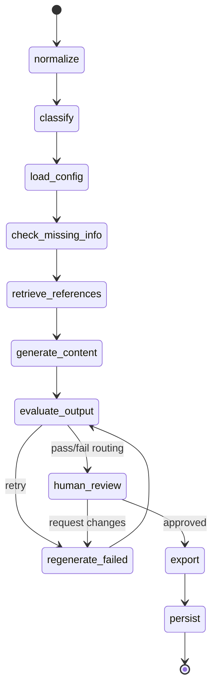
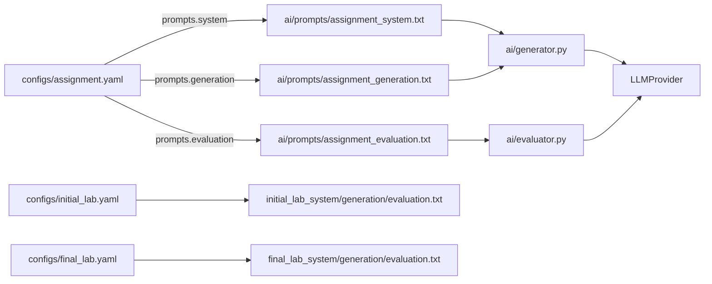
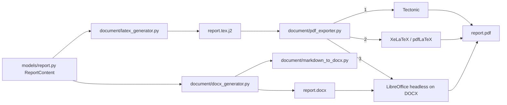

# 04 — File Dependency Map

> Read-only. This map combines **VERIFIED** code/import inspection with **Graphify-derived** edges. Graphify is the canonical machine graph (`docs/project_audit/graphify/`); the Mermaid diagrams below are a human-readable supplement.

## 1. Layer-level dependency (VERIFIED, high level)

```mermaid
flowchart TB
    subgraph Entry
        MAIN[app/main.py]
        MW[app/ui/main_window.py]
    end
    subgraph UI
        PAGES[app/ui/pages/*]
        WIDGETS[app/ui/widgets/*]
        WORKERS[app/ui/workers.py]
        QSS[app/ui/styles.qss]
    end
    subgraph Workflow
        GRAPH[workflow/graph.py]
        NODES[workflow/nodes.py]
        ROUTING[workflow/routing.py]
        STATE[workflow/state.py]
        CKPT[workflow/checkpointer.py]
    end
    subgraph AI
        CLASSIFIER[ai/classifier.py]
        GENERATOR[ai/generator.py]
        EVALUATOR[ai/evaluator.py]
        CALC[ai/calculations.py]
        SECURITY[ai/security.py]
        RETRIEVER[ai/retriever.py]
        FACTORY[ai/llm/factory.py]
        PROVIDERS[ai/llm/base|nvidia|mock|gemini]
    end
    subgraph Rules
        YAML[configs/*.yaml]
        SCHEMA[configs/schema.py]
        PROMPTS[ai/prompts/*.txt]
    end
    subgraph Document
        LATEXGEN[document/latex_generator.py]
        TEX[document/templates/latex/report.tex.j2]
        DOCXGEN[document/docx_generator.py]
        PDFEXP[document/pdf_exporter.py]
        MD2DOCX[document/markdown_to_docx.py]
    end
    subgraph Data
        MODELS[models/*]
        DB[database/*]
    end
    subgraph Integrations
        PARSER[integrations/file_parser/*]
        NORMALIZER[integrations/normalizer.py]
        GOOGLE[integrations/google_auth.py]
        CLASSROOM[integrations/classroom/client.py]
        GMAIL[integrations/gmail/client.py]
    end
    subgraph Config
        SETTINGS[app/settings.py]
        PREFS[app/preferences.py]
    end

    MAIN --> MW
    MW --> PAGES
    MW --> WIDGETS
    PAGES --> WORKERS
    WORKERS --> GRAPH
    WORKERS --> FACTORY
    WORKERS --> DB
    PAGES --> PARSER
    PAGES --> NORMALIZER
    GRAPH --> NODES
    GRAPH --> ROUTING
    GRAPH --> STATE
    GRAPH --> CKPT
    NODES --> CLASSIFIER
    NODES --> GENERATOR
    NODES --> EVALUATOR
    NODES --> RETRIEVER
    NODES --> CALC
    NODES --> YAML
    NODES --> SCHEMA
    NODES --> LATEXGEN
    NODES --> DOCXGEN
    NODES --> PDFEXP
    NODES --> DB
    CLASSIFIER --> SECURITY
    GENERATOR --> SECURITY
    GENERATOR --> PROMPTS
    EVALUATOR --> PROMPTS
    FACTORY --> PROVIDERS
    FACTORY --> SETTINGS
    LATEXGEN --> TEX
    DOCXGEN --> MD2DOCX
    PDFEXP --> LATEXGEN
    PDFEXP --> DOCXGEN
    CLASSROOM --> GOOGLE
    GMAIL --> GOOGLE
    GOOGLE --> SETTINGS
    CKPT --> SETTINGS
    DB --> SETTINGS
    MW --> PREFS
```

## 2. Workflow state machine (VERIFIED from `workflow/graph.py`)



- 11 nodes: `normalize`, `classify`, `load_config`, `check_missing_info`, `retrieve_references`, `generate_content`, `evaluate_output`, `regenerate_failed`, `human_review`, `export`, `persist`.
- Two conditional edges: after `evaluate_output` (`route_after_evaluation`) and after `human_review` (`route_after_human_review`).
- `regenerate_failed` loops back into `evaluate_output` (bounded retry).
- Compiled with a SQLite checkpointer (`workflow/checkpointer.py`).

## 3. Prompt/config binding (VERIFIED)



## 4. Export pipeline (VERIFIED)



## 5. Verified subsystem dependencies

| Module | Depends on (verified) | Depended on by |
|---|---|---|
| `app/main.py` | `app/ui/main_window.py` (GUI), `app/settings.py` | packaging/entry point |
| `app/ui/main_window.py` | `app/ui/pages/*`, `app/ui/widgets/*`, `app/preferences.py`, `app/settings.py` | `app/main.py` |
| `app/ui/workers.py` | `ai/llm/factory.py`, `workflow/graph.py`, `database/repositories.py` | `app/ui/pages/*` |
| `workflow/graph.py` | `workflow/nodes.py`, `workflow/routing.py`, `workflow/state.py`, `workflow/checkpointer.py`, `ai/llm/base.py`, `ai/llm/mock.py` | `app/ui/workers.py` |
| `workflow/nodes.py` | `ai/classifier.py`, `ai/generator.py`, `ai/evaluator.py`, `ai/retriever.py`, `ai/calculations.py`, `configs/schema.py`, `document/pdf_exporter.py`, `document/docx_generator.py`, `database/repositories.py`, `models/*` | `workflow/graph.py` |
| `workflow/routing.py` | `workflow/state.py` | `workflow/graph.py` |
| `workflow/state.py` | `models/*`, `configs/schema.py` | `workflow/*` |
| `workflow/checkpointer.py` | `langgraph-checkpoint-sqlite`, `app/settings.py` | `workflow/graph.py` |
| `ai/classifier.py` | `ai/llm/base.py`, `ai/security.py`, `models/*` | `workflow/nodes.py` |
| `ai/generator.py` | `ai/llm/base.py`, `ai/security.py`, `configs/schema.py`, `models/report.py`, `jinja2` | `workflow/nodes.py` |
| `ai/evaluator.py` | `ai/llm/base.py`, `configs/schema.py`, `models/evaluation.py`, `models/report.py` | `workflow/nodes.py` |
| `ai/retriever.py` | `chromadb` (optional), `app/settings.py` | `workflow/nodes.py` |
| `ai/llm/factory.py` | `ai/llm/base.py`, `app/settings.py`, lazy `ai/llm/mock.py` / `ai/llm/nvidia.py` | `app/ui/workers.py` |
| `ai/llm/nvidia.py` | `openai`, `ai/llm/base.py`, `app/settings.py`, `models/*` | `ai/llm/factory.py` |
| `ai/llm/mock.py` | `ai/llm/base.py` | `ai/llm/factory.py`, `workflow/graph.py` |
| `ai/llm/gemini.py` | `google-genai`, `ai/llm/base.py` | **nothing** (legacy, not in factory) |
| `document/latex_generator.py` | `jinja2`, `document/latex_escape.py`, `document/templates/latex/report.tex.j2`, `models/report.py` | `document/pdf_exporter.py` |
| `document/docx_generator.py` | `python-docx`, `document/markdown_to_docx.py`, `models/report.py`, `configs/schema.py` | `document/pdf_exporter.py`, `workflow/nodes.py` |
| `document/pdf_exporter.py` | `document/latex_generator.py`, `document/docx_generator.py`, `app/settings.py` | `workflow/nodes.py` |
| `database/*` | `sqlmodel`, `app/settings.py` | `app/ui/workers.py`, `workflow/nodes.py` |
| `integrations/file_parser/*` | `pymupdf`, `python-docx`, `pytesseract`, `pillow` | `app/ui/pages/*`, `integrations/normalizer.py` |
| `integrations/google_auth.py` | `google-auth-oauthlib`, `google-api-python-client`, `app/settings.py` | `integrations/classroom/client.py`, `integrations/gmail/client.py` |
| `integrations/classroom/client.py` | `google-api-python-client`, `integrations/google_auth.py` | `app/ui/pages/*` (course import) |
| `integrations/gmail/client.py` | `google-api-python-client`, `integrations/google_auth.py` | `app/ui/pages/*` (assignment import) |
| `app/settings.py` | `pydantic-settings`, `.env` | nearly every subsystem |

## 6. Configuration and environment dependencies

| Consumer | Environment / config keys (verified in `.env.example` / `app/settings.py`) |
|---|---|
| `ai/llm/factory.py` | `NVIDIA_API_KEY` (empty → Mock) |
| `ai/llm/nvidia.py` | `NVIDIA_MODEL`, `NVIDIA_FALLBACK_MODEL`, `NVIDIA_BASE_URL`, `NVIDIA_TIMEOUT_SECONDS`, embedding model/key |
| `ai/llm/gemini.py` (legacy) | `GOOGLE_API_KEY`, `GEMINI_MODEL` |
| `document/pdf_exporter.py` | `PDF_ENGINE`, `PDF_FALLBACK_ENGINE`, `TECTONIC_PATH`, `XELATEX_PATH`, `LIBREOFFICE_PATH` |
| `workflow/checkpointer.py` | `STORAGE_DIR` (checkpoint DB) |
| `database/*` | `STORAGE_DIR` (`academic_ai.db`) |
| `integrations/google_auth.py` | `credentials.json`, `token.json`, OAuth scopes |
| `app/settings.py` | all of the above + `LOG_LEVEL` |

## 7. Third-party dependency map (`pyproject.toml`, VERIFIED)

| Dependency | Used by |
|---|---|
| `pyside6` | `app/ui/*` |
| `langgraph`, `langgraph-checkpoint-sqlite` | `workflow/*` |
| `pydantic`, `pydantic-settings` | `models/*`, `configs/schema.py`, `app/settings.py` |
| `sqlmodel` | `database/*` |
| `openai` | `ai/llm/nvidia.py` (NVIDIA NIM is OpenAI-compatible) |
| `google-genai` | `ai/llm/gemini.py` (legacy) |
| `pymupdf` | `integrations/file_parser/pdf.py`, `ocr.py` |
| `python-docx` | `integrations/file_parser/docx.py`, `document/docx_generator.py`, `document/markdown_to_docx.py` |
| `pyyaml` | `configs/schema.py` |
| `jinja2` | `ai/generator.py`, `ai/evaluator.py`, `document/latex_generator.py` |
| `tenacity` | retry logic (provider/API calls) |
| `keyring` | `app/preferences.py` / credential storage |
| `pytesseract`, `pillow` | `integrations/file_parser/ocr.py` |
| `markdown` | DOCX/Markdown conversion |
| `google-api-python-client`, `google-auth-oauthlib`, `google-auth-httplib2` (optional `google`) | `integrations/google_auth.py`, Classroom, Gmail |
| `chromadb` (optional `rag`) | `ai/retriever.py` |
| `pytest*`, `ruff`, `mypy`, `pyinstaller` (dev) | tests, lint, packaging |

External binaries (not Python packages): **Tectonic**, **XeLaTeX/pdflatex**, **LibreOffice**, **Tesseract**.

## 8. Orphans, unused files, and dead hooks (VERIFIED)

| File | Status | Evidence |
|---|---|---|
| `ai/llm/gemini.py` | Not referenced by factory | `ai/llm/factory.py:7-16` |
| `document/templates/academic_base.docx` | Unused, 0 bytes | `DocxGenerator` never loads `template_path` |
| `document/templates/latex/references.bib.j2` | Unused, 0 bytes | No code reference; manual `thebibliography` |
| `names.java`, `names1.java` | Duplicate, misnamed prompt text | Byte-identical; no runtime reference |
| `ai/__init__.py`, `ai/llm/__init__.py` | No symbols | Graphify AST extraction found none |
| `tests/**/.gitkeep` | Placeholder only | Empty fixture dirs |

## 9. Graphify dependency summary (machine-derived)

- **1153 nodes, 2664 edges, 79 communities.**
- **0 import cycles**; health check passed except **2 self-loop edges**.
- **23 isolated nodes** (likely docs/assets/templates with no semantic edge).
- **21 thin communities** (small doc/asset clusters).
- 89% of relationships EXTRACTED, 11% INFERRED (avg confidence 0.9), 0% AMBIGUOUS.
- Top hubs (degree): `MockProvider` 42, `ReportContent` 42, `LLMProvider` 39, `NvidiaProvider` 30, `HomePage` 28, `SectionGenerator` 28, `DocxGenerator` 28, `Citation` 28, `MainWindow` 27, `Evaluator` 24.

See `06_GRAPHIFY_PROJECT_KNOWLEDGE_GRAPH.md` for the full report and limitations.
