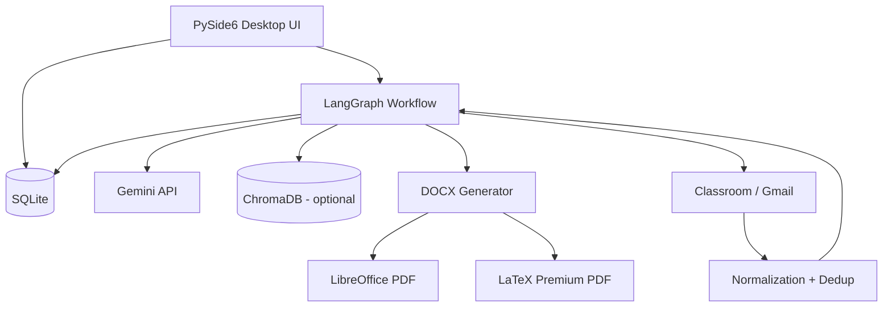
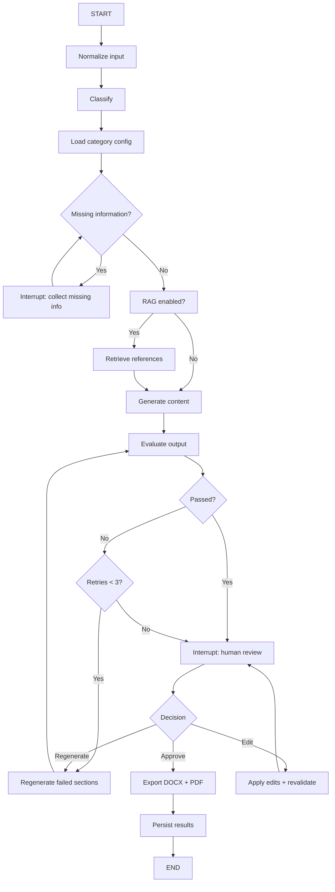

# AI-Powered Academic Document Preparation System — Implementation Plan

Status: Draft for review  
Last updated: 2026-11-21

---

## 1. Executive summary

Build a **local-first, cross-platform desktop application** that:

1. Collects assignments from manual text, local files, Google Classroom, and Gmail.
2. Normalizes and classifies them into **Assignment**, **Initial Lab**, or **Final Lab**.
3. Loads category-specific rules, templates, and prompts from YAML.
4. Generates structured academic content with **Google Gemini**.
5. Validates output with **deterministic Python checks + a separate Gemini evaluator**.
6. Retries only failed sections (maximum 3 attempts).
7. Requires **mandatory human review and approval**.
8. Exports a polished **DOCX** and a **high-quality PDF**.
9. Stores assignments, workflow state, and documents locally in SQLite.

The first full build includes Google integrations and optional RAG. The DOCX is the canonical editable artifact; PDF is a rendering of the same structured report.

---

## 2. Locked decisions

| Area | Decision | Rationale |
|---|---|---|
| Scope | Full system: MVP + Google + RAG | User selected full system |
| LLM | Google Gemini, `gemini-3.1-pro-preview` (quality target) with `gemini-3.5-flash` fallback (configurable) | User has Gemini Pro; `gemini-2.5-pro` is not available to new API users |
| Platform | Cross-platform (Linux + Windows) | User selected cross-platform |
| Python | `uv`-managed Python 3.12 venv | Reproducible, matches spec |
| Documents | Built-in academic DOCX template + override hook | Clean default, flexible later |
| Language | English only | User selected English |
| Google | Integration behind interfaces, setup guide, mocked tests | Credentials not yet created |
| PDF default | LibreOffice headless | Preserves DOCX fidelity, already installed |
| PDF premium | LaTeX (optional, user-selectable) | Best typography, math, and native TOC |
| Persistence | SQLite + SQLModel, LangGraph SQLite checkpoints | Local-first, crash recovery |
| Human approval | Mandatory before export | Safety and academic integrity |

---

## 3. Goals and non-goals

### Goals

- Reliable end-to-end workflow from assignment input to approved DOCX/PDF.
- Clear separation between generation, evaluation, and human approval.
- Strong guardrails against hallucination, fabricated data, and prompt injection.
- Deterministic behavior where Python is sufficient; LLM only where language understanding is required.
- Recoverable workflow after crashes or API failures.
- Professional, consistent document formatting across platforms.

### Non-goals (for this build)

- Automatic submission to Google Classroom or email.
- Multi-user/server deployment.
- Plagiarism detection.
- Real-time collaboration.
- Generating content in languages other than English.
- Fully automatic approval without human review.

---

## 4. Architecture



### Layers

1. **Presentation** — PySide6 pages, background workers, review UI.
2. **Orchestration** — LangGraph state machine, routing, retries, interrupts.
3. **Intelligence** — Gemini provider, classifier, generator, evaluator, retriever.
4. **Integration** — Google OAuth, Classroom, Gmail, file parsers, OCR.
5. **Documents** — DOCX builder, LaTeX/LibreOffice PDF exporters.
6. **Persistence** — SQLite domain tables, workflow checkpoints, audit log.

### Core design rules

- Do not use an LLM where deterministic Python is sufficient.
- Separate generation and evaluation nodes/prompts.
- Generate and regenerate sections independently.
- Keep human approval mandatory by default.
- Treat all external content as untrusted data.
- Keep the system local-first; use network only for LLM/Google when requested.
- Never embed secrets in the executable or repository.

---

## 5. Technology stack

| Layer | Technology | Purpose |
|---|---|---|
| Language | Python 3.12 | Development runtime |
| Environment | `uv` | Dependency and venv management |
| Desktop UI | PySide6 | Cross-platform desktop app |
| Orchestration | LangGraph | Stateful workflow, routing, retries, HITL |
| Checkpoints | `langgraph-checkpoint-sqlite` | Crash recovery and resume |
| LLM | `google-genai` (Gemini 3.1 Pro / 3.5 Flash fallback) | Classification, generation, evaluation, embeddings |
| Validation | Pydantic v2 | Schemas and structured output |
| Settings | `pydantic-settings` | Typed configuration |
| Database | SQLite + SQLModel | Local persistence |
| Google APIs | `google-api-python-client`, `google-auth-oauthlib` | Classroom and Gmail |
| Secrets | `keyring` + `.env` | Token and API-key storage |
| PDF parsing | PyMuPDF | Text extraction and page rendering |
| DOCX parsing | `python-docx` | Read and write Word files |
| OCR | Tesseract + `pytesseract` | Scanned PDF fallback |
| RAG | ChromaDB | Local vector store (optional extra) |
| Config | YAML + PyYAML | Category rules and prompts |
| Resilience | `tenacity` | Retry/backoff for API calls |
| Templating | Jinja2 | Prompts and LaTeX templates |
| DOCX creation | `python-docx` | Programmatic document generation |
| PDF default | LibreOffice headless | DOCX-to-PDF with high fidelity |
| PDF premium | XeLaTeX + `latexmk` | Maximum typography and math quality |
| Testing | pytest, pytest-qt, pytest-mock, pytest-cov | Unit, integration, UI |
| Quality | ruff, mypy | Lint and type checking |
| Packaging | PyInstaller | Native builds per OS |

### Dependency groups

- **Core**: UI, LangGraph, Pydantic, SQLModel, Gemini, parsing, DOCX, PDF detection.
- **`[google]`**: Google API clients.
- **`[rag]`**: ChromaDB.
- **`[dev]`**: pytest, ruff, mypy, PyInstaller.
- **LaTeX**: external TeX distribution, not a Python dependency.

---

## 6. Repository layout

```text
academic-ai/
├── app/
│   ├── main.py
│   ├── settings.py
│   └── ui/
│       ├── main_window.py
│       ├── pages/
│       │   ├── home_page.py
│       │   ├── input_page.py
│       │   ├── processing_page.py
│       │   ├── review_page.py
│       │   ├── history_page.py
│       │   └── settings_page.py
│       ├── widgets/
│       │   ├── preview.py
│       │   ├── section_editor.py
│       │   └── progress_log.py
│       ├── workers.py
│       └── styles.qss
├── integrations/
│   ├── google_auth.py
│   ├── classroom/
│   │   └── client.py
│   ├── gmail/
│   │   └── client.py
│   └── file_parser/
│       ├── base.py
│       ├── pdf.py
│       ├── docx.py
│       ├── text.py
│       └── ocr.py
├── workflow/
│   ├── graph.py
│   ├── state.py
│   ├── nodes.py
│   ├── routing.py
│   └── checkpointer.py
├── ai/
│   ├── llm/
│   │   ├── base.py
│   │   ├── gemini.py
│   │   └── mock.py
│   ├── classifier.py
│   ├── generator.py
│   ├── evaluator.py
│   ├── retriever.py
│   ├── calculations.py
│   ├── security.py
│   └── prompts/
├── configs/
│   ├── schema.py
│   ├── assignment.yaml
│   ├── initial_lab.yaml
│   └── final_lab.yaml
├── document/
│   ├── docx_generator.py
│   ├── markdown_to_docx.py
│   ├── latex_generator.py
│   ├── latex_escape.py
│   ├── pdf_exporter.py
│   └── templates/
│       ├── academic_base.docx
│       └── latex/
│           ├── report.tex.j2
│           └── references.bib.j2
├── models/
│   ├── assignment.py
│   ├── report.py
│   ├── evaluation.py
│   └── workflow.py
├── database/
│   ├── db.py
│   ├── repositories.py
│   └── migrations.py
├── storage/
│   ├── inputs/
│   ├── references/
│   ├── outputs/
│   └── rag/
├── tests/
│   ├── unit/
│   ├── integration/
│   ├── ui/
│   └── fixtures/
├── scripts/
│   ├── run.sh
│   ├── run.bat
│   └── build.py
├── pyproject.toml
├── pyinstaller.spec
├── .env.example
├── .gitignore
└── README.md
```

---

## 7. Domain model and database

### Domain models (Pydantic)

- `RawInput` — manual text, file path, Classroom item, or Gmail message.
- `NormalizedInput` — cleaned text, title, metadata, attachments, source, content hash.
- `Category` — enum: `assignment`, `initial_lab`, `final_lab`.
- `ClassificationResult` — category, confidence, rationale, method (rule/LLM/manual).
- `MissingInfoRequest` — questions and expected data.
- `SectionDraft` — heading, body, tables, figures, citations, word count.
- `ReportContent` — title, abstract, sections, references, metadata.
- `SectionEvaluation` — section, criteria scores, passed, issues.
- `EvaluationResult` — overall pass, deterministic findings, semantic findings.
- `HumanDecision` — approve, edit, regenerate, feedback.

### SQLite tables

| Table | Key fields |
|---|---|
| `Assignment` | id, title, source_type, source_id, content_hash, raw_text, normalized_text, category, status, timestamps |
| `SourceRecord` | assignment_id, source_type, external_id, url, author, received_at |
| `WorkflowRun` | thread_id, assignment_id, status, current_node, retry_count, state_json, timestamps |
| `GeneratedDocument` | assignment_id, run_id, version, docx_path, pdf_path, engine, created_at |
| `ReferenceDocument` | course_id, filename, path, chunk_count, indexed_at |
| `AuditLog` | assignment_id, event, detail_json, created_at |
| `SchemaVersion` | version, applied_at |

### Database rules

- WAL mode enabled.
- One connection per thread.
- Single-writer discipline for application tables.
- LangGraph checkpoints use their own tables in the same file.
- Idempotent `create_all` plus lightweight migrations tracked in `SchemaVersion`.
- Automatic backup of the database before migrations.

---

## 8. Configuration system

Each category has a validated YAML file. Configuration is loaded at startup and cached.

```yaml
category: initial_lab
display_name: Initial Lab

required_sections:
  - title
  - objective
  - apparatus
  - procedure
  - observations
  - calculations
  - results
  - discussion
  - conclusion
  - references

word_limits:
  total: { min: 1200, max: 2500 }
  sections:
    objective: { min: 80, max: 200 }
    discussion: { min: 200, max: 600 }

formatting:
  font: "Liberation Serif"
  font_size: 11
  line_spacing: 1.15
  margins_inches: { top: 1.0, bottom: 1.0, left: 1.0, right: 1.0 }
  citation_style: "IEEE"
  heading_numbering: true

prompts:
  system: "prompts/initial_lab_system.txt"
  generation: "prompts/initial_lab_generation.txt"
  evaluation: "prompts/initial_lab_evaluation.txt"

rubric:
  - id: clarity
    weight: 0.2
    description: "Writing is clear and logically organized."
  - id: accuracy
    weight: 0.3
    description: "Claims are consistent with supplied data and references."
  - id: completeness
    weight: 0.3
    description: "All required sections and elements are present."
  - id: formatting
    weight: 0.2
    description: "Document follows required structure and style."

rag:
  enabled: false
  collections: []

references:
  required: true
  min_count: 3
```

Validation rules:

- Every required section must have a heading and word limits.
- Rubric weights must sum to 1.0.
- Prompt files must exist.
- Unknown keys are rejected.
- All three category configs are validated at startup; failures block the app with a clear error.

---

## 9. LangGraph workflow



### State

`WorkflowState` holds:

- `assignment_id`, `thread_id`
- `raw_input`, `normalized_input`
- `category`, `category_config`
- `missing_info`, `user_provided_data`
- `references`, `retrieved_chunks`
- `report`, `evaluation`
- `retry_count`, `max_retries`, `failed_sections`
- `human_decision`, `human_edits`
- `status`, `errors`, `node_history`

### Human-in-the-loop

- Use LangGraph `interrupt()` for missing information and final review.
- Persist state with `SqliteSaver` after each node.
- UI resumes with `Command(resume=payload)`.
- One thread per assignment run; history can reopen completed runs.
- If the app crashes, the last checkpoint is recoverable.

### Retry policy

- Maximum 3 regeneration attempts per section.
- Only failed sections are regenerated.
- Evaluator feedback and previous draft are included in the regeneration prompt.
- API errors use exponential backoff and do not consume a content retry.
- After 3 failures, the run proceeds to human review with explicit warnings.

---

## 10. AI layer

### Provider abstraction

```python
class LLMProvider(Protocol):
    def generate_structured(self, schema, system, user, **kwargs): ...
    def generate_text(self, system, user, **kwargs): ...
    def embed(self, texts: list[str]) -> list[list[float]]: ...
```

Implementations:

- `GeminiProvider` — default, uses `google-genai` with JSON schema output.
- `MockProvider` — deterministic responses for tests.
- Future: OpenAI-compatible provider.

### Gemini configuration

- Primary model: `gemini-3.1-pro-preview` for classification, generation, and evaluation.
- Fallback model: `gemini-3.5-flash` when the primary model is unavailable or the project has no Pro quota.
- `gemini-2.5-pro` is listed by the API but returns 404 for new users; do not rely on it.
- Model availability and quota are checked at startup; the resolved model is cached for the session.
- Embeddings: `gemini-embedding-001`.
- Temperature: low for evaluation (0.0–0.2), moderate for generation (0.4–0.7).
- Structured output via `response_mime_type="application/json"` and `response_schema`.
- Token limits and per-call timeouts configured in settings.
- Content-hash cache for repeated prompts to reduce cost.

### Classification

1. Rule-based scoring using keywords, regex, and source metadata.
2. If confidence is below threshold, call Gemini with `ClassificationResult`.
3. If still ambiguous, ask the user to choose.
4. Always allow manual override.

### Generation

- Section-by-section generation using Pydantic schemas.
- Context includes assignment text, category rules, retrieved references, and already-generated sections.
- Constrained Markdown subset for body content.
- Unknown experimental data must be represented as `[[MISSING: description]]`, never invented.
- Numeric calculations are performed by `ai/calculations.py` using a safe AST evaluator; results are supplied to the LLM.
- Citations may only reference supplied or retrieved sources.
- Prompts explicitly prohibit fabricating data, references, and results.

### Evaluation

**Deterministic checks (Python):**

- Required sections present and in order.
- Word count within limits.
- Citation keys exist.
- No unresolved placeholders unless allowed.
- Arithmetic consistency.
- Banned phrases and obvious hallucination markers.
- Heading and table structure validity.

**Semantic evaluation (Gemini):**

- Separate evaluator prompt and node.
- Rubric-based per-section scoring.
- Returns pass/fail and actionable issues.
- Does not see the generator's internal reasoning.
- Overall pass requires deterministic pass and semantic threshold.

### RAG (optional)

- ChromaDB persistent client under `storage/rag`.
- Collections per course/category.
- Chunking: approximately 800–1200 tokens with 150-token overlap.
- Gemini embeddings.
- Metadata: source file, page, course, section.
- Retrieval query built from assignment + section heading.
- Citations map back to source metadata.
- RAG is gated per category and skipped when no documents exist.
- Retrieved content is treated as untrusted data.

### Prompt-injection defense

- Wrap untrusted content in randomized delimiters.
- System prompt states that wrapped content is data, never instructions.
- Strip control characters and cap input length.
- Never execute tools or commands based on document content.
- Enforce output schemas and run validators after generation.
- Log suspicious instruction-like content in the audit log.
- Retrieved RAG chunks receive the same treatment.

---

## 11. Input and integrations

### Manual input

- Raw assignment text.
- Optional title, course, due date, and user-provided data.

### Local files

- PDF via PyMuPDF.
- DOCX via `python-docx` (paragraphs and tables in order).
- TXT/Markdown with encoding detection.
- Validation: allowed extensions, maximum size (25 MB), sanitized filenames, path-traversal prevention.
- Deduplication using SHA-256 of normalized content.

### OCR fallback

- Detect PDFs with little or no extractable text.
- Render pages at 200–300 DPI with PyMuPDF.
- Run Tesseract via `pytesseract`.
- Attach OCR confidence and warn the user when quality is low.

### Google OAuth

- Installed-app desktop flow with local redirect server.
- Least-privilege scopes:
  - Classroom: courses and coursework read-only.
  - Gmail: read-only.
- Refresh token stored in the OS keyring.
- Encrypted-file fallback if keyring is unavailable.
- `credentials.json` is never committed.
- Clear error messages for consent, permission, and quota failures.

### Google Classroom

- List active courses.
- Fetch coursework and materials.
- Download attachments.
- Map external IDs to `SourceRecord` for deduplication.
- If access fails, offer manual upload.

### Gmail

- Search using sender, subject, date, and attachment filters.
- Download supported attachments.
- Deduplicate by message ID and attachment hash.
- Ask the user to confirm ambiguous matches.

---

## 12. Document generation and PDF strategy

### DOCX (canonical artifact)

- Built-in academic template with:
  - Title page: course, title, author, date, institution.
  - Table of contents field.
  - Heading styles 1–3.
  - Body text, lists, tables, figures, captions.
  - References and appendix.
  - Header/footer with page numbers.
- Named styles only; no direct formatting.
- Configurable font, size, margins, spacing, and citation style.
- Constrained Markdown to DOCX converter.
- Tables via `python-docx` table styles.
- Images embedded at high resolution; charts preferred as vector where possible.
- Simple equations as formatted text initially; complex equations may be rendered as images.
- Template override: replace `document/templates/academic_base.docx`.

### PDF default: LibreOffice headless

Why: preserves DOCX layout, is cross-platform, and is already available.

Quality configuration:

- Export PDF/A-2b where possible.
- Tagged PDF and bookmarks enabled.
- Embedded fonts.
- No image downsampling; maximum image resolution 600 DPI.
- Document metadata populated.
- Update TOC and fields via a UNO script before export, because headless conversion does not reliably refresh page numbers.
- Detect the LibreOffice binary on Linux, macOS, and Windows.
- Run with a timeout and capture stderr.
- Validate output with `pypdf` (text extraction) and optional `veraPDF` (PDF/A).

### PDF premium: LaTeX (optional, recommended for math-heavy reports)

LaTeX is a strong choice for maximum-quality academic PDFs, especially lab reports with equations, tables, units, and references. It is included as an **optional premium exporter**, not the default, because it requires a TeX distribution and a second template.

Pipeline:

1. Generate `.tex` from `ReportContent` using a trusted Jinja2 template.
2. Convert the constrained Markdown subset to LaTeX.
3. Escape all user and LLM text with a dedicated escaper.
4. Sanitize math to a safe command set.
5. Write references to a `.bib` file or `thebibliography`.
6. Compile with `latexmk -xelatex -interaction=nonstopmode -halt-on-error`.
7. Compile in an isolated temporary directory with a timeout.
8. Validate the PDF and copy it to versioned output storage.

Template features:

- `report` or `article` class with `fontspec` and a high-quality serif font.
- `geometry` for margins, `setspace` for spacing, `microtype` for typography.
- `booktabs`, `siunitx`, `graphicx`, `caption`, `float` for tables and figures.
- `amsmath`, `mathtools`, `unicode-math` for equations.
- `hyperref`, `cleveref` for links and cross-references.
- `biblatex` + `biber` for references, with a manual fallback.
- Native table of contents with correct page numbers.
- PDF metadata via `hyperref`.
- Optional PDF/A via `pdfx` or a Ghostscript post-process.

Security:

- Compile with `-no-shell-escape`.
- Never accept raw LaTeX from the LLM; only structured fields and sanitized math.
- Deny dangerous commands such as `\input`, `\include`, `\write`, `\openout`, `\read`, `\catcode`, `\def`, `\newcommand`, `\special`, and `\usepackage` in generated content.
- Restrict `\includegraphics` to controlled storage paths.
- Compile in a temporary sandbox directory.
- Enforce time and size limits.

Toolchain and packaging:

- Detect `xelatex` and `latexmk`.
- If LaTeX is unavailable, fall back to LibreOffice and inform the user.
- Do not bundle a full TeX distribution.
- Document installation options: TeX Live, MiKTeX, or TinyTeX.
- Optionally offer a guided TinyTeX install in the settings page.

LaTeX vs Typst:

- LaTeX has the broadest academic ecosystem and best-in-class math.
- Typst is easier to bundle (single binary), faster, and modern, but has a smaller package ecosystem.
- The exporter interface keeps both options open; LaTeX is the premium path in this plan.

### PDF exporter interface

```python
class PdfExporter(Protocol):
    def export(self, report: ReportContent, docx_path: Path, output_dir: Path) -> Path: ...
```

Implementations:

- `LibreOfficeExporter` — default, cross-platform.
- `LatexExporter` — premium quality, optional.
- `WordComExporter` — Windows + Microsoft Word only, optional.
- `WeasyPrintExporter` — fallback if LibreOffice is unavailable, optional.

### Output storage

```text
storage/outputs/<assignment_id>/<version>/
├── report.docx
├── report.pdf
├── report.tex          # when LaTeX is used
└── metadata.json
```

---

## 13. Desktop UI

### Pages

- **Home** — new assignment, recent assignments, resume interrupted runs.
- **Input** — manual text, file picker, Classroom, Gmail.
- **Processing** — live node progress, retry status, errors.
- **Review** — rendered preview, section editor, per-section regenerate, approve.
- **History** — past assignments, documents, re-export, audit trail.
- **Settings** — Gemini key/model, OAuth connection, PDF engine, RAG indexing, paths.

### Interaction rules

- Long-running work runs in a `QThread` worker.
- UI never blocks on network or LLM calls.
- Worker emits progress, interrupt, error, and completion signals.
- Interrupts open a dialog or review page and resume the graph with `Command`.
- Destructive actions require confirmation.
- Unsaved edits are protected.
- High-DPI support and consistent styling via QSS.

### Threading and database

- One SQLite connection per thread.
- Writes serialized through a repository layer.
- No UI access from worker threads.
- Graceful shutdown waits for active jobs or checkpoints state.

---

## 14. Security and guardrails

- API keys via environment variables or keyring; never committed or embedded.
- OAuth tokens in keyring with encrypted-file fallback.
- `.env` and `credentials.json` excluded from version control.
- Least-privilege Google scopes.
- Untrusted content cannot alter system prompts, invoke tools, or bypass validation.
- Safe arithmetic AST only; no `eval` or `exec` of model output.
- LibreOffice and LaTeX invoked with fixed arguments and no shell.
- Filename sanitization and path-traversal prevention.
- Size and type limits for uploads.
- Log redaction for secrets and tokens.
- Audit log for classification overrides, approvals, exports, and suspicious content.
- Mandatory human approval before final export.

---

## 15. Testing and quality gates

### Unit tests

- Config loading and validation.
- PDF/DOCX/TXT parsers and OCR fallback.
- Classifier rules.
- Deterministic validators.
- Safe calculations.
- LaTeX escaping and math sanitization.
- DOCX generation and reopening.
- Repositories and migrations.
- Prompt-injection wrappers.

### Integration tests

- Full graph with `MockProvider`:
  - Happy path.
  - Failed evaluation and retry.
  - Maximum retries reached.
  - Human edit and approve.
  - Regenerate a single section.
  - Interrupt and resume.
- Database checkpoint recovery.
- DOCX-to-PDF conversion (skipped if LibreOffice is absent).
- LaTeX compilation (skipped if `latexmk` is absent).

### UI tests

- `pytest-qt` smoke tests for navigation, input, review, and settings.

### Google tests

- Mocked HTTP for Classroom and Gmail.
- Live OAuth tests marked and opt-in.

### Quality gates

- `ruff` clean.
- `mypy` clean for core modules.
- Target approximately 80% coverage for core logic.
- No secrets in the repository.
- All tests pass before packaging.

---

## 16. Packaging and distribution

- PyInstaller one-folder build for faster startup and easier ChromaDB bundling.
- Bundle YAML configs, prompts, DOCX template, and LaTeX templates.
- Hidden imports for Google, LangGraph, and ChromaDB.
- Lazy-load optional integrations to keep startup fast.
- Build natively on each OS; PyInstaller cannot cross-compile.
- Linux artifact tested on this machine.
- Windows build documented for a Windows host.
- External prerequisites documented:
  - LibreOffice for default PDF export.
  - TeX distribution for LaTeX PDF export.
  - Tesseract for OCR.
- Provide `scripts/run.sh`, `scripts/run.bat`, and `scripts/build.py`.
- Include version information and an application icon.

---

## 17. Delivery phases

| Phase | Deliverable | Acceptance criteria |
|---|---|---|
| 0 | Project scaffolding: uv 3.12, dependencies, settings, logging, `.gitignore`, README skeleton | `uv run` imports the app; empty test suite runs |
| 1 | Domain models, SQLModel database, repositories, migrations, YAML configs | Config and repository tests pass |
| 2 | Manual input, PDF/DOCX/TXT parsing, OCR fallback, normalization, deduplication | Parser fixture tests pass |
| 3 | Gemini provider with model fallback, classifier, section generator, deterministic + semantic evaluator, retry logic | Mocked integration tests cover pass/fail/retry |
| 4 | LangGraph graph, SQLite checkpoints, interrupts, resume, recovery | Graph path tests pass |
| 5 | DOCX generator, built-in template, LibreOffice PDF export, versioned storage | DOCX reopens correctly; PDF generated |
| 5b | LaTeX premium exporter, template, escaping, sanitization, fallback | LaTeX PDF compiles when toolchain present; fallback works |
| 6 | PySide6 UI, workers, review/edit/approve flow, history, settings | Manual end-to-end test and UI smoke tests pass |
| 7 | Google OAuth, Classroom, Gmail, setup guide, mocked tests | Mocked tests pass; live flow documented |
| 8 | ChromaDB RAG ingestion, retrieval, grounding, citations | Retrieval and grounding tests pass |
| 9 | PyInstaller spec, cross-platform docs, hardening, final QA | Linux artifact launches; Windows steps documented |

Each phase ends with tests and a short demo path.

---

## 18. Risks and mitigations

| Risk | Impact | Mitigation |
|---|---|---|
| Gemini cost and latency | Slow, expensive runs | Content-hash cache, section-level regeneration, token caps, limited concurrency |
| Gemini model/quota changes | Pro calls fail | Startup model resolution, Flash fallback, configurable model IDs |
| Structured-output failures | Invalid content | Simple schemas, JSON repair, one corrective retry |
| Hallucinated facts or references | Academic integrity | Reference grounding, citation validation, deterministic checks, human review |
| Fabricated experimental data | Serious integrity issue | `[[MISSING]]` placeholders, no invented results, user prompts |
| Incorrect arithmetic | Wrong results | Python safe AST calculations; never trust LLM arithmetic |
| Prompt injection in documents/emails | Unsafe behavior | Untrusted-content wrapping, no tool execution, validators, audit log |
| Google OAuth complexity | Integration blocked | Setup guide, mock mode, actionable errors |
| Classroom API limitations | Missing assignments | Manual upload fallback |
| Gmail search noise | Wrong assignment selected | Filters, attachment matching, user confirmation |
| Duplicate assignments | Repeated work | Content hash and external source IDs |
| OCR quality | Poor extraction | Confidence warning, editable text, manual correction |
| LibreOffice missing | No default PDF | Detect and fall back to LaTeX or WeasyPrint; clear guidance |
| LaTeX toolchain missing or large | Premium PDF unavailable | Optional install, detection, fallback to LibreOffice, TinyTeX guidance |
| LaTeX injection | Unsafe compile | Trusted templates, escaped text, sanitized math, `-no-shell-escape`, sandbox |
| DOCX/PDF divergence | Inconsistent outputs | DOCX canonical; both render from the same structured report; visual regression tests |
| PyInstaller size | Large distribution | One-folder build, optional extras, lazy imports |
| SQLite concurrency | Locked database | WAL, per-thread connections, single-writer repository |
| Crash during generation | Lost work | Checkpoints after each node, resume from UI |
| Secrets leakage | Security breach | Env/keyring, redacted logs, `.gitignore`, no embedding |

---

## 19. Prerequisites

- Gemini API key in `.env` or keyring.
- Billing enabled on the Google Cloud project for Gemini Pro API quota; otherwise the app falls back to Flash.
- Google Cloud project with Classroom API and Gmail API enabled.
- OAuth desktop client JSON (`credentials.json`).
- LibreOffice installed for default PDF export.
- TeX distribution (TeX Live, MiKTeX, or TinyTeX) for LaTeX PDF export.
- Tesseract installed for OCR of scanned PDFs.
- A Windows host for the Windows EXE build.
- Python 3.12 available through `uv`.

---

## 20. Definition of done

The full build is complete when:

1. A user can input an assignment manually or from a local file.
2. The system classifies it into one of three categories with a confidence and rationale.
3. Missing information is requested before generation when needed.
4. Content is generated section-by-section with structured schemas.
5. Deterministic and semantic evaluation run independently.
6. Failed sections are regenerated up to three times.
7. The user can review, edit, regenerate, and approve.
8. DOCX and high-quality PDF are exported and stored with version history.
9. Google Classroom and Gmail imports work with credentials and are mocked in tests.
10. Optional RAG retrieval improves grounding with citations.
11. Workflow state survives crashes and can be resumed.
12. Tests, lint, and type checks pass.
13. A packaged Linux build launches; Windows packaging steps are documented.
14. Secrets are never committed or embedded.
15. Human approval remains mandatory before final export.

---

## 21. Open items for final review

1. Confirm that LaTeX is included as the premium PDF engine in the first full build, or deferred.
2. Confirm whether equations are central enough to prioritize LaTeX over LibreOffice in the default UI.
3. Confirm the desired citation style (IEEE is the current default).
4. Confirm whether the built-in DOCX template is acceptable until a university template is provided.
5. Confirm whether RAG should be enabled by default or opt-in per category.
6. Confirm the Windows build environment and who will produce the first EXE.
7. Confirm whether billing will be enabled for Gemini Pro API quota or the app should default to Flash.
