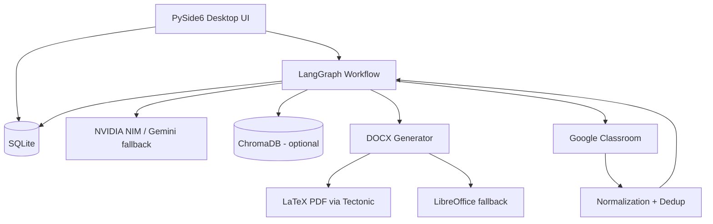
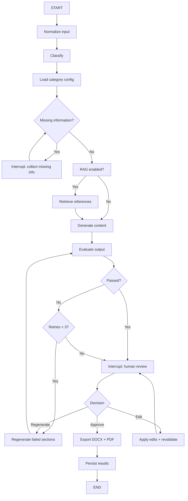

# AI-Powered Academic Document Preparation System — Implementation Plan

Status: Draft for review  
Last updated: 2026-11-21

---

## 1. Executive summary

Build a **local-first, cross-platform desktop application** that:

1. Collects assignments from Google Classroom courses the student is enrolled in.
2. Normalizes and classifies them into **Assignment**, **Initial Lab**, or **Final Lab**.
3. Loads category-specific rules, templates, and prompts from YAML.
4. Generates structured academic content with **NVIDIA Nemotron** (Gemini fallback) using the student profile, document defaults, and formatting notes.
5. Validates output with **deterministic Python checks + a separate LLM evaluator**.
6. Retries only failed sections (maximum 3 attempts) and supports feedback-driven regeneration.
7. Requires **mandatory human review and approval**.
8. Exports a polished **DOCX** and a **high-quality PDF** with a front page and optional table of contents.
9. Stores assignments, workflow state, documents, and revision history locally in SQLite.
10. Lets the student revise an exported document with written feedback.

The first full build includes Google integrations and optional RAG. The DOCX is the canonical editable artifact; PDF is a rendering of the same structured report.

---

## 2. Locked decisions

| Area | Decision | Rationale |
|---|---|---|
| Scope | Full system: MVP + Google + RAG | User selected full system |
| Primary user | Student | Production app is student-facing and reads only student data |
| LLM | NVIDIA NIM default (`nvidia/nemotron-3-ultra-550b-a55b`), Google Gemini fallback | Gemini Pro quota is exhausted quickly; Nemotron is the primary generator |
| Platform | Cross-platform (Linux + Windows) | User selected cross-platform |
| Python | `uv`-managed Python 3.12 venv | Reproducible, matches spec |
| Documents | Built-in academic DOCX template + override hook | Clean default, flexible later |
| Language | English only | User selected English |
| Google | Integration behind interfaces, setup guide, mocked tests | Credentials not yet created |
| PDF default | LaTeX via Tectonic (bundled) | Best typography, math, and native TOC; no LibreOffice required |
| PDF fallback | LibreOffice headless (optional) | DOCX-fidelity fallback if LaTeX is unavailable |
| Persistence | SQLite + SQLModel, LangGraph SQLite checkpoints | Local-first, crash recovery |
| Human approval | Mandatory before export | Safety and academic integrity |

---

## 3. Goals and non-goals

### Primary user

The production application is **student-facing**. A student signs in with their own Google account, fetches assignments from courses they are enrolled in, generates and reviews content, and exports the final document.

The app never creates courses or assignments and never requests write scopes.

### Goals

- Reliable end-to-end workflow from assignment input to approved DOCX/PDF.
- Clear separation between generation, evaluation, and human approval.
- Strong guardrails against hallucination, fabricated data, and prompt injection.
- Deterministic behavior where Python is sufficient; LLM only where language understanding is required.
- Recoverable workflow after crashes or API failures.
- Professional, consistent document formatting across platforms.

### Non-goals (for this build)

- Automatic submission to Google Classroom or email.
- Multi-user/server deployment.
- Plagiarism detection.
- Real-time collaboration.
- Generating content in languages other than English.
- Fully automatic approval without human review.

Post-approval submission to Classroom may be added later as an explicit, confirmed action. It must never happen automatically.

---

## 4. Architecture



### Layers

1. **Presentation** — PySide6 pages, background workers, review UI.
2. **Orchestration** — LangGraph state machine, routing, retries, interrupts.
3. **Intelligence** — NVIDIA NIM provider (Gemini fallback), classifier, generator, evaluator, retriever.
4. **Integration** — Google OAuth and Classroom courses/coursework.
5. **Documents** — DOCX builder, Tectonic/LaTeX PDF exporter, LibreOffice fallback.
6. **Persistence** — SQLite domain tables, workflow checkpoints, audit log.

### Core design rules

- Do not use an LLM where deterministic Python is sufficient.
- Separate generation and evaluation nodes/prompts.
- Generate and regenerate sections independently.
- Keep human approval mandatory by default.
- Treat all external content as untrusted data.
- Keep the system local-first; use network only for LLM/Google when requested.
- Never embed secrets in the executable or repository.

---

## 5. Technology stack

| Layer | Technology | Purpose |
|---|---|---|
| Language | Python 3.12 | Development runtime |
| Environment | `uv` | Dependency and venv management |
| Desktop UI | PySide6 | Cross-platform desktop app |
| Orchestration | LangGraph | Stateful workflow, routing, retries, HITL |
| Checkpoints | `langgraph-checkpoint-sqlite` | Crash recovery and resume |
| LLM | `httpx` (NVIDIA NIM default) + `google-genai` (Gemini fallback) | Classification, generation, evaluation, embeddings |
| Validation | Pydantic v2 | Schemas and structured output |
| Settings | `pydantic-settings` | Typed configuration |
| Database | SQLite + SQLModel | Local persistence |
| Google APIs | `google-api-python-client`, `google-auth-oauthlib` | Classroom courses and coursework |
| Secrets | `keyring` + `.env` | Token and API-key storage |
| RAG | ChromaDB | Local vector store (optional extra) |
| Config | YAML + PyYAML | Category rules and prompts |
| Resilience | `tenacity` | Retry/backoff for API calls |
| Templating | Jinja2 | Prompts and LaTeX templates |
| DOCX creation | `python-docx` | Programmatic document generation |
| PDF default | Tectonic (XeTeX engine) | Self-contained LaTeX, cross-platform, bundleable |
| PDF fallback | LibreOffice headless | DOCX-to-PDF fallback |
| PDF optional | System XeLaTeX + `latexmk` | Use an existing TeX installation when present |
| Testing | pytest, pytest-qt, pytest-mock, pytest-cov | Unit, integration, UI |
| Quality | ruff, mypy | Lint and type checking |
| Packaging | PyInstaller | Native builds per OS |

### Dependency groups

- **Core**: UI, LangGraph, Pydantic, SQLModel, NVIDIA NIM, Gemini fallback, parsing, DOCX, PDF detection.
- **`[google]`**: Google API clients.
- **`[rag]`**: ChromaDB.
- **`[dev]`**: pytest, ruff, mypy, PyInstaller.
- **LaTeX**: Tectonic binary bundled with the app, or an optional system TeX distribution.

---

## 6. Repository layout

```text
academic-ai/
├── app/
│   ├── main.py
│   ├── preferences.py
│   ├── settings.py
│   └── ui/
│       ├── main_window.py
│       ├── pages/
│       │   ├── home_page.py
│       │   ├── input_page.py
│       │   ├── processing_page.py
│       │   ├── review_page.py
│       │   ├── history_page.py
│       │   └── settings_page.py
│       ├── widgets/
│       │   ├── course_card.py
│       │   ├── preparation_form.py
│       │   ├── preview.py
│       │   ├── section_editor.py
│       │   └── progress_log.py
│       ├── workers.py
│       └── styles.qss
├── integrations/
│   ├── google_auth.py
│   └── classroom/
│       └── client.py
├── workflow/
│   ├── graph.py
│   ├── state.py
│   ├── nodes.py
│   ├── routing.py
│   └── checkpointer.py
├── ai/
│   ├── llm/
│   │   ├── base.py
│   │   ├── gemini.py
│   │   └── mock.py
│   ├── classifier.py
│   ├── generator.py
│   ├── evaluator.py
│   ├── retriever.py
│   ├── calculations.py
│   ├── security.py
│   └── prompts/
├── configs/
│   ├── schema.py
│   ├── assignment.yaml
│   ├── initial_lab.yaml
│   └── final_lab.yaml
├── document/
│   ├── docx_generator.py
│   ├── markdown_to_docx.py
│   ├── latex_generator.py
│   ├── latex_escape.py
│   ├── pdf_exporter.py
│   └── templates/
│       ├── academic_base.docx
│       └── latex/
│           ├── report.tex.j2
│           └── references.bib.j2
├── models/
│   ├── assignment.py
│   ├── report.py
│   ├── evaluation.py
│   └── workflow.py
├── database/
│   ├── db.py
│   ├── repositories.py
│   └── migrations.py
├── storage/
│   ├── inputs/
│   ├── references/
│   ├── outputs/
│   └── rag/
├── tests/
│   ├── unit/
│   ├── integration/
│   ├── ui/
│   └── fixtures/
├── scripts/
│   ├── run.sh
│   ├── run.bat
│   └── build.py
├── pyproject.toml
├── pyinstaller.spec
├── .env.example
├── .gitignore
└── README.md
```

---

## 7. Domain model and database

### Domain models (Pydantic)

- `RawInput` — Classroom coursework item and its teacher instructions.
- `NormalizedInput` — cleaned text, title, metadata, attachments, source, content hash.
- `Category` — enum: `assignment`, `initial_lab`, `final_lab`.
- `ClassificationResult` — category, confidence, rationale, method (rule/LLM/manual).
- `MissingInfoRequest` — questions and expected data.
- `SectionDraft` — heading, body, tables, figures, citations, word count.
- `ReportContent` — title, abstract, sections, references, front page, document type, table-of-contents flag, metadata.
- `SectionEvaluation` — section, criteria scores, passed, issues.
- `EvaluationResult` — overall pass, deterministic findings, semantic findings.
- `HumanDecision` — approve, edit, regenerate, feedback.

### SQLite tables

| Table | Key fields |
|---|---|
| `Assignment` | id, title, source_type, source_id, content_hash, raw_text, normalized_text, category, status, timestamps |
| `SourceRecord` | assignment_id, source_type, external_id, url, author, received_at |
| `WorkflowRun` | thread_id, assignment_id, status, current_node, retry_count, state_json, timestamps |
| `GeneratedDocument` | assignment_id, run_id, version, docx_path, pdf_path, engine, created_at |
| `ReferenceDocument` | course_id, filename, path, chunk_count, indexed_at |
| `AuditLog` | assignment_id, event, detail_json, created_at |
| `SchemaVersion` | version, applied_at |

### Database rules

- WAL mode enabled.
- One connection per thread.
- Single-writer discipline for application tables.
- LangGraph checkpoints use their own tables in the same file.
- Idempotent `create_all` plus lightweight migrations tracked in `SchemaVersion`.
- Automatic backup of the database before migrations.

---

## 8. Configuration system

Each category has a validated YAML file. Configuration is loaded at startup and cached.

```yaml
category: initial_lab
display_name: Initial Lab

required_sections:
  - title
  - objective
  - apparatus
  - procedure
  - observations
  - calculations
  - results
  - discussion
  - conclusion
  - references

word_limits:
  total: { min: 1200, max: 2500 }
  sections:
    objective: { min: 80, max: 200 }
    discussion: { min: 200, max: 600 }

formatting:
  font: "Liberation Serif"
  font_size: 11
  line_spacing: 1.15
  margins_inches: { top: 1.0, bottom: 1.0, left: 1.0, right: 1.0 }
  citation_style: "IEEE"
  heading_numbering: true

prompts:
  system: "prompts/initial_lab_system.txt"
  generation: "prompts/initial_lab_generation.txt"
  evaluation: "prompts/initial_lab_evaluation.txt"

rubric:
  - id: clarity
    weight: 0.2
    description: "Writing is clear and logically organized."
  - id: accuracy
    weight: 0.3
    description: "Claims are consistent with supplied data and references."
  - id: completeness
    weight: 0.3
    description: "All required sections and elements are present."
  - id: formatting
    weight: 0.2
    description: "Document follows required structure and style."

rag:
  enabled: false
  collections: []

references:
  required: true
  min_count: 3
```

Validation rules:

- Every required section must have a heading and word limits.
- Rubric weights must sum to 1.0.
- Prompt files must exist.
- Unknown keys are rejected.
- All three category configs are validated at startup; failures block the app with a clear error.

---

## 9. LangGraph workflow



### State

`WorkflowState` holds:

- `assignment_id`, `thread_id`
- `raw_input`, `normalized_input`
- `category`, `category_config`
- `missing_info`, `user_provided_data`
- `references`, `retrieved_chunks`
- `report`, `evaluation`
- `retry_count`, `max_retries`, `failed_sections`
- `human_decision`, `human_edits`
- `status`, `errors`, `node_history`

### Human-in-the-loop

- Use LangGraph `interrupt()` for missing information and final review.
- Persist state with `SqliteSaver` after each node.
- UI resumes with `Command(resume=payload)`.
- One thread per assignment run; history can reopen completed runs.
- If the app crashes, the last checkpoint is recoverable.

### Retry policy

- Maximum 3 regeneration attempts per section.
- Only failed sections are regenerated.
- Evaluator feedback and previous draft are included in the regeneration prompt.
- API errors use exponential backoff and do not consume a content retry.
- After 3 failures, the run proceeds to human review with explicit warnings.

---

## 10. AI layer

### Provider abstraction

```python
class LLMProvider(Protocol):
    def generate_structured(self, schema, system, user, **kwargs): ...
    def generate_text(self, system, user, **kwargs): ...
    def embed(self, texts: list[str]) -> list[list[float]]: ...
```

Implementations:

- `NvidiaProvider` — default, uses NVIDIA NIM's OpenAI-compatible chat completions with JSON output.
- `GeminiProvider` — fallback, uses `google-genai` with JSON schema output.
- `MockProvider` — deterministic responses for tests.
- Future: OpenAI-compatible provider.

### NVIDIA configuration

- Default provider: NVIDIA NIM through the OpenAI-compatible `https://integrate.api.nvidia.com/v1` endpoint.
- Default model: `nvidia/nemotron-3-ultra-550b-a55b`.
- Structured requests use `response_format={"type": "json_object"}` with thinking disabled for clean JSON.
- Text requests enable thinking through `chat_template_kwargs`.
- Token budget: 16384 output tokens; per-call timeout: 180 seconds.
- If `NVIDIA_API_KEY` is missing, the factory falls back to Gemini and then the mock provider.
- Embeddings use `nvidia/nv-embedqa-e5-v5`.

### Gemini fallback configuration

- Free-tier default: `gemini-3.6-flash` for classification, generation, and evaluation.
- Premium model: `gemini-3.1-pro-preview` when billing is enabled on the Google Cloud project.
- Fallback chain: `gemini-3.6-flash` → `gemini-3.5-flash` → `gemini-2.5-flash`.
- `gemini-2.5-pro` is listed by the API but returns 404 for new users; do not rely on it.
- Pro models have zero free-tier quota; the app detects this at startup and uses the free-tier model.
- Gemini 3.x Flash models use thinking tokens; set a generous max output token budget (for example 8192).
- Model availability and quota are checked at startup; the resolved model is cached for the session.
- Embeddings: `gemini-embedding-001`.
- Temperature: low for evaluation (0.0–0.2), moderate for generation (0.4–0.7).
- Structured output via `response_mime_type="application/json"` and `response_schema`.
- Token limits and per-call timeouts configured in settings.
- Content-hash cache for repeated prompts to reduce cost.

### Classification

1. Rule-based scoring using keywords, regex, and source metadata.
2. If confidence is below threshold, call the configured LLM with `ClassificationResult`.
3. If still ambiguous, ask the user to choose.
4. Always allow manual override.

### Generation

- Section-by-section generation using Pydantic schemas.
- Context includes assignment text, category rules, retrieved references, and already-generated sections.
- Constrained Markdown subset for body content.
- Unknown experimental data must be represented as `[[MISSING: description]]`, never invented.
- Numeric calculations are performed by `ai/calculations.py` using a safe AST evaluator; results are supplied to the LLM.
- Citations may only reference supplied or retrieved sources.
- Prompts explicitly prohibit fabricating data, references, and results.

### Evaluation

**Deterministic checks (Python):**

- Required sections present and in order.
- Word count within limits.
- Citation keys exist.
- No unresolved placeholders unless allowed.
- Arithmetic consistency.
- Banned phrases and obvious hallucination markers.
- Heading and table structure validity.

**Semantic evaluation (LLM):**

- Separate evaluator prompt and node.
- Rubric-based per-section scoring.
- Returns pass/fail and actionable issues.
- Does not see the generator's internal reasoning.
- Overall pass requires deterministic pass and semantic threshold.

### RAG (optional)

- ChromaDB persistent client under `storage/rag`.
- Collections per course/category.
- Chunking: approximately 800–1200 tokens with 150-token overlap.
- Provider embeddings (NVIDIA NIM or Gemini).
- Metadata: source file, page, course, section.
- Retrieval query built from assignment + section heading.
- Citations map back to source metadata.
- RAG is gated per category and skipped when no documents exist.
- Retrieved content is treated as untrusted data.

### Prompt-injection defense

- Wrap untrusted content in randomized delimiters.
- System prompt states that wrapped content is data, never instructions.
- Strip control characters and cap input length.
- Never execute tools or commands based on document content.
- Enforce output schemas and run validators after generation.
- Log suspicious instruction-like content in the audit log.
- Retrieved RAG chunks receive the same treatment.

---

## 11. Input and integrations

### Primary input: Google Classroom

- Student signs in with their own Google account.
- List active courses the student is enrolled in.
- Load published coursework and teacher instructions for the selected course.
- Use the Classroom coursework ID as the external source ID for deduplication.
- Open the assignment in Classroom from the preparation page when a link is available.
- Manual, file, and Gmail input are not part of the current student build.

### Student profile and document defaults

- Persist the student's name, roll number, group, program, department, semester, section, and email.
- Persist document defaults: type, institution, university, campus, department, front-page toggle, table-of-contents toggle, citation style, font, size, line spacing, margins, logo, and formatting notes.
- Pre-fill the preparation form from saved defaults.
- Save changes back to `storage/preferences.json` when the student asks.

### Preparation page

- Single-page workspace; no input-source tabs.
- Class selector and assignment list.
- Read-only teacher instructions preview.
- Editable document title and course.
- Submission details, document type, front-page fields, formatting controls, and extra notes.
- Everything is adjustable before generation starts.
- The document type can be auto-detected or explicitly selected.

### Google OAuth

- Installed-app desktop flow with local redirect server.
- Least-privilege scopes:
  - Classroom courses: read-only.
  - Classroom coursework: read-only.
- No Gmail scope.
- Refresh token stored under `storage/credentials/`.
- `credentials.json` is never committed.
- Clear error messages for consent, permission, and quota failures.
- `OAUTHLIB_RELAX_TOKEN_SCOPE=1` prevents crashes when Google returns a narrower scope set than requested.

---

## 12. Document generation and PDF strategy

### DOCX (canonical artifact)

- Built-in academic template with:
  - Title page: course, title, author, date, institution.
  - Table of contents field.
  - Heading styles 1–3.
  - Body text, lists, tables, figures, captions.
  - References and appendix.
  - Header/footer with page numbers.
- Named styles only; no direct formatting.
- Configurable font, size, margins, spacing, and citation style.
- Constrained Markdown to DOCX converter.
- Tables via `python-docx` table styles.
- Images embedded at high resolution; charts preferred as vector where possible.
- Simple equations as formatted text initially; complex equations may be rendered as images.
- Template override: replace `document/templates/academic_base.docx`.

### PDF default: LaTeX via Tectonic

LaTeX is the default PDF engine for all categories. It provides the best typography, native equations, correct table-of-contents page numbers, and professional references. To avoid requiring a full TeX installation, the app bundles **Tectonic**, a self-contained XeTeX-based LaTeX engine available for Windows, Linux, and macOS.

Why Tectonic:

- Single cross-platform binary, bundleable with PyInstaller.
- Uses the XeTeX engine, so Unicode and system fonts work through `fontspec`.
- Fetches missing packages on demand and caches them.
- No LibreOffice dependency.
- Produces the same high-quality output as a standard XeLaTeX build.

Pipeline:

1. Generate `.tex` from `ReportContent` using a trusted Jinja2 template.
2. Convert the constrained Markdown subset to LaTeX.
3. Escape all user and LLM text with a dedicated escaper.
4. Sanitize math to a safe command set.
5. Write references to a `.bib` file or `thebibliography`.
6. Compile with the bundled Tectonic binary in an isolated temporary directory.
7. Enforce a timeout and capture the compile log.
8. Validate the PDF and copy it to versioned output storage.

Template features:

- `report` or `article` class with `fontspec` and a high-quality serif font.
- `geometry` for margins, `setspace` for spacing, `microtype` for typography.
- `booktabs`, `siunitx`, `graphicx`, `caption`, `float` for tables and figures.
- `amsmath`, `mathtools`, `unicode-math` for equations.
- `hyperref`, `cleveref` for links and cross-references.
- `biblatex` + `biber` for references, with a manual `thebibliography` fallback.
- Native table of contents with correct page numbers.
- PDF metadata via `hyperref`.
- Optional PDF/A via `pdfx` or a Ghostscript post-process.

### LaTeX problems and how the plan handles them

| Problem | Mitigation |
|---|---|
| TeX is not installed on Windows/Linux | Bundle Tectonic; no system TeX required |
| Full TeX Live is very large | Use Tectonic or TinyTeX instead of a full distribution |
| First compile may download packages | Pre-warm the Tectonic cache during packaging; document offline setup |
| Special characters break compilation | Escape every text field; sanitize math; never pass raw LaTeX |
| LaTeX injection | Trusted templates only; deny `\input`, `\write`, `\openout`, `\catcode`, `\def`, `\usepackage` in generated content |
| Shell escape risk | Compile with shell escape disabled or untrusted mode; sandbox in a temp directory |
| Compile errors are hard to read | Capture logs, map common errors to user-friendly messages, offer DOCX fallback |
| Missing fonts differ by OS | Bundle fonts and use `fontspec` with explicit font paths |
| SVG images are unsupported | Convert charts to PDF or high-resolution PNG before inclusion |
| Complex tables overflow | Use `tabularx`, `longtable`, and explicit column specifications |
| Reference tooling adds dependencies | Prefer `thebibliography`; use `biblatex`/`biber` only when available |
| PDF/A and accessibility are harder | Optional `pdfx`/Ghostscript post-process; validate with `veraPDF` |
| DOCX and PDF can drift | Both render from the same structured report; add visual regression tests |
| Word templates cannot be reproduced exactly | DOCX remains the submission artifact; LaTeX is the high-quality PDF view |

Security:

- Compile with shell escape disabled or Tectonic's untrusted mode.
- Never accept raw LaTeX from the LLM; only structured fields and sanitized math.
- Deny dangerous commands in generated content.
- Restrict `\includegraphics` to controlled storage paths.
- Compile in a temporary sandbox directory.
- Enforce time and size limits.

Toolchain detection and fallback chain:

1. Bundled Tectonic binary.
2. System `tectonic`.
3. System `xelatex` + `latexmk`.
4. LibreOffice headless (optional).
5. DOCX-only export with clear instructions if no PDF engine is available.

Packaging:

- Ship platform-specific Tectonic binaries under `document/bin/<platform>/`.
- Add them to the PyInstaller build.
- Store the Tectonic cache in the user's app-data directory, not the install directory.
- Pre-warm the cache during the build to support offline use.
- Provide a documented offline mode using a pre-populated cache or TinyTeX.

### PDF exporter interface

```python
class PdfExporter(Protocol):
    def export(self, report: ReportContent, docx_path: Path, output_dir: Path) -> Path: ...
```

Implementations:

- `TectonicExporter` — default, bundled LaTeX engine.
- `SystemLatexExporter` — optional, uses an installed XeLaTeX/latexmk.
- `LibreOfficeExporter` — fallback, optional.
- `WordComExporter` — Windows + Microsoft Word only, optional.
- `WeasyPrintExporter` — last-resort pure-Python fallback, optional.

### Output storage

```text
storage/outputs/<assignment_id>/<version>/
├── report.docx
├── report.pdf
├── report.tex          # LaTeX source for the PDF
└── metadata.json
```

---

## 13. Desktop UI

### Pages

- **Dashboard** — Classroom connection, enrolled classes, recent documents, profile status, and quick actions.
- **Prepare assignment** — single-page Classroom workspace: class selector, assignment list, teacher instructions, submission details, front-page options, formatting, and notes.
- **Processing** — live node progress, retry status, errors, and missing-data prompts.
- **Review** — rendered preview, section editor, per-section regenerate, feedback-driven regeneration, approve.
- **History** — exported documents, open DOCX/PDF/folder, revise with written feedback.
- **Settings** — student profile, document defaults, NVIDIA/Gemini key and model, PDF engine, Google connection.

### Student workflow

1. Connect Classroom from the dashboard or preparation page.
2. Select a class and assignment.
3. Confirm or edit submission details, document type, front page, formatting, and notes.
4. Start preparation and monitor processing.
5. Review the generated document, edit sections, regenerate failed sections, or request changes with feedback.
6. Approve and export DOCX + PDF.
7. Reopen the document from history, or revise it with new feedback to create another version.

### Interaction rules

- Long-running work runs in a `QThread` worker.
- UI never blocks on network or LLM calls.
- Worker emits progress, interrupt, error, and completion signals.
- Interrupts open a dialog or review page and resume the graph with `Command`.
- Destructive actions require confirmation.
- Unsaved edits are protected.
- High-DPI support and consistent styling via QSS.

### Threading and database

- One SQLite connection per thread.
- Writes serialized through a repository layer.
- No UI access from worker threads.
- Graceful shutdown waits for active jobs or checkpoints state.

---

## 14. Security and guardrails

- API keys via environment variables or keyring; never committed or embedded.
- OAuth tokens in keyring with encrypted-file fallback.
- `.env` and `credentials.json` excluded from version control.
- Least-privilege Google scopes.
- Untrusted content cannot alter system prompts, invoke tools, or bypass validation.
- Safe arithmetic AST only; no `eval` or `exec` of model output.
- LibreOffice and LaTeX invoked with fixed arguments and no shell.
- Filename sanitization and path-traversal prevention.
- Size and type limits for uploads.
- Log redaction for secrets and tokens.
- Audit log for classification overrides, approvals, exports, and suspicious content.
- Mandatory human approval before final export.

---

## 15. Testing and quality gates

### Unit tests

- Config loading and validation.
- Student profile and document-default persistence.
- Front-page construction and revision feedback metadata.
- Classifier rules.
- Deterministic validators.
- Safe calculations.
- LaTeX escaping and math sanitization.
- DOCX generation and reopening.
- Repositories and migrations.
- Prompt-injection wrappers.

### Integration tests

- Full graph with `MockProvider`:
  - Happy path.
  - Failed evaluation and retry.
  - Maximum retries reached.
  - Human edit and approve.
  - Regenerate a single section.
  - Interrupt and resume.
- Database checkpoint recovery.
- DOCX-to-PDF conversion (skipped if LibreOffice is absent).
- LaTeX compilation (skipped if `latexmk` is absent).

### UI tests

- `pytest-qt` smoke tests for navigation, input, review, and settings.

### Google tests

- Mocked HTTP for Classroom courses and coursework.
- Live OAuth tests marked and opt-in.

### Quality gates

- `ruff` clean.
- `mypy` clean for core modules.
- Target approximately 80% coverage for core logic.
- No secrets in the repository.
- All tests pass before packaging.

---

## 16. Packaging and distribution

- PyInstaller one-folder build for faster startup and easier ChromaDB bundling.
- Bundle YAML configs, prompts, DOCX template, LaTeX templates, and platform-specific Tectonic binaries.
- Hidden imports for Google, LangGraph, and ChromaDB.
- Lazy-load optional integrations to keep startup fast.
- Build natively on each OS; PyInstaller cannot cross-compile.
- Linux artifact tested on this machine.
- Windows build documented for a Windows host.
- External prerequisites documented:
  - Tectonic is bundled; system TeX and LibreOffice are optional fallbacks.
- Provide `scripts/run.sh`, `scripts/run.bat`, and `scripts/build.py`.
- Include version information and an application icon.

---

## 17. Delivery phases

| Phase | Deliverable | Acceptance criteria |
|---|---|---|
| 0 | Project scaffolding: uv 3.12, dependencies, settings, logging, `.gitignore`, README skeleton | `uv run` imports the app; empty test suite runs |
| 1 | Domain models, SQLModel database, repositories, migrations, YAML configs | Config and repository tests pass |
| 2 | Classroom input, normalization, deduplication, student profile, document defaults | Normalization and preference tests pass |
| 3 | NVIDIA NIM provider with Gemini fallback, classifier, section generator, deterministic + semantic evaluator, retry logic | Mocked integration tests cover pass/fail/retry |
| 4 | LangGraph graph, SQLite checkpoints, interrupts, resume, recovery | Graph path tests pass |
| 5 | DOCX generator, built-in template, Tectonic LaTeX PDF export, versioned storage | DOCX reopens correctly; LaTeX PDF generated |
| 5b | LaTeX template hardening, escaping, sanitization, toolchain fallback chain | Compiles with bundled Tectonic; fallback chain works |
| 6 | PySide6 UI, dashboard, single-page preparation, workers, review/edit/approve flow, feedback revision, history, settings | Manual end-to-end test and UI smoke tests pass |
| 7 | Google OAuth, Classroom courses/coursework, setup guide, mocked tests | Mocked tests pass; live flow documented |
| 8 | ChromaDB RAG ingestion, retrieval, grounding, citations | Retrieval and grounding tests pass |
| 9 | PyInstaller spec, cross-platform docs, hardening, final QA | Linux artifact launches; Windows steps documented |

Each phase ends with tests and a short demo path.

---

## 18. Risks and mitigations

| Risk | Impact | Mitigation |
|---|---|---|
| LLM cost and latency | Slow, expensive runs | Content-hash cache, section-level regeneration, token caps, limited concurrency |
| LLM model/quota changes | Calls fail | NVIDIA/Gemini fallback chain, configurable model IDs |
| Structured-output failures | Invalid content | Simple schemas, JSON repair, one corrective retry |
| Hallucinated facts or references | Academic integrity | Reference grounding, citation validation, deterministic checks, human review |
| Fabricated experimental data | Serious integrity issue | `[[MISSING]]` placeholders, no invented results, user prompts |
| Incorrect arithmetic | Wrong results | Python safe AST calculations; never trust LLM arithmetic |
| Prompt injection in documents/emails | Unsafe behavior | Untrusted-content wrapping, no tool execution, validators, audit log |
| Google OAuth complexity | Integration blocked | Setup guide, mock mode, actionable errors |
| Classroom API limitations | Missing assignments | Manual upload fallback |
| Duplicate assignments | Repeated work | Content hash and external source IDs |
| TeX toolchain missing or large | No PDF export | Bundle Tectonic; fall back to system TeX, LibreOffice, or DOCX-only |
| Tectonic first-run package downloads | Offline compile fails | Pre-warm cache at build time; document offline bundle |
| LaTeX compile errors | Export fails | Escaping, sanitization, captured logs, user-friendly errors, fallback |
| LaTeX injection | Unsafe compile | Trusted templates, escaped text, sanitized math, untrusted mode, sandbox |
| LibreOffice missing | Fallback unavailable | Tectonic is primary; fallback chain continues to DOCX-only |
| DOCX/PDF divergence | Inconsistent outputs | DOCX canonical; both render from the same structured report; visual regression tests |
| PyInstaller size | Large distribution | One-folder build, optional extras, lazy imports |
| SQLite concurrency | Locked database | WAL, per-thread connections, single-writer repository |
| Crash during generation | Lost work | Checkpoints after each node, resume from UI |
| Secrets leakage | Security breach | Env/keyring, redacted logs, `.gitignore`, no embedding |

---

## 19. Prerequisites

- NVIDIA NIM API key in `.env` (primary provider).
- Optional Gemini API key and billing for the fallback provider.
- Google Cloud project with the Classroom API enabled.
- OAuth desktop client JSON (`credentials.json`).
- Tectonic binary bundled with the app (recommended); no system TeX or LibreOffice required.
- Optional: system TeX distribution or LibreOffice as fallbacks.
- Network access on first Tectonic compile unless the package cache is pre-warmed.
- A Windows host for the Windows EXE build.
- Python 3.12 available through `uv`.

---

## 20. Definition of done

The full build is complete when:

1. A student can connect Google Classroom, select a class, and select a published assignment.
2. The preparation page pre-fills the student profile and document defaults and allows all details to be changed before generation.
3. The system classifies the assignment into one of three categories with a confidence and rationale.
4. Missing information is requested before generation when needed.
5. Content is generated section-by-section with structured schemas.
6. Deterministic and semantic evaluation run independently.
7. Failed sections are regenerated up to three times.
8. The student can review, edit, regenerate failed sections, or regenerate with written feedback.
9. DOCX and a high-quality LaTeX PDF (via Tectonic) are exported with a front page, optional table of contents, and version history.
10. Classroom courses and coursework imports work with credentials and are mocked in tests.
11. Exported documents can be reopened or revised with feedback from history.
12. Optional RAG retrieval improves grounding with citations.
13. Workflow state survives crashes and can be resumed.
14. Tests, lint, and type checks pass for changed modules.
15. A packaged Linux build launches; Windows packaging steps are documented.
16. Secrets are never committed or embedded.
17. Human approval remains mandatory before final export.

---

## 21. Open items for final review

1. Confirm Tectonic as the bundled LaTeX engine, or use TinyTeX/system TeX instead.
2. Confirm whether the Tectonic package cache must be fully offline at first run.
3. Confirm the desired citation style (IEEE is the current default).
4. Confirm whether the built-in DOCX template is acceptable until a university template is provided.
5. Confirm whether RAG should be enabled by default or opt-in per category.
6. Confirm the Windows build environment and who will produce the first EXE.
7. Confirm whether NVIDIA NIM remains the default provider or Gemini Pro billing is enabled.
